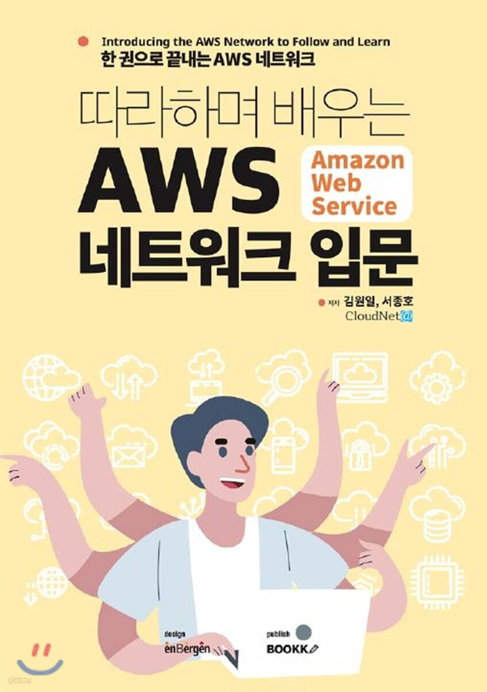

### 따라하며 배우는 AWS 네트워크 입문

※ 이미지 출처: Yes24

#### 정보

- 제목: 따라하며 배우는 AWS 네트워크 입문
- 저자: 김원일, 서종호
- 출판사: BOOKK (부크크)
- Yes24: `https://www.yes24.com/product/goods/93887402`
- 시작: 2026-10-09
- 완독: 2026-10-11

#### 목차

- ✅ [1장. AWS 인프라](chapter01/README.md)
- ✅ [2장. VPC 기초](chapter02/README.md)
- ✅ [3장. VPC 고급](chapter03/README.md)
- ✅ [4장. 인터넷 연결](chapter04/README.md)
- ✅ [5장. 부하 분산](chapter05/README.md)
- ✅ [6장. 네트워크 연결 옵션](chapter06/README.md)
- ✅ [7장. 네트워크 보안](chapter07/README.md)
- ✅ 8장. 종합 실습
