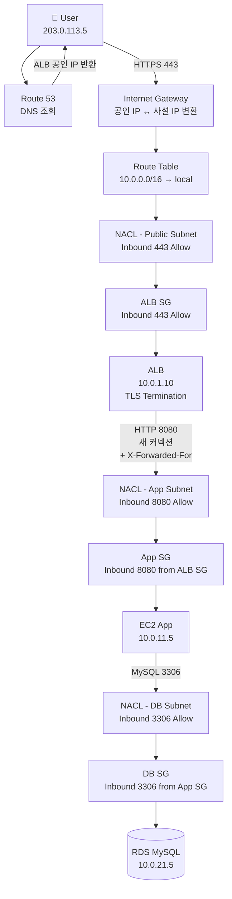
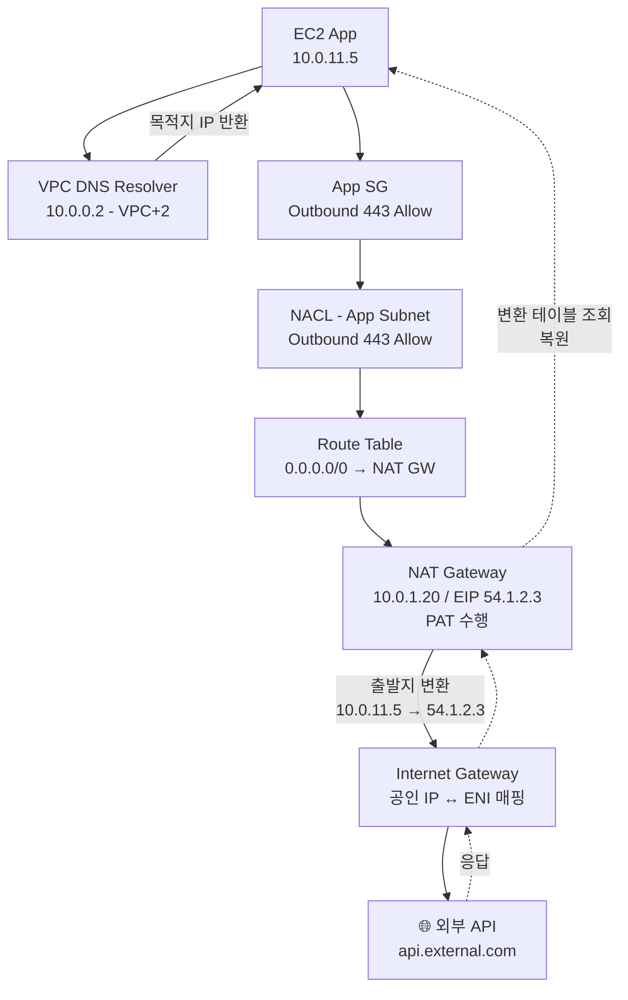

### CHAPTER 2 VPC 기초

AWS 네트워크의 출발점. **VPC = AWS 계정 안에 만드는 사설 네트워크 공간**. EC2, RDS, Lambda(VPC 모드) 등 거의 모든 리소스가 VPC 안에서 돈다. 1장이 "AWS 인프라가 어디에 있는가(Region/AZ)"였다면, 2장은 "그 안에서 내 네트워크 경계를 어떻게 긋는가"다.

#### 목차

- [1부. VPC 개념과 특징](#1부-vpc-개념과-특징)
- [2부. 퍼블릭 IP vs 프라이빗 IP](#2부-퍼블릭-ip-vs-프라이빗-ip)
- [3부. 서브넷과 서브넷 마스크](#3부-서브넷과-서브넷-마스크)
- [4부. 퍼블릭 서브넷 vs 프라이빗 서브넷](#4부-퍼블릭-서브넷-vs-프라이빗-서브넷)
- [5부. NAT Gateway](#5부-nat-gateway)
- [6부. 보안그룹과 네트워크 ACL](#6부-보안그룹과-네트워크-acl)
- [7부. 요청 흐름 (End-to-End Flow)](#7부-요청-흐름-end-to-end-flow)

---

## 1부. VPC 개념과 특징

### VPC(Virtual Private Cloud)란

> AWS 클라우드 내에서 **논리적으로 격리된** 가상 네트워크. 사용자가 CIDR 블록·라우팅·서브넷·게이트웨이를 직접 정의해 자신만의 네트워크를 구성한다.

쉬운 비유: AWS라는 거대한 공공 데이터센터 안에 **내가 사용할 수 있는 임대 공간**을 받고, 그 안을 어떻게 쪼개서 쓸지(서브넷), 외부와 어떻게 연결할지(IGW/NAT), 누가 들어올 수 있는지(SG/NACL)를 모두 내가 결정한다.

### VPC 핵심 특징

| 특징 | 설명 |
|---|---|
| **리전 종속** | VPC는 특정 리전에 종속됨. 리전을 넘나들 수 없음 (Peering/Transit Gateway로 연결) |
| **다중 AZ 가능** | 하나의 VPC는 리전 내 **여러 AZ에 걸쳐** 서브넷을 가질 수 있음 |
| **CIDR 블록** | VPC 생성 시 IPv4 CIDR 지정 (예: `10.0.0.0/16`). 생성 후 보조 CIDR 추가 가능 |
| **논리적 격리** | 다른 VPC/계정과 완전히 격리됨 (명시적으로 Peering/VPC Endpoint 등으로 연결하지 않는 한) |
| **소프트웨어 정의** | 물리 네트워크 장비 없이 전부 API/콘솔로 구성 (SDN, Software-Defined Network) |
| **기본 생성** | 각 리전마다 **Default VPC**가 자동으로 하나 생성되어 있음 (`172.31.0.0/16`) |

### VPC 안에 들어가는 것들

```
VPC (10.0.0.0/16)
├── Subnet (10.0.1.0/24) ─ AZ-a 퍼블릭
├── Subnet (10.0.2.0/24) ─ AZ-a 프라이빗
├── Subnet (10.0.3.0/24) ─ AZ-c 퍼블릭
├── Subnet (10.0.4.0/24) ─ AZ-c 프라이빗
├── Internet Gateway (IGW)
├── NAT Gateway
├── Route Table × N
├── Security Group × N
├── Network ACL × N
└── VPC Endpoint × N
```

### VPC 사용의 이점

- **보안**: 외부로부터 완전히 격리된 상태를 기본값으로 시작 → 필요한 통로만 명시적으로 뚫음
- **유연성**: IP 대역, 서브넷 분할, 라우팅을 자유롭게 설계
- **온프레미스 연결**: VPN, Direct Connect로 사내 데이터센터와 연결해 **하이브리드 네트워크** 구성
- **비용**: VPC 자체는 **무료**. 안의 트래픽/NAT GW/VPC Endpoint 등이 과금 대상

### 왜 VPC가 필요한가 (역사)

AWS 초창기(2006~2009)에는 EC2가 **Public Cloud만** 지원했다. 모든 EC2 인스턴스가 공인 IP를 받고, AWS가 소유한 거대한 공용 네트워크에 떠다녔다. 보안 격리는 **보안 그룹**만으로 처리.

2009년 **VPC 서비스 출시** → 사용자가 자기만의 사설 네트워크를 정의할 수 있게 됨. 2013년부터는 신규 계정에 **Default VPC**가 자동 생성되고, 기본적으로 모든 EC2가 VPC 안에서 뜨도록 바뀜. "EC2-Classic"(VPC 밖 EC2)은 2022년 8월 완전 종료.

> 즉 **현재 AWS에서는 VPC 밖에 리소스를 만드는 것 자체가 불가능**하다. VPC는 AWS 네트워크의 전제조건.

---

## 2부. 퍼블릭 IP vs 프라이빗 IP

### IPv4 주소 체계

IPv4는 32비트(4 octet × 8bit) → 약 43억 개 주소. 전 세계가 공유하기엔 턱없이 부족 → **공인(Public) IP**와 **사설(Private) IP**로 분리해 재사용.

### 퍼블릭 IP(공인 IP)

- 인터넷 전역에서 **고유해야 하는** 주소
- IANA → RIR(APNIC/ARIN/RIPE…) → ISP → 최종 사용자 순으로 할당
- AWS에서는 EC2 생성 시 자동 할당받거나, **Elastic IP(EIP)**를 명시적으로 할당받아 사용
- 인터넷에서 바로 접근 가능 → IGW를 통한 외부 통신 필수

### 프라이빗 IP(사설 IP)

- 인터넷에서는 **라우팅되지 않는** 주소
- 같은 네트워크(또는 VPC) 안에서만 유효 → 서로 다른 조직이 **동시에 같은 사설 IP**를 써도 충돌 없음
- 외부로 나가려면 **NAT**(Network Address Translation)로 공인 IP로 변환 필요

### 프라이빗 IP 대역 (RFC 1918)

| 클래스 | 대역 | CIDR | 개수 |
|---|---|---|---|
| **A** | 10.0.0.0 ~ 10.255.255.255 | `10.0.0.0/8` | 약 1,677만 |
| **B** | 172.16.0.0 ~ 172.31.255.255 | `172.16.0.0/12` | 약 104만 |
| **C** | 192.168.0.0 ~ 192.168.255.255 | `192.168.0.0/16` | 약 6.5만 |

**암기 요령**:
- 10.x.x.x — 가장 큰 대역, 기업용 (AWS VPC 기본값으로 많이 씀)
- 172.16~31.x.x — 중간, Default VPC가 쓰는 대역 (`172.31.0.0/16`)
- 192.168.x.x — 가장 작음, 가정용 공유기 기본값

### 특수 대역 (참고)

| 대역 | 용도 |
|---|---|
| `127.0.0.0/8` | Loopback (localhost) |
| `169.254.0.0/16` | Link-local. AWS에서는 **메타데이터 서비스 169.254.169.254**로 유명 |
| `224.0.0.0/4` | 멀티캐스트 |
| `0.0.0.0/0` | 전체 인터넷 (라우팅 테이블에서 "모든 경로"를 의미) |

### AWS 퍼블릭 IP의 함정

- **인스턴스 중지 → 재시작 시 Auto-assigned Public IP는 바뀜** (EIP는 유지됨)
- EIP는 **인스턴스에 붙어 있는 동안엔 무료**, 미연결 상태로 방치 시 **시간당 과금** (2024년부터는 연결 중이어도 유료)
- AWS 공인 IP는 AWS가 사용 중인 거대 CIDR 풀에서 할당됨 → 과거에 다른 사용자가 쓰던 IP를 받을 수도 있음(IP 재사용)

### 퍼블릭 vs 프라이빗 비교

| 항목 | 퍼블릭 IP | 프라이빗 IP |
|---|---|---|
| **범위** | 인터넷 전역 유일 | 로컬 네트워크 내에서만 유일 |
| **라우팅** | 인터넷으로 라우팅 가능 | 라우팅 불가 (내부 전용) |
| **할당 주체** | ISP / 클라우드 사업자 | 사용자 자율 (RFC 1918 범위 내) |
| **AWS 사용처** | IGW를 통한 외부 노출 (ALB, Bastion 등) | VPC 내부 통신, NAT를 통한 외부 통신 |
| **비용** | 과금 대상 | 무료 |

---

## 3부. 서브넷과 서브넷 마스크

### 서브넷(Subnet)이란

> VPC CIDR의 **일부를 떼어낸 더 작은 네트워크 블록**. 리소스(EC2, RDS, Lambda 등)는 서브넷에 소속되고, 서브넷은 **특정 AZ에 종속**된다.

```
VPC (10.0.0.0/16)
 ├── Subnet A (10.0.1.0/24) → AZ ap-northeast-2a
 ├── Subnet B (10.0.2.0/24) → AZ ap-northeast-2b
 └── Subnet C (10.0.3.0/24) → AZ ap-northeast-2c
```

**왜 쪼개는가**:
1. **AZ 분산** — HA 구성(ELB, RDS Multi-AZ 등)은 **서로 다른 AZ의 서브넷**이 필요
2. **역할 분리** — Public(외부 노출)/Private(내부용) 분리로 보안 레이어 구축
3. **라우팅 분리** — 서브넷마다 **다른 라우팅 테이블** 적용 가능

### CIDR과 서브넷 마스크

**CIDR(Classless Inter-Domain Routing)** 표기: `10.0.1.0/24`
- `10.0.1.0` = 네트워크 주소
- `/24` = **앞 24비트가 네트워크 부분**, 나머지 8비트가 호스트 부분

**서브넷 마스크**: `/24` ≡ `255.255.255.0` (앞 24비트가 1)

```
IP:    10.    0.    1.    5
2진:   00001010.00000000.00000001.00000101
Mask:  11111111.11111111.11111111.00000000   /24
       └─────── 네트워크 ──────┘└ 호스트 ┘
```

### CIDR별 IP 개수

| CIDR | 서브넷 마스크 | 전체 IP | 사용 가능 IP (AWS) |
|---|---|---|---|
| /16 | 255.255.0.0 | 65,536 | 65,531 |
| /20 | 255.255.240.0 | 4,096 | 4,091 |
| /24 | 255.255.255.0 | 256 | **251** |
| /26 | 255.255.255.192 | 64 | 59 |
| /28 | 255.255.255.240 | 16 | **11** |

### AWS 서브넷의 **예약 IP 5개**

예: `10.0.1.0/24` 서브넷(256개)에서 AWS가 **5개를 예약** → 251개만 사용 가능.

| IP | 용도 |
|---|---|
| `.0` | 네트워크 주소 (CIDR 자체) |
| `.1` | VPC Router (게이트웨이) |
| `.2` | DNS 서버 (VPC+2 규칙) |
| `.3` | AWS 예약 (미래 사용) |
| `.255` | 브로드캐스트 주소 |

> 그래서 `/28`로 작은 서브넷을 만들면 **16-5=11개**밖에 못 쓴다. 서브넷은 **/28 이상 /16 이하**로 제한.

### VPC CIDR 설계 예시

**가장 흔한 패턴** (10.0.0.0/16 VPC, 서브넷 /24):

| 서브넷 | CIDR | AZ | 역할 |
|---|---|---|---|
| public-a | 10.0.1.0/24 | 2a | ALB, NAT GW |
| public-c | 10.0.2.0/24 | 2c | ALB, NAT GW |
| private-app-a | 10.0.11.0/24 | 2a | EC2, EKS 노드 |
| private-app-c | 10.0.12.0/24 | 2c | EC2, EKS 노드 |
| private-db-a | 10.0.21.0/24 | 2a | RDS |
| private-db-c | 10.0.22.0/24 | 2c | RDS |

**설계 팁**:
- VPC는 `/16`으로 크게 잡아라 (서브넷 추가/확장 여유)
- 서브넷 CIDR은 **역할별로 10 단위**로 띄워 쓰면 가독성 ↑ (1~10 public, 11~20 app, 21~30 db)
- 다른 VPC와 Peering/TGW 연결 가능성이 있으면 **대역이 겹치지 않도록** 설계 (10.0 / 10.1 / 10.2 …)

---

## 4부. 퍼블릭 서브넷 vs 프라이빗 서브넷

**중요**: AWS 콘솔/API에 "public subnet"이라는 **속성 자체는 없다**. 다음 2가지 조건이 모두 충족되면 **관례적으로** 퍼블릭 서브넷이라 부른다.

1. 서브넷의 라우팅 테이블에 **`0.0.0.0/0 → IGW`** 라우트가 있음
2. 서브넷 설정에서 **Auto-assign Public IPv4** 활성화 (또는 리소스별로 공인 IP 수동 할당)

### 퍼블릭 서브넷

- 외부 인터넷에서 **직접 접근 가능한** 리소스가 위치
- 대표 리소스: **ALB/NLB, NAT Gateway, Bastion Host**
- IGW(Internet Gateway)와 연결된 라우팅 테이블 사용

### 프라이빗 서브넷

- 외부에서 **직접 접근 불가**
- 외부로 **나가는** 트래픽은 NAT Gateway를 거침 (업데이트, API 호출 등)
- 대표 리소스: **애플리케이션 EC2, EKS 워커 노드, RDS, ElastiCache**

### 라우팅 테이블 비교

**퍼블릭 서브넷의 라우팅 테이블**:

| 목적지 | 타겟 |
|---|---|
| 10.0.0.0/16 | local (VPC 내부) |
| 0.0.0.0/0 | **igw-xxx (Internet Gateway)** |

**프라이빗 서브넷의 라우팅 테이블**:

| 목적지 | 타겟 |
|---|---|
| 10.0.0.0/16 | local (VPC 내부) |
| 0.0.0.0/0 | **nat-xxx (NAT Gateway)** |

**격리된 프라이빗 서브넷**(외부 통신 완전 차단, 예: 민감 DB):

| 목적지 | 타겟 |
|---|---|
| 10.0.0.0/16 | local (VPC 내부) |

→ `0.0.0.0/0` 라우트 자체가 없음.

### 3-Tier 아키텍처 예시

```
┌──────────────────────────────────────────────┐
│ VPC (10.0.0.0/16)                            │
│                                              │
│  Public Subnet (10.0.1.0/24)                 │
│  ├── ALB                                     │
│  └── NAT Gateway                             │
│         │                                    │
│         ▼                                    │
│  Private Subnet - App (10.0.11.0/24)         │
│  ├── EC2 (Spring Boot)                       │
│  └── EC2 (Spring Boot)                       │
│         │                                    │
│         ▼                                    │
│  Private Subnet - DB (10.0.21.0/24)          │
│  └── RDS                                     │
│                                              │
└──────────────────────────────────────────────┘
        ▲
        │ Internet
   [Internet Gateway]
```

- 사용자 → ALB(퍼블릭) → App EC2(프라이빗) → RDS(프라이빗)
- App EC2가 패키지 업데이트/외부 API 호출 → NAT Gateway → IGW → 인터넷
- 외부에서 App/RDS로의 **직접 접근 경로는 없음**

---

## 5부. NAT Gateway

### NAT란

> **Network Address Translation**. 사설 IP를 공인 IP로(또는 그 반대로) 변환해주는 기술. 프라이빗 서브넷의 리소스가 **외부로 나가는 통신**을 가능케 함.

### 왜 필요한가

프라이빗 서브넷의 EC2는 공인 IP가 없다 → 외부로 패킷을 보내도 **응답을 받을 길이 없음**. 하지만 실제로는 `apt update`, 외부 API 호출, Docker Hub pull 등 **아웃바운드 통신은 필요**.

**해결**: 프라이빗 EC2 → NAT Gateway(공인 IP 보유) → IGW → 인터넷. 응답은 역순으로 NAT가 추적해 원래 EC2로 전달.

### NAT Gateway (AWS 관리형)

- **AWS가 완전 관리**하는 NAT 서비스
- **퍼블릭 서브넷**에 위치, **Elastic IP** 하나 할당받아 사용
- 대역폭 **5~100 Gbps** 자동 확장
- AZ 종속 → **HA가 필요하면 AZ마다 NAT GW를 하나씩** 두고 각 AZ의 프라이빗 서브넷이 자기 AZ NAT를 쓰도록 라우팅

### NAT Gateway vs NAT Instance

| 항목 | NAT Gateway | NAT Instance (레거시) |
|---|---|---|
| **관리** | AWS 완전 관리형 | 사용자가 EC2로 직접 운영 |
| **확장성** | 5~100 Gbps 자동 | EC2 타입에 종속 |
| **가용성** | AZ 단위 자동 (AZ당 1개 권장) | 사용자가 HA 구성 필요 |
| **보안그룹** | 적용 불가 | 적용 가능 |
| **포트 포워딩** | 불가 | 가능 |
| **비용** | 시간당 요금 + 데이터 처리 요금 | EC2 요금만 (더 쌈) |
| **권장** | ✅ 기본 선택 | 특수한 경우만 (포트 포워딩 등) |

### NAT Gateway 비용 주의

- 시간당 요금 + **GB당 데이터 처리 요금** (서울 리전 기준 약 $0.045/GB)
- 대량 트래픽 발생 시 비용이 급증 → **VPC Endpoint**로 AWS 서비스(S3, DynamoDB, ECR 등) 트래픽을 우회시키면 NAT 비용 절감
- AZ 분산을 위해 2~3개 NAT GW 운영 시 **고정 비용만으로 월 $100+** → 소규모 환경이라면 NAT Instance도 고려

### 트래픽 흐름 예시

**프라이빗 EC2가 `curl https://api.example.com` 실행 시**:

```
Private EC2 (10.0.11.5)
   ↓ "api.example.com으로 보내줘"
Route Table: 0.0.0.0/0 → NAT GW
   ↓
NAT Gateway (Public IP: 54.1.2.3)
   ↓ 출발지를 54.1.2.3으로 변환
IGW
   ↓
Internet → api.example.com
   ↓ 응답
IGW
   ↓
NAT Gateway (변환 테이블 보고 원래 10.0.11.5로 복구)
   ↓
Private EC2 (10.0.11.5)
```

NAT는 **아웃바운드 → 응답 인바운드**만 가능. 외부에서 먼저 들어오는 통신은 **불가능** (프라이빗 서브넷의 보안이 유지되는 이유).

---

## 6부. 보안그룹과 네트워크 ACL

VPC에서 **트래픽을 통제하는 두 가지 레이어**. 둘 다 방화벽 역할이지만 동작 방식·적용 지점·룰 평가 방식이 전혀 다르다.

### Security Group(보안그룹, SG)

> **인스턴스(ENI) 레벨** 방화벽. **Stateful**. 허용 룰만 작성.

- 적용 대상: EC2, RDS, ALB, Lambda(VPC) 등 **ENI를 가진 리소스**
- **허용(Allow) 룰만** 정의 — 기본은 모두 거부
- **Stateful**: 아웃바운드로 나간 트래픽의 응답은 **인바운드 룰 없이 자동 허용**
- 룰에서 **다른 SG를 소스/대상으로 지정 가능** (`sg-abc의 어떤 포트든 허용`)

**예시 룰**:

| 타입 | 프로토콜 | 포트 | 소스 | 설명 |
|---|---|---|---|---|
| Inbound | TCP | 443 | 0.0.0.0/0 | 전체 공개 HTTPS |
| Inbound | TCP | 22 | 10.0.0.0/16 | VPC 내부에서만 SSH |
| Inbound | TCP | 3306 | sg-app | App SG에서만 RDS 접속 |
| Outbound | ALL | ALL | 0.0.0.0/0 | 기본값 (전체 허용) |

### Network ACL(네트워크 ACL, NACL)

> **서브넷 레벨** 방화벽. **Stateless**. 허용/거부 룰 작성.

- 적용 대상: **서브넷** (해당 서브넷의 모든 리소스에 적용)
- **허용 + 거부(Allow/Deny) 둘 다** 정의 가능
- **Stateless**: 응답 트래픽도 **별도의 룰이 필요** (ephemeral port 1024-65535 허용 룰 필수)
- 룰 번호 순서대로 평가, 처음 매칭된 룰 적용 (낮은 번호가 우선)

**예시 룰**:

| 룰# | 타입 | 프로토콜 | 포트 | 소스/대상 | 허용/거부 |
|---|---|---|---|---|---|
| 100 | Inbound | TCP | 443 | 0.0.0.0/0 | Allow |
| 110 | Inbound | TCP | 1024-65535 | 0.0.0.0/0 | Allow (응답용) |
| 200 | Inbound | ALL | ALL | 1.2.3.4/32 | **Deny** (특정 IP 차단) |
| * | — | ALL | ALL | 0.0.0.0/0 | Deny (기본) |

### 보안그룹 vs 네트워크 ACL 비교

| 항목 | Security Group | Network ACL |
|---|---|---|
| **적용 대상** | 인스턴스(ENI) | 서브넷 |
| **적용 방식** | 리소스에 명시적으로 attach | 서브넷에 자동 적용 (서브넷당 1개) |
| **상태 추적** | **Stateful** (응답 자동 허용) | **Stateless** (응답 룰 별도 필요) |
| **룰 종류** | **Allow만** | Allow + **Deny** 둘 다 |
| **룰 평가** | 모든 룰 종합 평가 (하나라도 매칭되면 허용) | 번호 순으로 평가 (첫 매칭 룰 적용) |
| **룰 참조** | SG ID를 소스/대상으로 지정 가능 | CIDR만 가능 |
| **다중 할당** | 리소스당 **최대 5개** SG 할당 가능 | 서브넷당 **1개** NACL |
| **기본값** | 인바운드 전체 거부, 아웃바운드 전체 허용 | 인바운드/아웃바운드 모두 전체 허용 (default NACL) |

### 두 레이어가 함께 작동하는 흐름

```
Inbound 트래픽 (외부 → EC2)
   │
   ▼
┌─────────────────┐
│ Network ACL     │  ← 서브넷 레벨에서 1차 검사 (Stateless)
│ (서브넷)        │
└─────────────────┘
   │
   ▼
┌─────────────────┐
│ Security Group  │  ← 인스턴스 레벨에서 2차 검사 (Stateful)
│ (EC2)           │
└─────────────────┘
   │
   ▼
   EC2 인스턴스

Outbound 트래픽 (EC2 → 외부)
   역순으로 SG → NACL 순서로 검사
```

**둘 다 통과해야 트래픽이 전달됨** → 보안 레이어 2중 구성.

### 언제 어떤 걸 쓰나

- **SG**가 **일반적**이고 **1차 방어선** → 거의 모든 트래픽 제어는 SG로 해결
- **NACL**은 **서브넷 전체에 일괄 적용**해야 할 때 → 특정 IP 블랙리스트, 서브넷 간 통신 완전 차단, 컴플라이언스 요구사항 등
- **잘못된 사용 패턴**: NACL로 모든 걸 통제하려 하면 ephemeral port 룰 때문에 복잡해지고 디버깅 지옥

### Stateful vs Stateless 쉽게 이해하기

**Stateful (SG)**:
> "밖으로 나가는 사람 명단을 외워뒀다가, 돌아오면 그냥 통과시킨다"

Outbound ALL Allow 상태에서 EC2가 외부로 요청을 보내면, 응답 트래픽은 **인바운드 룰이 없어도** 자동으로 들어온다.

**Stateless (NACL)**:
> "들어오는 사람, 나가는 사람 다 매번 신분증 검사한다"

Outbound로 요청이 나갔다 하더라도, 응답 패킷은 **인바운드 NACL 룰에 명시적으로 Allow 되어야** 들어올 수 있다. 그래서 보통 **ephemeral port(1024-65535) Allow**를 함께 열어둔다.

### 실무 베스트 프랙티스

1. **기본은 SG로 제어** — NACL은 default(all allow) 유지
2. **ALB/App/DB 각각 다른 SG** — SG 끼리 참조로 체인 구성
   - ALB SG: 0.0.0.0/0:443 → ALB
   - App SG: ALB SG:8080 → App EC2
   - DB SG: App SG:3306 → RDS
3. **"all" 룰 지양** — 포트/CIDR을 최대한 좁게
4. **NACL 사용 사례**:
   - 특정 공격 IP 서브넷 차단
   - 격리된 Dev 서브넷에서 Prod 서브넷으로의 통신 완전 차단
   - 컴플라이언스상 서브넷 레벨 로깅 필요 시 (VPC Flow Logs와 함께)
5. **SG 룰 변경은 즉시 반영** — 재시작 불필요
6. **SG는 리전 종속** — 다른 리전에서 재사용 불가

---

## 7부. 요청 흐름 (End-to-End Flow)

사용자가 `https://app.example.com`에 접속할 때, 패킷이 **어떤 순서로 어떤 컴포넌트를 거쳐 EC2까지 도달하는가**. 그리고 EC2가 외부 API를 호출할 때 **역방향으로는 어떻게 흘러가는가**.

### 기준 아키텍처

```
┌───────────────────────────────────────────────────────────────┐
│ VPC (10.0.0.0/16) — ap-northeast-2                            │
│                                                               │
│   Public Subnet (10.0.1.0/24, AZ-2a)                          │
│   ├── ALB (내부 IP: 10.0.1.10, Public via IGW)                │
│   └── NAT Gateway (10.0.1.20, EIP: 54.1.2.3)                  │
│                                                               │
│   Private Subnet - App (10.0.11.0/24, AZ-2a)                  │
│   └── EC2 App (10.0.11.5, No Public IP)                       │
│                                                               │
│   Private Subnet - DB (10.0.21.0/24, AZ-2a)                   │
│   └── RDS MySQL (10.0.21.5)                                   │
│                                                               │
└───────────────────────────────────────────────────────────────┘
        ▲                              ▲
        │                              │
   [Internet Gateway]            외부 API 호출용
        │
     Internet
        │
     [User]
```

### 흐름 다이어그램 (요약)

**한 줄 요약 (텍스트 체인)**:

```
[인바운드]
User → DNS → IGW → Route Table → NACL → SG → ALB
     → NACL → SG → App EC2 → NACL → SG → RDS

[아웃바운드 - 요청]
App EC2 → VPC DNS → SG(Out) → NACL(Out) → Route Table
        → NAT GW → IGW → 외부 API

[아웃바운드 - 응답]
외부 API → IGW → NAT GW(변환 테이블 조회 → 원래 EC2 IP 복원)
        → Route Table(local) → NACL(In, ephemeral 1024-65535)
        → SG(In, Stateful - 자동 허용) → App EC2
```

**인바운드 (User → App → DB)**:



**아웃바운드 (App EC2 → 외부 API)**:



**검사 순서 요약표**:

| 방향 | 트래픽 경로 | 거치는 검사 레이어 |
|---|---|---|
| 외부 → 내부 | User → IGW → ALB | Route Table → NACL(In) → SG(In) |
| ALB → App | ALB → App EC2 | Route Table → NACL(In) → SG(In) |
| App → RDS | App EC2 → RDS | Route Table(local) → NACL(In) → SG(In) |
| 내부 → 외부 | App EC2 → NAT → IGW | SG(Out) → NACL(Out) → Route Table → NAT → IGW |

---

### 흐름 1: 인바운드 — 사용자가 웹 서비스에 접속

**시나리오**: 사용자가 브라우저에서 `https://app.example.com` 호출 → ALB를 거쳐 App EC2가 처리.

#### Step 0. DNS 조회 (VPC 바깥에서 일어남)

```
User PC → Local DNS (예: 8.8.8.8)
       → Authoritative DNS (Route 53)
       → "app.example.com = ALB DNS = 1.2.3.4"
```

**Route 53**이 ALB의 공인 IP를 반환. ALB의 공인 IP는 **ENI를 통해 AWS가 자동으로 매핑** (Elastic IP는 아님).

#### Step 1. 사용자 → Internet Gateway

```
User (출발지: 203.0.113.5)
   ↓ 목적지: 1.2.3.4 (ALB 공인 IP), 443
Internet
   ↓
Internet Gateway (IGW)
```

**IGW의 역할**:
- VPC와 인터넷을 연결하는 **논리적 게이트웨이**
- 수평 확장, 가용성 100% (AWS 관리형, AZ 종속 없음)
- **1:1 NAT 수행** — 공인 IP를 **ENI에 매핑된 사설 IP로 변환**
  - 목적지 `1.2.3.4` → `10.0.1.10` (ALB의 내부 IP)로 변환
- **별도 비용 없음** (IGW 자체는 무료)

> IGW를 통과하려면 **라우팅 테이블에 `0.0.0.0/0 → IGW`** 라우트가 있어야 함.

#### Step 2. IGW → 라우팅 테이블 조회

VPC Router(각 서브넷의 `.1` 주소)가 **목적지 IP `10.0.1.10`을 어떤 서브넷으로 보낼지** 라우팅 테이블로 결정.

| 목적지 | 타겟 | 매칭? |
|---|---|---|
| 10.0.0.0/16 | local | ✅ (가장 긴 prefix match) |
| 0.0.0.0/0 | igw-xxx | — |

→ `10.0.1.10`은 VPC CIDR(`10.0.0.0/16`) 내부이므로 **local 라우트** 사용. 패킷은 ALB가 속한 Public Subnet(`10.0.1.0/24`)으로 전달.

#### Step 3. Public Subnet 진입 — NACL 검사 (Inbound)

```
Network ACL (Public Subnet에 연결된 NACL)
  Rule 100: Inbound TCP 443 from 0.0.0.0/0 → Allow ✅
  → 통과
```

- NACL은 **Stateless** → 들어오는 패킷을 룰 번호 순서대로 평가
- Deny에 걸리거나 매칭 룰이 없으면 **여기서 패킷 drop**

#### Step 4. ALB ENI 도착 — Security Group 검사 (Inbound)

```
ALB Security Group (sg-alb)
  Inbound: TCP 443 from 0.0.0.0/0 → Allow ✅
  → ALB 처리
```

- SG는 **Stateful** → 이 요청에 대한 응답은 자동 허용 (룰 추가 불필요)
- ALB가 TLS 종료(Termination) 수행, HTTPS → HTTP로 변환해서 백엔드 전달

#### Step 5. ALB → App EC2로 포워딩

**ALB는 자신의 ENI(10.0.1.10)에서 새 TCP 연결을 만들어 Target Group의 EC2로 트래픽을 보냄**. 이는 **새 커넥션**이지 사용자 패킷의 포워딩이 아니다 (L7 프록시).

```
ALB (10.0.1.10)
   ↓ 출발지: 10.0.1.10, 목적지: 10.0.11.5, 8080
VPC Router (라우팅 테이블: 10.0.0.0/16 → local)
   ↓
Private Subnet - App (10.0.11.0/24)
```

- 출발지가 **ALB의 사설 IP**로 바뀜 → App EC2 서버에서 보면 `Remote-Addr`가 ALB IP로 보임
- 사용자 원본 IP는 **X-Forwarded-For 헤더**로 전달

#### Step 6. App Subnet NACL + App EC2 SG 검사

```
Network ACL (Private App Subnet)
  Rule 100: Inbound TCP 8080 from 10.0.1.0/24 (ALB 서브넷) → Allow ✅

Security Group (sg-app)
  Inbound: TCP 8080 from sg-alb → Allow ✅
```

- **SG 체인**: App SG가 "출발지 ALB SG"를 참조 → CIDR 하드코딩 없이 ALB 교체에도 안전

#### Step 7. App EC2 처리 → RDS 호출

```
EC2 App (10.0.11.5)
   ↓ 출발지: 10.0.11.5, 목적지: 10.0.21.5, 3306
VPC Router (10.0.0.0/16 → local)
   ↓
Private Subnet - DB (10.0.21.0/24)
   ↓
RDS NACL / RDS SG(sg-db) 검사
   ↓
RDS MySQL
```

- DB SG는 `Inbound TCP 3306 from sg-app` → App EC2에서만 접속 가능
- **VPC 내부 통신**이므로 IGW/NAT 거치지 않음, local 라우트만 사용

#### Step 8. 응답 흐름 (역방향)

```
RDS → EC2 App (SG Stateful: 응답 자동 허용)
   → ALB (SG Stateful: 자동 허용)
   → IGW (ALB 사설 IP → 공인 IP로 역변환)
   → Internet → User
```

- SG가 Stateful이므로 **아웃바운드 룰 없이도** 응답이 돌아감
- NACL은 Stateless → **ephemeral port(1024-65535)**가 양방향으로 열려 있어야 함

### 흐름 2: 아웃바운드 — 프라이빗 EC2가 외부 API 호출

**시나리오**: App EC2가 `curl https://api.external.com` 실행.

#### Step 1. EC2 → DNS 조회

```
EC2 App (10.0.11.5)
   ↓ 목적지: VPC+2 DNS (10.0.0.2)
VPC 내부 Route 53 Resolver
   ↓
"api.external.com = 198.51.100.5"
```

- VPC마다 **VPC CIDR의 두 번째 IP(VPC+2)**가 DNS Resolver
- EC2의 `/etc/resolv.conf`에 자동 세팅됨 (DHCP Option Set 통해)

#### Step 2. 라우팅 테이블 조회 — NAT GW로 보내기

```
EC2 App (10.0.11.5)
   ↓ 출발지: 10.0.11.5, 목적지: 198.51.100.5, 443
```

Private Subnet(App)의 라우팅 테이블:

| 목적지 | 타겟 | 매칭? |
|---|---|---|
| 10.0.0.0/16 | local | — |
| 0.0.0.0/0 | **nat-xxx** | ✅ |

→ 외부 IP이므로 `0.0.0.0/0` 매칭 → **NAT Gateway로 포워딩**.

#### Step 3. App EC2 SG + NACL 검사 (Outbound)

```
Security Group (sg-app)
  Outbound: TCP 443 to 0.0.0.0/0 → Allow ✅

Network ACL
  Outbound: TCP 443 to 0.0.0.0/0 → Allow ✅
```

#### Step 4. NAT Gateway 진입 (Public Subnet)

```
EC2 (10.0.11.5)
   ↓
Public Subnet NACL (Inbound 10.0.11.5 from App Subnet) → Allow
NAT Gateway (10.0.1.20)
   ↓ 출발지: 10.0.11.5 → 54.1.2.3 (NAT GW의 EIP)로 변환
   ↓ NAT가 변환 테이블에 (10.0.11.5:ephemeral ↔ 54.1.2.3:port) 기록
```

**중요한 점**:
- NAT GW는 **보안 그룹 적용 불가** (적용 안 됨, 룰이 없음)
- NAT GW는 **Stateful** → 응답 트래픽 자동으로 올바른 EC2에 전달
- NAT는 **포트 변환(PAT)** 사용 → 하나의 공인 IP로 수만 개 커넥션 동시 처리

#### Step 5. NAT GW → IGW → Internet

```
NAT Gateway (54.1.2.3)
   ↓ VPC Router → 0.0.0.0/0 → IGW
Internet Gateway
   ↓
Internet → api.external.com (198.51.100.5)
```

- NAT GW가 있는 **Public Subnet의 라우팅 테이블**에 `0.0.0.0/0 → IGW` 라우트가 반드시 있어야 함
- IGW가 다시 공인 IP ↔ ENI 변환

#### Step 6. 응답 흐름

```
api.external.com → IGW
   ↓ 목적지 54.1.2.3 → NAT GW ENI로 전달
NAT Gateway
   ↓ 변환 테이블 조회: 54.1.2.3:port → 10.0.11.5:ephemeral
   ↓ 목적지를 EC2 사설 IP로 복원
VPC Router (10.0.0.0/16 → local)
   ↓
Private Subnet App
   ↓
EC2 App (10.0.11.5) → 응답 수신
```

### 전체 흐름 요약 다이어그램

```
┌─ Inbound (User → App) ──────────────────────────────────┐
│                                                         │
│  User → DNS(Route 53) → IGW → [NACL → ALB SG]           │
│       → ALB → [NACL → App SG] → App EC2                 │
│       → [NACL → DB SG] → RDS                            │
│                                                         │
└─────────────────────────────────────────────────────────┘

┌─ Outbound (App → 외부) ─────────────────────────────────┐
│                                                         │
│  App EC2 → VPC DNS → [App SG → NACL] → Route Table      │
│          → NAT GW → IGW → Internet → 외부 API           │
│                                                         │
└─────────────────────────────────────────────────────────┘
```

### 핵심 포인트 체크리스트

| 체크 | 설명 |
|---|---|
| ✅ **라우팅 테이블** | 각 홉마다 "목적지에 어떻게 가는가"를 결정하는 1차 관문. local → longest prefix match |
| ✅ **IGW는 양방향 1:1 NAT** | 공인 IP ↔ ENI의 사설 IP 변환 |
| ✅ **NAT GW는 아웃바운드 전용 PAT** | 여러 사설 IP를 하나의 공인 IP로 압축, 응답은 자동 전달. 외부에서 들어올 수는 없음 |
| ✅ **SG는 리소스마다, NACL은 서브넷마다** | 두 레이어 모두 통과해야 패킷 전달 |
| ✅ **ALB는 L7 프록시** | 사용자 패킷을 포워딩하는 게 아니라 새 커넥션 생성. 원본 IP는 X-Forwarded-For 헤더 |
| ✅ **VPC 내부 통신은 local 라우트만** | IGW/NAT 안 거침, 비용 없음 (교차 AZ는 데이터 전송 요금 발생) |
| ✅ **DNS는 VPC+2** | 각 VPC에 내장된 Route 53 Resolver, VPC CIDR의 두 번째 IP |
| ✅ **SG Stateful** | 응답 트래픽 자동 허용 → 룰 수가 적게 유지됨 |

### 디버깅할 때 체크 순서

트래픽이 안 통할 때 **아래 순서로 하나씩** 점검:

1. **DNS 조회**가 되는가? (`nslookup`, `dig`)
2. **라우팅 테이블**에 목적지 경로가 있는가? (local → IGW/NAT/VPC Endpoint 등)
3. **NACL**에 Allow 룰이 있는가? (양방향 — 응답용 ephemeral port도)
4. **Security Group**에 Allow 룰이 있는가?
5. **IGW/NAT GW**가 연결/활성 상태인가?
6. **VPC Flow Logs** 활성화 후 ACCEPT/REJECT 확인

> **Flow Logs**는 ENI 단위로 패킷의 Accept/Reject를 CloudWatch Logs/S3에 기록 → 네트워크 디버깅의 결정적 도구.

---

### 요약

- **VPC**: AWS 계정 안의 격리된 사설 네트워크. 리전 종속, 다중 AZ 가능, CIDR로 IP 공간 정의
- **공인 IP**는 인터넷 전역 유일, **사설 IP**는 로컬 전용(10/172.16/192.168 대역)
- **서브넷**은 VPC CIDR을 쪼갠 블록으로 AZ 종속. AWS 예약 IP 5개 주의
- **퍼블릭 서브넷** = IGW 라우트 있는 서브넷 / **프라이빗 서브넷** = NAT 또는 격리
- **NAT Gateway**: 프라이빗 리소스의 아웃바운드 통신 담당. AZ당 하나 권장, 데이터 처리 요금 주의
- **SG**(인스턴스, Stateful, Allow만) + **NACL**(서브넷, Stateless, Allow/Deny) 2중 방화벽. 실무는 SG 중심
- **요청 흐름**: `User → DNS → IGW → NACL/SG → ALB → NACL/SG → App EC2 → NACL/SG → RDS` / 아웃바운드는 `App EC2 → Route Table → NAT GW → IGW → Internet`

> **이전 책 참고**: [업무에 바로 쓰는 AWS 입문 — Chapter 3 EC2](../../aws-practical-intro/chapter03/README.md)에서 EC2가 서브넷에 어떻게 배치되고 SG가 어떻게 attach 되는지 확인
