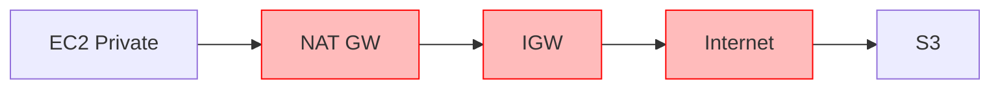
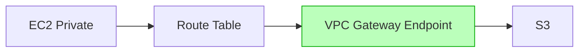
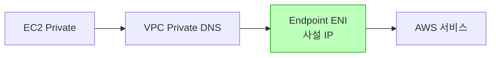

### CHAPTER 3 VPC 고급

2장이 VPC의 "뼈대"였다면, 3장은 **운영 중에 자주 마주치는 심화 주제들**. 특히 VPC Endpoint는 **비용·보안·속도** 모두에 영향을 주는 중요 개념이고, 메타데이터 서비스는 **운영/보안 사고의 단골 소재**다.

#### 목차

- [1부. VPC Endpoint](#1부-vpc-endpoint)
- [2부. Placement Group](#2부-placement-group)
- [3부. EC2 Metadata Service](#3부-ec2-metadata-service)

---

## 1부. VPC Endpoint

### 왜 필요한가 — 문제 상황

프라이빗 서브넷의 EC2가 **S3나 DynamoDB 같은 AWS 서비스**에 접근할 때:

```
EC2 (Private) → NAT GW → IGW → Internet → S3
```

- S3는 **AWS 서비스지만 공인 엔드포인트**(`s3.ap-northeast-2.amazonaws.com`)로 통신 → NAT 거침
- **문제**:
  1. **비용** — NAT GW 데이터 처리료 ($0.045/GB) × 수백 GB 로그 업로드 = 월 수십~수백만 원
  2. **속도** — 패킷이 인터넷을 돌아나감 (실제로는 AWS 내부지만 라우팅상 외부)
  3. **보안** — 트래픽이 공용 인터넷 경로를 거침, IGW/NAT 필요

### VPC Endpoint란

> VPC 내부에서 **AWS 서비스 또는 다른 VPC 서비스로의 비공개 연결**을 제공하는 가상 디바이스. 트래픽이 **AWS 백본 네트워크 안에서만** 흐른다 (인터넷/IGW/NAT 거치지 않음).

```
[VPC Endpoint 사용 시]
EC2 (Private) → VPC Endpoint → S3
                 (AWS 백본 내부)
```

### VPC Endpoint 핵심 특징

| 특징 | 설명 |
|---|---|
| **비공개 통신** | IGW/NAT GW 불필요, AWS 내부 네트워크로 완결 |
| **보안 강화** | 인터넷에 노출되지 않음, Endpoint Policy로 접근 제어 |
| **비용 절감** | NAT GW 데이터 처리료 회피 (단, Interface Endpoint는 시간당 요금 있음) |
| **IAM 통합** | VPC Endpoint Policy로 **서비스별 접근 제한** 가능 |
| **리전 종속** | 리전 간 Endpoint는 불가. 다른 리전은 각각 Endpoint 생성 필요 |

### VPC Endpoint 유형 (3가지)

| 유형 | 생성 대상 | 동작 방식 | 지원 서비스 |
|---|---|---|---|
| **Gateway Endpoint** | 라우팅 테이블에 경로 추가 | 라우팅 레벨 | **S3, DynamoDB (단 2개)** |
| **Interface Endpoint** | 서브넷에 ENI 생성 | DNS로 사설 IP 리졸브 | 대부분의 AWS 서비스 (100+) |
| **Gateway Load Balancer Endpoint** | 서드파티 보안 어플라이언스 체인 | 특수 (방화벽·IDS 연동) | PrivateLink 파트너 전용 |

### 1. Gateway Endpoint

- **지원 서비스**: S3, DynamoDB **단 2개** (역사적 이유)
- **동작**: VPC 라우팅 테이블에 **prefix list → vpce-xxx** 라우트 자동 추가
- **비용**: **무료** (데이터 처리료 없음, 생성료 없음)
- **보안**: Endpoint Policy로 접근 제어

**라우팅 테이블 예시** (S3 Gateway Endpoint 생성 후):

| 목적지 | 타겟 |
|---|---|
| 10.0.0.0/16 | local |
| 0.0.0.0/0 | nat-xxx |
| **pl-xxxxx (S3 prefix list)** | **vpce-s3-xxx** |

> `pl-xxxxx`는 AWS가 관리하는 **S3의 모든 공인 IP 범위**. 라우팅 테이블이 "S3 IP는 Endpoint로 보내라"고 지시.

**사용 흐름**:

```
EC2 (10.0.11.5) → curl s3.ap-northeast-2.amazonaws.com
   ↓ DNS: 원래 S3 공인 IP 반환 (예: 52.219.x.x)
   ↓ Route Table: 52.219.x.x는 pl-xxx에 포함 → vpce-s3로 라우팅
VPC Gateway Endpoint
   ↓ AWS 백본으로 S3 서비스에 전달
S3
```

### 2. Interface Endpoint (PrivateLink)

- **지원 서비스**: 거의 모든 AWS 서비스 (CloudWatch, SNS, SQS, ECR, Secrets Manager, KMS 등)
- **동작**: 지정한 **서브넷에 ENI를 생성** → **사설 IP 할당**. DNS가 공인 엔드포인트를 사설 IP로 리졸브
- **비용**: **시간당 요금 ($0.014/hour × AZ 수)** + **데이터 처리료 ($0.01/GB)**
- **보안**: Security Group 적용 가능, Endpoint Policy 사용 가능
- **AZ 복수 선택** 가능 → HA 구성

**생성 시 선택 사항**:
- VPC + 서브넷(들)
- 서비스 이름 (예: `com.amazonaws.ap-northeast-2.ecr.api`)
- Security Group
- **Private DNS Enabled** (기본값 ON) — 서비스 공식 DNS를 사설 IP로 자동 리졸브

**사용 흐름** (ECR Interface Endpoint 예):

```
EC2 (10.0.11.5) → docker pull <acct>.dkr.ecr.ap-northeast-2.amazonaws.com/myimg
   ↓ DNS 조회 (Private DNS Enabled 상태)
      → VPC Resolver가 Endpoint ENI의 사설 IP(10.0.11.100) 반환
   ↓ VPC Router (10.0.0.0/16 → local)
Interface Endpoint ENI (10.0.11.100)
   ↓ Endpoint SG 검사
   ↓ AWS 백본으로 ECR에 전달
ECR
```

### Gateway vs Interface Endpoint 비교

| 항목 | Gateway Endpoint | Interface Endpoint |
|---|---|---|
| **대상 서비스** | S3, DynamoDB (2개뿐) | 대부분의 AWS 서비스 |
| **구성 방식** | 라우팅 테이블 라우트 추가 | 서브넷에 ENI 생성 |
| **AWS 리소스 소비** | 없음 | ENI (사설 IP 소비) |
| **DNS 처리** | 공인 DNS 그대로 (라우팅으로 우회) | **사설 DNS로 재리졸브** |
| **Security Group** | 적용 불가 | 적용 가능 |
| **AZ 가용성** | 리전 단위 자동 | AZ마다 ENI 필요 (HA) |
| **비용** | **무료** | 시간당 + 데이터 처리료 |
| **온프레미스/다른 VPC 접근** | 불가 | 가능 (사설 IP 기반) |

### VPC Endpoint Policy

> Endpoint를 통과하는 **API 요청에 대한 리소스 레벨 접근 제어**. IAM Policy 문법 그대로 사용.

**예: S3 Gateway Endpoint에서 특정 버킷만 허용**:

```json
{
  "Version": "2012-10-17",
  "Statement": [{
    "Effect": "Allow",
    "Principal": "*",
    "Action": ["s3:GetObject", "s3:PutObject"],
    "Resource": [
      "arn:aws:s3:::my-prod-bucket",
      "arn:aws:s3:::my-prod-bucket/*"
    ]
  }]
}
```

→ 이 Endpoint로는 **my-prod-bucket만** 접근 가능. 다른 버킷 요청은 거부.

**활용 패턴**:
- **데이터 유출 방지**: VPC에서 **회사 소유 S3 버킷**으로만 접근 허용
- **감사**: 특정 AWS 서비스 호출만 허용
- **멀티테넌트**: VPC별로 다른 리소스 접근

### VPC Endpoint 사용 베스트 프랙티스

1. **S3/DynamoDB는 반드시 Gateway Endpoint** — 무료인데 NAT 비용 아낌
2. **ECR, Secrets Manager, SSM Parameter Store 등**은 Interface Endpoint — 민감 데이터 격리
3. **Endpoint Policy로 리소스 범위 제한** — Role 권한 + Endpoint Policy 이중 방어
4. **AZ 종속 주의** — Interface Endpoint는 **서비스 사용 EC2와 동일 AZ**에 ENI 두어야 교차 AZ 비용 회피
5. **Private DNS Enabled 확인** — 꺼져 있으면 애플리케이션 코드에서 Endpoint URL을 직접 지정해야 함
6. **PrivateLink로 커스텀 서비스 노출**도 가능 — 사내 다른 VPC/계정에 서비스 공유

### 흐름 비교 다이어그램

**NAT 사용 (기본)**:



**Gateway Endpoint 사용**:



**Interface Endpoint 사용**:



---

## 2부. Placement Group

### 개념

> EC2 인스턴스를 **물리적으로 어떻게 배치할지** 지정하는 논리 그룹. 네트워크 지연·장애 격리·처리량 요구에 따라 **배치 전략**을 선택한다.

AWS는 데이터센터 내 수많은 랙·호스트에 인스턴스를 배치하는데, **기본값**은 AWS가 알아서 분산. Placement Group은 이 배치 정책을 사용자가 선언하는 것.

### 3가지 전략

| 전략 | 배치 방식 | 사용 사례 |
|---|---|---|
| **Cluster** | 같은 AZ의 **같은 랙(또는 가까운 하드웨어)에 조밀 배치** | HPC, 저지연 네트워크 통신, ML 분산 학습 |
| **Spread** | 서로 **다른 하드웨어(랙·호스트)에 분산** | 중요 서비스의 장애 격리, HA |
| **Partition** | 인스턴스를 **파티션(그룹) 단위로 묶어 각 파티션을 다른 랙에 배치** | HDFS, Cassandra, Kafka 등 분산 시스템 |

### 1. Cluster Placement Group

- **배치**: 같은 AZ, 같은 저지연 네트워크 세그먼트에 밀집
- **장점**:
  - **인스턴스 간 네트워크 성능 최대** (최대 10/25/100 Gbps, 라운드트립 수십 μs)
  - 저지연 TCP/UDP 통신
- **단점**:
  - 같은 하드웨어 장애 시 **전체 영향**
  - 용량 부족 시 **인스턴스 시작 실패 가능성** (가까운 하드웨어가 꽉 차면)
- **권장 조건**: **같은 인스턴스 타입**, **같은 AMI**, 동시에 모두 Launch

**사용 사례**:
- 과학 시뮬레이션 (CFD, 기상)
- ML 분산 학습 (NCCL AllReduce)
- 저지연 트레이딩 시스템

### 2. Spread Placement Group

- **배치**: 각 인스턴스를 **별개의 하드웨어**에 배치
- **제약**: **AZ당 최대 7개 인스턴스** (리전 전체 X AZ 수 만큼 가능)
- **장점**: 하드웨어 장애 시 다른 인스턴스는 영향 없음
- **단점**: 인스턴스 개수 제한 → 대규모 서비스엔 부적합

**사용 사례**:
- 소수의 **중요 미션 크리티컬** 서버 (NameNode, 라이선스 서버 등)
- 소량이지만 **반드시 분리**되어야 하는 워크로드

### 3. Partition Placement Group

- **배치**: 인스턴스를 **파티션(1~7개)**으로 그룹핑, **각 파티션은 다른 랙**에 배치
- **파티션 내 인스턴스는 같은 랙 공유** → 파티션 간은 완전 격리
- **AZ당 최대 7 파티션**

**사용 사례**:
- 분산 저장소 (HDFS DataNode, Cassandra, Kafka)
- **파티션 단위 장애 격리**가 필요한 Big Data 워크로드
- Hadoop Rack Awareness와 동일한 개념

### 세 전략 비교

| 전략 | 지연시간 | 장애 격리 | 인스턴스 수 | 적합 워크로드 |
|---|---|---|---|---|
| **Cluster** | 최저 | **낮음** | 많음 (AZ 용량 내) | HPC, ML, 저지연 |
| **Spread** | 중간 | **높음** | 적음 (AZ당 7개) | 소규모 미션 크리티컬 |
| **Partition** | 중간 | **파티션 단위** | 많음 | 분산 저장/스트림 |

### 시각화

```
Cluster (조밀 배치)             Spread (분산)              Partition (파티션별 격리)

┌────────────────┐             ┌───┐  ┌───┐  ┌───┐        ┌─ Partition 1 ─┐
│ ■ ■ ■ ■ ■ ■    │             │ ■ │  │ ■ │  │ ■ │        │ ■ ■ ■          │
│   (한 랙)      │             └───┘  └───┘  └───┘        ├─ Partition 2 ─┤
└────────────────┘             (각각 다른 하드웨어)         │ ■ ■ ■          │
                                                            ├─ Partition 3 ─┤
                                                            │ ■ ■            │
                                                            └────────────────┘
                                                              (각 파티션 = 다른 랙)
```

### 사용 시 주의

- Placement Group은 **생성 후 전략 변경 불가** → 재생성 필요
- Cluster는 **동일 인스턴스 패밀리/세대** 권장
- 기존 인스턴스를 PG에 넣으려면 중지 후 `modify-instance-placement`
- 비용 **추가 없음** — PG 자체는 무료 (인스턴스 비용만 과금)

---

## 3부. EC2 Metadata Service

### 개념

> EC2 인스턴스가 **자기 자신에 대한 정보**(인스턴스 ID, AMI, IAM Role 자격증명, 네트워크 정보 등)를 조회할 수 있는 **인스턴스 내부에서만 접근 가능한 HTTP 서비스**.

**엔드포인트**: `http://169.254.169.254/latest/meta-data/`

- `169.254.0.0/16`은 **Link-Local 대역** (라우팅되지 않는 특수 주소)
- 외부에서는 접근 불가 — **인스턴스 안에서만**
- VPC Router 레벨에서 가로채기 (hypervisor가 응답)

### 왜 쓰는가

- 애플리케이션이 **자기 인스턴스 ID** 알아야 할 때
- **IAM Role로 임시 자격증명** 받을 때 (AWS SDK가 내부적으로 사용)
- 유저 데이터 스크립트 읽을 때
- CloudWatch Agent, SSM Agent 등이 호스트 정보 수집
- Auto Scaling 그룹에서 인스턴스 자신의 상태 조회

### 주요 메타데이터 항목

```bash
# 인스턴스 기본 정보
curl http://169.254.169.254/latest/meta-data/instance-id
# → i-0abc123def456

curl http://169.254.169.254/latest/meta-data/instance-type
# → t3.medium

curl http://169.254.169.254/latest/meta-data/ami-id
# → ami-0xxxx

# 네트워크
curl http://169.254.169.254/latest/meta-data/local-ipv4
# → 10.0.11.5

curl http://169.254.169.254/latest/meta-data/public-ipv4
# → 54.1.2.3 (있는 경우만)

# AZ / 리전
curl http://169.254.169.254/latest/meta-data/placement/availability-zone
# → ap-northeast-2a

# IAM Role 임시 자격증명 ⚠️ 보안 민감
curl http://169.254.169.254/latest/meta-data/iam/security-credentials/MyRole
# → { "AccessKeyId": "...", "SecretAccessKey": "...", "Token": "..." }

# User Data (부팅 스크립트)
curl http://169.254.169.254/latest/user-data
```

### IMDSv1 vs IMDSv2 (중요)

**IMDSv1** (레거시):
- **GET 요청 한 번**이면 끝 → 토큰 불필요
- SSRF 공격에 취약 — 외부에서 EC2 안의 애플리케이션을 속여 메타데이터 요청 유도 → **IAM 자격증명 탈취**

> 유명 사례: **Capital One 2019년 데이터 유출** — 잘못 설정된 WAF가 SSRF로 메타데이터 호출당해 IAM 자격증명 유출, 1억 명 고객 정보 노출.

**IMDSv2** (현재 권장, 2019 도입):
- **세션 토큰 방식** — PUT으로 토큰 발급받고, GET 요청 헤더에 토큰 포함
- SSRF 공격 방어 — 공격자가 PUT 요청까지 조작하긴 어려움
- **TTL 홉 제한** — 토큰에 네트워크 홉 수 제한 (기본 1) → 컨테이너 내부에서 호스트 메타데이터 접근 차단 가능

**IMDSv2 사용법**:

```bash
# 1. PUT으로 토큰 발급 (TTL 21600초 = 6시간)
TOKEN=$(curl -X PUT "http://169.254.169.254/latest/api/token" \
  -H "X-aws-ec2-metadata-token-ttl-seconds: 21600")

# 2. GET 요청에 토큰 헤더 포함
curl -H "X-aws-ec2-metadata-token: $TOKEN" \
  http://169.254.169.254/latest/meta-data/instance-id
```

### IMDSv1 vs IMDSv2 비교

| 항목 | IMDSv1 | IMDSv2 |
|---|---|---|
| **인증** | 없음 (단순 GET) | 세션 토큰 (PUT으로 발급) |
| **SSRF 방어** | 취약 | 강함 |
| **홉 제한** | 없음 | 설정 가능 (기본 1) |
| **호환성** | 모든 SDK | 신규 SDK (2019+) |
| **AWS 권장** | ⚠️ 사용 중단 권장 | ✅ 기본 사용 |

### 2026년 현재 상태

- 2024년부터 **신규 AMI 기본값이 IMDSv2 Required**
- EC2 생성 시 **"Instance metadata service"** 섹션에서 **V2 Only** 강제 가능
- AWS Config / Security Hub가 **IMDSv1 활성 인스턴스를 보안 위반**으로 플래그
- EKS, ECS 등 컨테이너 플랫폼은 모두 IMDSv2 기본

### 메타데이터 보안 베스트 프랙티스

1. **IMDSv2 Required 설정** — 모든 EC2에서 강제
2. **홉 제한 1** — 컨테이너에서 호스트 메타데이터 접근 차단
3. **IAM Role 최소 권한** — 메타데이터 유출돼도 피해 범위 제한
4. **애플리케이션 레벨**:
   - SSRF 방지 — URL 입력 검증 시 `169.254.169.254` 블랙리스트
   - 사용자 입력으로 외부 URL 요청하는 기능은 특히 조심
5. **SG/NACL로 차단 불가** — Link-Local은 라우팅 테이블 밖에서 처리됨. 인스턴스 OS에서 iptables로 차단 가능하지만 비권장 (SDK 작동 불가)

### Dynamic Data (추가)

메타데이터와 별개로 **Dynamic Data** 엔드포인트도 있음:

```bash
curl http://169.254.169.254/latest/dynamic/instance-identity/document
# → 인스턴스 식별 문서 (JSON, AWS 서명 포함)
```

- **AWS가 서명한 인스턴스 신원 문서** 제공
- 애플리케이션이 **"내가 진짜 AWS EC2임"을 증명**할 때 사용 (예: 라이선스 서버 검증)

---

### 요약

- **VPC Endpoint**: 프라이빗 서브넷에서 AWS 서비스에 **IGW/NAT 없이** 접근
  - **Gateway Endpoint**: S3/DynamoDB 전용, 라우팅 테이블 수정, **무료**
  - **Interface Endpoint**: 거의 모든 서비스, 서브넷 ENI 생성, 시간당+데이터 요금
  - Endpoint Policy로 리소스 범위 제한 → 데이터 유출 방지 2중 방어
- **Placement Group**: EC2 물리 배치 전략
  - **Cluster**(저지연, 조밀) / **Spread**(장애 격리, AZ당 7개) / **Partition**(분산 저장소용)
- **Metadata Service**: `169.254.169.254`로 자기 인스턴스 정보 조회
  - **IMDSv2 필수** — SSRF 공격 방어 (Capital One 사고 교훈)
  - IAM Role 임시 자격증명도 여기서 발급 → 공격자 최우선 타겟

> **이전 책 참고**: [업무에 바로 쓰는 AWS 입문 — Chapter 3 EC2 - IAM Role](../../aws-practical-intro/chapter03/README.md)에서 EC2에 IAM Role 붙이는 방식 복습
