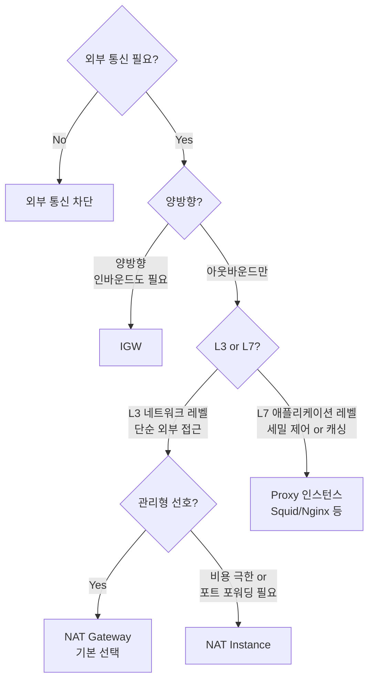

### CHAPTER 4 인터넷 연결

2~3장이 VPC 내부 구조였다면, 4장은 **VPC 밖(인터넷) 과 어떻게 연결하는가**. 핵심은 **IGW / NAT 디바이스 / Proxy 인스턴스** 세 가지 방식의 특징과 선택 기준이다.

#### 목차

- [1부. Internet Gateway (IGW)](#1부-internet-gateway-igw)
- [2부. NAT 디바이스 (NAT Gateway vs NAT Instance)](#2부-nat-디바이스-nat-gateway-vs-nat-instance)
- [3부. Proxy 인스턴스](#3부-proxy-인스턴스)
- [4부. 세 방식 비교와 선택 기준](#4부-세-방식-비교와-선택-기준)

---

## 1부. Internet Gateway (IGW)

### 개념

> VPC와 **인터넷을 연결하는 수평 확장형 가상 게이트웨이**. 양방향 통신을 가능케 하는 **AWS 완전관리형** 컴포넌트.

**핵심 성질**:
- **AWS 관리형** — 운영/확장/가용성 모두 AWS가 책임
- **수평 확장** — 트래픽 증가에 따라 자동 확장
- **가용성 100%** — AZ 종속 없음 (VPC 전체 레벨)
- **VPC당 1개** — IGW 하나를 VPC에 attach
- **비용** — IGW 자체는 **무료** (지나가는 트래픽만 과금)

### 역할 — 양방향 1:1 NAT

IGW는 단순 "경로" 가 아니라 **공인 IP ↔ 사설 IP 변환**을 수행:

```
외부 → IGW: 목적지 공인 IP(1.2.3.4) → ENI 사설 IP(10.0.1.10)로 변환
내부 → IGW: 출발지 사설 IP(10.0.1.10) → 공인 IP(1.2.3.4)로 변환
```

**중요**: EC2에 할당된 **공인 IP는 실제로 OS에 바인딩되지 않는다**. `ifconfig` / `ip a`로는 사설 IP만 보임. 공인 IP는 **IGW의 매핑 테이블**에만 존재.

### IGW를 사용하기 위한 조건 (4가지 모두 충족)

1. VPC에 **IGW가 attach** 되어 있을 것
2. 서브넷의 **라우팅 테이블에 `0.0.0.0/0 → IGW`** 라우트
3. 인스턴스에 **공인 IP 또는 EIP** 할당
4. **NACL / SG**에서 해당 트래픽 Allow

→ 네 가지 중 **하나라도 빠지면 외부 통신 불가**. 디버깅 시 체크 순서로 활용.

### IGW 특징 요약표

| 항목 | 설명 |
|---|---|
| **방향** | 양방향 (Inbound + Outbound) |
| **변환** | 1:1 NAT (공인 ↔ 사설) |
| **대상** | 공인 IP/EIP를 가진 리소스 |
| **AZ** | 리전 레벨 (AZ 종속 없음) |
| **비용** | 무료 (데이터 전송 비용은 별도) |
| **대안** | **Egress-only IGW** (IPv6 전용, 아웃바운드만) |

### Egress-only IGW (참고)

- **IPv6 전용** NAT GW의 역할
- IPv6는 모든 주소가 공인 → 사설 개념 없음. 하지만 **외부에서 들어오는 트래픽은 막고 싶을 때** 사용
- Stateful, 아웃바운드만 허용

---

## 2부. NAT 디바이스 (NAT Gateway vs NAT Instance)

**NAT(Network Address Translation)**: 여러 사설 IP를 **하나의 공인 IP**로 변환해 **아웃바운드만** 가능케 하는 장치.

**프라이빗 서브넷**의 EC2가 외부 통신하기 위한 **필수 장치**. 외부 → 내부 방향은 불가 (보안 유지).

### NAT Gateway (NAT GW)

> **AWS 완전관리형 NAT 서비스**. 2015년 출시 이후 사실상 표준.

**특징**:
- 지정한 **퍼블릭 서브넷에 배치** → **EIP 1개** 할당
- 대역폭 **5 → 100 Gbps 자동 확장**
- **AZ 종속** → HA 필요 시 AZ마다 하나씩 (각 AZ 서브넷은 자기 AZ NAT 사용)
- **Security Group 적용 불가** — NACL은 서브넷 레벨로 적용 가능
- **포트 포워딩/인바운드 불가**
- **고정 비용 + 데이터 처리료**

**가격 (서울 리전 기준)**:
- 시간당 약 $0.059 (**월 약 $43**)
- 데이터 처리료 **$0.045/GB**
- → **AZ 3개 분산 운영 시 월 ~$130 고정** (트래픽 별도)

### NAT Instance

> **사용자가 직접 EC2에 NAT 소프트웨어를 올려 운영**하는 전통 방식. AWS AMI 중 `amzn-ami-vpc-nat`을 사용 (최근엔 사용자가 iptables로 직접 구성).

**특징**:
- EC2 인스턴스로 **직접 운영** → 모든 책임이 사용자에게
- 대역폭 **인스턴스 타입에 종속** (t3.micro = ~5 Gbps, c5n.large = ~25 Gbps)
- **Security Group 적용 가능**
- **포트 포워딩 가능** (iptables NAT 룰 수정)
- 가용성 → **단일 EC2라 다운 가능** → HA는 사용자가 구현 (Auto Scaling + 라우팅 테이블 자동 전환)
- **소스/대상 체크 비활성화 필수** (`modify-instance-attribute --no-source-dest-check`)

**비용 (서울 리전 기준)**:
- t3.micro ≈ **월 $7~8** (NAT GW의 1/5)
- 데이터 처리료 **없음** (EC2 트래픽 요금만)

**설정 요약**:

```bash
# 1. Source/Destination Check 끄기
aws ec2 modify-instance-attribute --instance-id i-xxx --no-source-dest-check

# 2. IP forwarding 활성화 (OS 레벨)
sudo sysctl -w net.ipv4.ip_forward=1

# 3. iptables NAT 룰
sudo iptables -t nat -A POSTROUTING -o eth0 -s 10.0.0.0/16 -j MASQUERADE
```

### NAT Gateway vs NAT Instance 비교표

| 항목 | NAT Gateway | NAT Instance |
|---|---|---|
| **관리 주체** | AWS | 사용자 |
| **대역폭** | 5~100 Gbps 자동 | 인스턴스 타입 종속 |
| **고가용성** | AZ 단위 자동 | 사용자가 구성 (ASG + 라우팅 전환) |
| **Security Group** | 적용 불가 | 적용 가능 |
| **포트 포워딩** | ❌ | ✅ |
| **Bastion 역할 겸용** | 불가 | 가능 |
| **비용** | 월 $43 + $0.045/GB (AZ당) | EC2 요금만 |
| **운영 복잡도** | 매우 낮음 | 높음 |
| **AWS 권장** | ✅ 기본 선택 | 특수 요구사항만 |

### 언제 어떤 걸 쓰나

**NAT Gateway 선택**:
- 운영 리소스가 적다 (스타트업, 신규 프로젝트)
- 트래픽이 크지 않다 (NAT GW 비용 감당 가능)
- 안정성/HA가 중요하다
- 트래픽이 매우 크다 → NAT GW가 알아서 확장

**NAT Instance 선택**:
- **극한의 비용 최적화** 필요 (개발/스테이징 환경)
- **포트 포워딩** 필요 (예: 특정 포트의 외부 접근을 내부로 터널링)
- Bastion과 NAT를 **같은 호스트로 겸용**하고 싶음
- Security Group 레벨 접근 제어 필요

### HA 구성 패턴

**NAT GW (권장)**:
```
Public Subnet (AZ-a) → NAT GW A
Public Subnet (AZ-c) → NAT GW C

Private Subnet (AZ-a) 라우팅 테이블: 0.0.0.0/0 → NAT GW A
Private Subnet (AZ-c) 라우팅 테이블: 0.0.0.0/0 → NAT GW C
```

**NAT Instance (ASG + 라우팅 자동화)**:
- ASG로 **단일 NAT 인스턴스 유지** (desired=1, max=1)
- 라이프사이클 훅으로 EC2 교체 시 **라우팅 테이블 자동 업데이트** (0.0.0.0/0 타겟을 신규 EC2 ENI로 변경)
- 복잡도 높음 → 특수 사례만

---

## 3부. Proxy 인스턴스

### 개념

> **애플리케이션 레벨(L7)** 에서 트래픽을 **중계·필터링·변환**하는 EC2. NAT가 네트워크 레이어 변환이라면, Proxy는 **애플리케이션 레이어 변환/제어**.

대표 소프트웨어: **Squid, Nginx, HAProxy, Envoy**

### 왜 쓰는가 — NAT와의 차이

NAT는 **"내보내준다"**가 전부. 반면 Proxy는:
- 특정 **URL/도메인만** 외부 접근 허용 (whitelist)
- **HTTPS 중계** + 트래픽 **로깅/감사**
- 공유 **캐시** (사내 패키지 미러, 외부 API 응답 캐시)
- **인증 추가** (내부망에서 외부 접근 전 사용자 인증)
- 데이터 **DLP(유출 방지)** 필터링

### 아키텍처

```
Private EC2 (10.0.11.5)
   ↓ HTTP_PROXY=http://10.0.1.100:3128
Proxy Instance (10.0.1.100, Public Subnet)
   ↓ 접근 제어 (허용 도메인?) → 로그 기록
   ↓ 캐시 조회 → hit 시 바로 응답
   ↓ miss 시 외부 요청
IGW → Internet → 외부 서비스
```

### Squid 기본 설정 예시

```
# /etc/squid/squid.conf
http_port 3128

# 사내 네트워크만 허용
acl internal src 10.0.0.0/16
http_access allow internal

# 허용 도메인 whitelist
acl allowed_sites dstdomain .github.com .pypi.org .npmjs.org
http_access allow allowed_sites

# 그 외 전부 차단
http_access deny all

# 로깅
access_log /var/log/squid/access.log
```

**클라이언트 설정**:

```bash
export HTTP_PROXY=http://10.0.1.100:3128
export HTTPS_PROXY=http://10.0.1.100:3128
curl https://api.github.com   # 프록시 경유
```

### Proxy 인스턴스의 장단점

**장점**:
- **L7 레벨 세밀 제어** — URL/도메인 단위
- **감사 로깅** — 누가 언제 어디에 접근했는지
- **캐시로 트래픽 절감** — NAT 데이터 처리료 절감
- **DLP, 멀웨어 필터링** 등 보안 레이어 추가 가능

**단점**:
- **운영 부담** — 패치, 모니터링, HA 모두 사용자 몫
- **단일 장애점** — HA 구성 필수 (ASG + ALB)
- **애플리케이션 설정 필요** — HTTP_PROXY 환경변수 또는 코드 수정
- **HTTPS 처리 복잡** — MITM 방식 복호화는 CA 인증서 신뢰 필요

### Forward Proxy vs Reverse Proxy

| 항목 | Forward Proxy | Reverse Proxy |
|---|---|---|
| **보호 대상** | **클라이언트 측** (사내 EC2) | **서버 측** (내부 서비스) |
| **외부에 노출** | 클라이언트가 어디에 접근하려는지 외부 서버는 Proxy만 봄 | 클라이언트는 Proxy를 서버로 인식, 실제 서버는 숨김 |
| **대표 사용처** | 사내 → 인터넷 접근 통제 | ALB, Nginx로 백엔드 로드밸런싱 |
| **AWS 예** | Squid NAT 대체 | ALB, CloudFront, Nginx |

→ 이번 장의 Proxy는 **Forward Proxy**. ALB는 Reverse Proxy.

### Proxy 인스턴스 HA 구성 패턴

```
Private EC2 → NLB(사설) → Proxy ASG (여러 Proxy 인스턴스)
                            ↓
                          IGW → Internet
```

- NLB는 L4 → TCP:3128 분산
- Proxy ASG로 **스케일 아웃 + 장애 복구**
- Health check로 비정상 Proxy 자동 교체

### 실무에서 Proxy를 쓰는 전형 사례

1. **금융권 / 공공기관** — 외부 접근은 **반드시 whitelist 기반 Proxy 경유** (컴플라이언스)
2. **사내 패키지 미러** — pip/npm/apt/docker 패키지를 Proxy에서 캐싱 → 외부 트래픽 급감
3. **외부 API 호출 로깅** — 어떤 서비스가 어떤 외부 API를 몇 번 호출했는지 전체 집계
4. **멀티계정 외부 접근 통합** — 중앙 네트워크 계정에 Proxy, 다른 계정 VPC는 TGW 통해 Proxy 경유

---

## 4부. 세 방식 비교와 선택 기준

### 요약 비교표

| 항목 | IGW | NAT Gateway | NAT Instance | Proxy 인스턴스 |
|---|---|---|---|---|
| **레이어** | L3 (네트워크) | L3 (네트워크) | L3 (네트워크) | **L7 (애플리케이션)** |
| **방향** | **양방향** | 아웃바운드만 | 아웃바운드만 | 아웃바운드만 (Forward Proxy 기준) |
| **대상** | 공인 IP 보유 리소스 | 프라이빗 서브넷 | 프라이빗 서브넷 | 프라이빗 서브넷 |
| **관리 주체** | AWS | AWS | 사용자 | 사용자 |
| **접근 제어 단위** | SG/NACL | NACL만 | SG/NACL | **URL/도메인 단위** |
| **캐싱** | ❌ | ❌ | ❌ | ✅ |
| **감사 로깅** | VPC Flow Logs | VPC Flow Logs | VPC Flow Logs | **애플리케이션 레벨 상세 로그** |
| **대표 비용** | 무료 | 월 $43 + $0.045/GB | EC2 요금 | EC2 + 운영비 |

### 선택 흐름도



### 조합 패턴 (실무)

**패턴 1. 소규모/일반 서비스**:
- Public: ALB + NAT GW
- Private: App EC2
- 외부 접근은 전부 NAT GW

**패턴 2. 비용 민감 (개발/스테이징)**:
- NAT Instance (t3.micro) 하나
- Dev용이라 HA 불필요

**패턴 3. 보안 강화 (금융/공공)**:
- Public: ALB + Proxy ASG + NAT GW
- Private App → Proxy → IGW
- 외부 API 호출은 Proxy 경유 **의무**
- NAT GW는 Proxy가 다룰 수 없는 트래픽만 (OS 패키지 등)

**패턴 4. 대용량 데이터 트래픽**:
- Private App → **VPC Endpoint** → S3/DynamoDB (NAT 비용 회피)
- 그 외 소량 외부 호출만 NAT GW

### 비용 절감 체크리스트

- [ ] **S3, DynamoDB는 Gateway Endpoint** (무료, NAT GW 비용 회피)
- [ ] **ECR, Secrets Manager 등은 Interface Endpoint** (NAT 비용 vs Endpoint 비용 비교)
- [ ] **사내 패키지 미러**로 외부 데이터 전송 급감 (apt/pip/npm/docker)
- [ ] **단일 AZ 개발 환경**은 NAT GW 하나만 (교차 AZ 비용 감수)
- [ ] **배치/대량 전송**은 CloudFront, Transfer Family 등으로 라우팅 변경

### 비용 비교 (월 기준, 서울 리전, 트래픽 1 TB 가정)

| 방식 | 고정 비용 | 데이터 처리 | 합계 |
|---|---|---|---|
| NAT GW (AZ 2개) | ~$86 | $45 (1 TB × $0.045) | **~$131** |
| NAT Instance (t3.medium × 2) | ~$60 | $0 | **~$60** |
| S3/DynamoDB → **Gateway Endpoint** | $0 | $0 | **$0** |
| Proxy ASG (c5.large × 2) | ~$140 | NAT GW 트래픽 급감 | NAT 비용 절감분 - $140 |

→ **S3/DynamoDB 트래픽이 많다면 Gateway Endpoint 하나로 월 수십~수백만 원 절감 가능**.

---

### 요약

- **IGW**: VPC와 인터넷을 연결하는 양방향 게이트웨이. 공인 IP ↔ 사설 IP 1:1 NAT. AWS 관리형, 무료
- **NAT Gateway**: AWS 관리형 아웃바운드 NAT. AZ당 하나씩 HA. 시간당 + 데이터 처리료 → 비용 민감
- **NAT Instance**: 사용자 운영 NAT. 저렴하지만 운영 부담. 포트 포워딩/Bastion 겸용 가능
- **Proxy 인스턴스**: L7 레벨 외부 접근 통제·캐시·감사. 보안/컴플라이언스 요구사항 있을 때 필수
- **선택 기준**:
  - 양방향? → IGW
  - L3 아웃바운드 + 관리 편의 → NAT GW
  - L3 아웃바운드 + 비용/특수 요구 → NAT Instance
  - L7 세밀 제어/로깅/캐시 → Proxy
- **비용 최적화 핵심**: **S3/DynamoDB는 Gateway Endpoint**, 그 외는 패턴 조합

> **이전 책 참고**: [업무에 바로 쓰는 AWS 입문 — Chapter 3 EC2](../../aws-practical-intro/chapter03/README.md)
