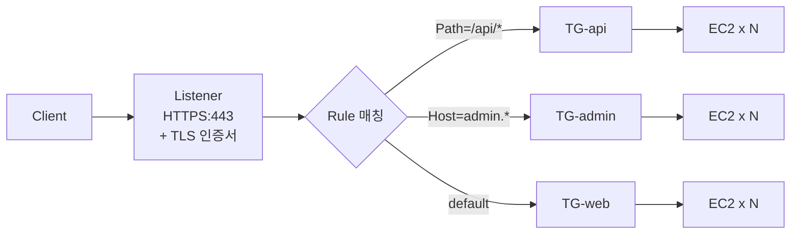
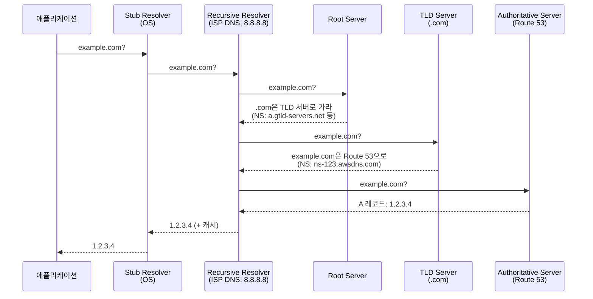

### CHAPTER 5 부하 분산

트래픽을 **여러 서버에 분산**해 **가용성·확장성·성능**을 확보하는 방법. AWS는 L4~L7의 ELB, 글로벌 DNS 기반 Route 53, 엣지 캐싱 CloudFront, Anycast 가속 Global Accelerator 등 **다양한 레이어의 부하 분산 수단**을 제공한다.

#### 목차

- [1부. ELB (리스너와 대상 그룹)](#1부-elb-리스너와-대상-그룹)
- [2부. ELB 통신 방식](#2부-elb-통신-방식)
- [3부. Route 53과 DNS 개념](#3부-route-53과-dns-개념)
- [4부. DNS 레코드 유형](#4부-dns-레코드-유형)
- [5부. Route 53 라우팅 정책](#5부-route-53-라우팅-정책)
- [6부. DNS 조회 순서 (Resolve)](#6부-dns-조회-순서-resolve)
- [7부. CloudFront와 CDN](#7부-cloudfront와-cdn)
- [8부. Global Accelerator](#8부-global-accelerator)

---

## 1부. ELB (리스너와 대상 그룹)

### ELB 개요

> **Elastic Load Balancer**. AWS가 제공하는 **완전관리형 로드밸런서**. 하나 이상의 AZ에 걸쳐 트래픽을 **여러 백엔드로 분산**한다.

**4가지 유형**:

| 종류 | 레이어 | 사용처 |
|---|---|---|
| **ALB** (Application LB) | L7 (HTTP/HTTPS, gRPC, WebSocket) | 웹/API, 호스트/경로 기반 라우팅 |
| **NLB** (Network LB) | L4 (TCP/UDP/TLS) | 초고성능, 고정 IP 필요, non-HTTP |
| **GWLB** (Gateway LB) | L3 (IP 패킷) | 서드파티 보안 어플라이언스 체인 |
| **CLB** (Classic LB) | L4/L7 (레거시) | 신규 사용 X, 2013년 이전 세대 |

### 핵심 3요소

```
Client
   ↓
[Listener] (프로토콜:포트)  — ex. HTTPS:443
   ↓
[Rule] (조건 → 액션)        — ex. Host=api.* → forward to TG-A
   ↓
[Target Group] (백엔드 묶음) — ex. EC2 / IP / Lambda / Fargate
   ↓
Target (EC2, IP, Lambda)
```

### 1. Listener (리스너)

- ELB가 **클라이언트의 연결을 받을 프로토콜 + 포트**
- 1개 ELB에 **여러 리스너** 가능 (예: HTTP:80, HTTPS:443)
- 리스너에 **TLS 인증서(ACM)**를 붙여 HTTPS 종단 처리

**ALB 리스너 액션 종류**:
- Forward → Target Group으로 전달
- Redirect → URL 리다이렉트 (HTTP→HTTPS)
- Fixed Response → 고정 응답 (503, 404 등)
- Authenticate (OIDC/Cognito) → 인증 통과한 요청만 포워드

### 2. Rule (리스너 규칙)

ALB의 **L7 라우팅 핵심**. 리스너 안에서 조건 매칭 후 액션 수행.

**조건 종류**:
- **Host header** (예: `api.example.com`)
- **Path pattern** (예: `/api/*`, `/images/*`)
- **HTTP header** (예: `User-Agent: Mozilla*`)
- **HTTP method** (GET/POST)
- **Query string** (예: `env=prod`)
- **Source IP**

**예시 규칙 세트**:

| 우선순위 | 조건 | 액션 |
|---|---|---|
| 10 | Path=`/api/*` | → TG-api |
| 20 | Host=`admin.example.com` | → TG-admin |
| 30 | Path=`/images/*` | → TG-s3-static |
| default | — | → TG-web |

### 3. Target Group (대상 그룹)

- **같은 역할의 백엔드 묶음** + **헬스체크 정책**
- Target 타입:
  - **instance** — EC2 (ENI 통해 라우팅)
  - **ip** — 특정 IP (온프레미스, 다른 VPC, EKS Pod)
  - **lambda** — Lambda 함수 호출 (ALB 전용)
  - **ALB** — NLB → ALB 체이닝 (최근 지원)

**헬스체크 설정**:

| 항목 | 설명 |
|---|---|
| **프로토콜/포트** | HTTP:80, HTTPS:443, TCP 등 |
| **경로** | `/health`, `/actuator/health` 등 |
| **임계값** | Healthy threshold (예: 2회 연속 성공 → Healthy) |
| **임계값** | Unhealthy threshold (예: 3회 연속 실패 → Unhealthy) |
| **간격** | 30초(기본) |
| **타임아웃** | 5초(기본) |
| **매칭 코드** | `200-299` (HTTP) |

→ Unhealthy로 판정된 타겟은 **라우팅에서 자동 제외**.

### ELB 통신 흐름 (ALB 기준)



---

## 2부. ELB 통신 방식

### 공통 — ELB는 ENI를 통해 트래픽을 받는다

- ELB는 **각 AZ 서브넷에 ENI를 하나씩** 생성
- 클라이언트는 ELB의 **DNS 이름**으로 접근 → Route 53이 **여러 AZ의 ENI IP** 반환
- ELB는 백엔드로 **새 커넥션**을 만듦 (L7은 완전 분리, L4는 흐름 유지)

### ALB (L7 Reverse Proxy)

**특징**:
- **HTTP/HTTPS/gRPC/WebSocket** 전용
- 클라이언트 커넥션과 백엔드 커넥션이 **완전 분리** (L7 프록시)
- 백엔드가 보는 요청의 **출발지 IP는 ALB IP** → 원본 IP는 **`X-Forwarded-For`** 헤더
- **고정 IP 없음** (DNS 이름 기반)
- **SG 적용 가능**
- **TLS 종료**(Termination) — ALB에서 복호화 후 백엔드로 평문 또는 재암호화

**지원 기능**:
- WAF 연동
- Cognito/OIDC 인증
- Lambda 타겟
- Sticky Session (쿠키 기반)

### NLB (L4 TCP/UDP)

**특징**:
- **TCP/UDP/TLS** — HTTP 외의 모든 TCP/UDP 프로토콜
- **초고성능** — 수백만 CPS, 지연 수백 μs
- **고정 IP** — AZ당 EIP 할당 가능 → 방화벽 whitelist 유용
- **클라이언트 IP 보존** (Preserve Client IP, instance 타겟 기본값) → 백엔드가 **실제 클라이언트 IP** 봄
- **SG 적용 가능** (2023년부터 지원)
- **TLS 종료 가능**

**통신 특징**:
- **흐름 유지** — 같은 5-tuple(출발지 IP/Port + 목적지 IP/Port + Protocol)은 같은 타겟으로 (해시 기반)
- 백엔드가 응답을 **직접 클라이언트로** 보내지 않고 NLB 통해 돌려보냄 (관리 편의)

### CLB (레거시)

- 2009년 출시, 2013년 ALB/NLB로 대체
- L4/L7 혼합 지원이지만 기능이 빈약
- **신규 생성 비권장** — 레거시 유지보수 외에는 사용하지 않음

### GWLB (Gateway LB)

- **서드파티 보안 어플라이언스 체이닝** 전용
- 모든 IP 패킷을 **GENEVE 터널**로 보안 어플라이언스에 전달 → 검사 후 반환
- 트래픽 가로채기(bump-in-the-wire) 패턴

### ALB vs NLB 비교

| 항목 | ALB | NLB |
|---|---|---|
| **레이어** | L7 | L4 |
| **프로토콜** | HTTP/HTTPS/gRPC/WS | TCP/UDP/TLS |
| **라우팅 기준** | Host, Path, Header, Method, Query | 5-tuple 해시 |
| **클라이언트 IP** | X-Forwarded-For 헤더 | 보존 (instance 타겟 기본) |
| **고정 IP** | ❌ | ✅ (AZ당 EIP) |
| **TLS 종료** | ✅ | ✅ |
| **WAF 연동** | ✅ | ❌ (직접 불가) |
| **Lambda 타겟** | ✅ | ❌ |
| **지연** | 수 ms | 수백 μs |
| **CPS** | 수만~ | 수백만 |

### 커넥션 흐름 비교 (중요)

**ALB** — 커넥션 분리:
```
Client ──(TCP 1)──> ALB ──(TCP 2, 새 커넥션)──> Target
```
- Target이 보는 Remote-Addr = ALB IP
- X-Forwarded-For로 원본 IP 전달

**NLB** — 흐름 전달:
```
Client ──(TCP)──> NLB ──(TCP, 원본 IP 보존)──> Target
```
- Target이 보는 Remote-Addr = **클라이언트 IP**
- 애플리케이션 코드 수정 없이 바로 사용 가능

---

## 3부. Route 53과 DNS 개념

### DNS란

> **Domain Name System**. 사람이 읽는 **도메인(`example.com`)을 IP 주소(`1.2.3.4`)로 변환**하는 분산 디렉터리 시스템.

**왜 필요한가**: 사람은 IP를 외우기 힘들고, 서버 IP는 바뀔 수 있음. **이름 ↔ IP 중간 추상화**가 필수.

### DNS 서버 분류

DNS는 **계층 구조**로, 역할별로 서버가 분리되어 있다.

| 종류 | 역할 | 예시 |
|---|---|---|
| **Root Name Server** | 최상위 (`.`). TLD 서버 위치 안내 | 전 세계 13개 (`a.root-servers.net`~`m.root-servers.net`) |
| **TLD Name Server** | 최상위 도메인 (`.com`, `.kr`, `.io`). 2차 도메인의 Authoritative 서버 안내 | Verisign (`.com`, `.net`), KISA (`.kr`) |
| **Authoritative Name Server** | 특정 도메인의 **최종 레코드 보유** | Route 53, Cloudflare DNS, 자체 BIND 서버 |
| **Recursive Resolver (Caching)** | 클라이언트 요청을 받아 **대신 조회·캐싱** | ISP DNS, 8.8.8.8, 1.1.1.1 |
| **Stub Resolver** | 운영체제의 **클라이언트 측** DNS 라이브러리 | `/etc/resolv.conf`, Windows DNS Client |

### Route 53

> **AWS의 Authoritative Name Server + Recursive Resolver + 도메인 등록 서비스**. 100% SLA.

**주요 역할**:
1. **도메인 등록** (Registrar) — `.com`, `.io`, `.kr` 등
2. **Authoritative DNS** 호스팅 — 사용자 도메인의 레코드 보관
3. **Resolver** — VPC 내부 DNS 조회 (VPC+2 주소)
4. **헬스체크 + 라우팅 정책** — 지능형 트래픽 분산

### Hosted Zone (호스팅 영역)

- **Public Hosted Zone** — 인터넷 공개 도메인 (예: `example.com`)
- **Private Hosted Zone** — VPC 내부 전용 도메인 (예: `internal.example.com`)
- 각 Hosted Zone에 레코드 추가/수정

---

## 4부. DNS 레코드 유형

### 주요 레코드

| 유형 | 용도 | 예시 |
|---|---|---|
| **A** | 도메인 → IPv4 주소 | `example.com → 1.2.3.4` |
| **AAAA** | 도메인 → IPv6 주소 | `example.com → 2001:db8::1` |
| **CNAME** | 도메인 → 다른 도메인 (별칭) | `www.example.com → example.com` |
| **MX** | 메일 서버 (우선순위 + 호스트) | `example.com → mail.example.com (prio 10)` |
| **TXT** | 임의 텍스트 (SPF, DKIM, 도메인 소유권 증명) | `v=spf1 include:_spf.google.com ~all` |
| **NS** | 도메인의 Name Server 지정 | `example.com → ns-123.awsdns.com` |
| **SOA** | 영역 시작 정보 (관리자, 시리얼 등) | 자동 생성 |
| **PTR** | IP → 도메인 (역방향) | `1.2.3.4.in-addr.arpa → example.com` |
| **SRV** | 서비스 레코드 (프로토콜+포트) | `_sip._tcp.example.com → sip.example.com:5060` |
| **CAA** | 발급 가능 CA 지정 (TLS 보안) | `example.com → 0 issue "letsencrypt.org"` |
| **Alias** (AWS 전용) | AWS 리소스 → 도메인 (CNAME 유사하지만 Root 가능, 무료 쿼리) | `example.com → ALB DNS` |

### CNAME vs Alias (AWS 특이)

| 항목 | CNAME | Alias |
|---|---|---|
| **표준** | DNS 표준 | AWS Route 53 전용 |
| **Root 도메인(`example.com`)** | ❌ 사용 불가 (`www.example.com`만 가능) | ✅ 가능 |
| **대상** | 모든 도메인 | AWS 리소스 (ALB, CloudFront, S3, API Gateway, 다른 Route 53 레코드 등) |
| **쿼리 요금** | 과금 | **무료** (AWS 리소스 대상 시) |
| **TTL** | 사용자 지정 | AWS가 관리 |

→ **AWS 리소스 지향 시 Alias를 항상 선호**. 특히 **Zone Apex**(`example.com`)에 ALB 연결하려면 Alias 필수.

### 왜 Root 도메인에 CNAME을 못 쓰나

DNS RFC상 **CNAME은 다른 레코드와 공존 불가**. Root 도메인은 반드시 NS, SOA 레코드를 가져야 하므로 CNAME 설정 시 충돌. 그래서 AWS는 Alias(실제론 Route 53 서버에서 A 레코드로 응답)로 우회.

---

## 5부. Route 53 라우팅 정책

Route 53의 **지능형 라우팅** 기능. 같은 레코드 이름에 **여러 값**을 등록하고 **정책에 따라 응답**을 다르게 반환.

### 1. Simple Routing (단순)

- 레코드 하나에 **값 하나 또는 여러 개**
- 여러 개면 **라운드 로빈** (클라이언트가 랜덤 선택)
- 헬스체크 없음

### 2. Weighted Routing (가중치)

- 여러 레코드에 **가중치 할당** → 가중치 비율대로 트래픽 분배
- **Canary 배포, A/B 테스트, 점진적 마이그레이션**에 유용

**예시**:

| 레코드 | 가중치 | 비율 |
|---|---|---|
| v1.example.com → 1.2.3.4 | 90 | 90% |
| v2.example.com → 1.2.3.5 | 10 | 10% |

### 3. Latency-based Routing (지연 기반)

- 요청자(클라이언트의 리졸버) **위치에 가장 지연이 낮은 리전**으로 라우팅
- 멀티 리전 배포 시 **가장 가까운 리전**으로 자동 전달

### 4. Geolocation Routing (지역 기반)

- 요청자 **대륙/국가/주 단위**로 다른 응답
- 예: 한국 요청 → 서울 리전, 미국 → 버지니아
- **컴플라이언스**(데이터 로컬라이제이션) 요구에 활용

### 5. Geoproximity Routing (지리 근접)

- 리소스와 사용자의 **지리적 거리** + **바이어스**(가중치) 기반
- 예: 서울에 있지만 **도쿄 리소스를 선호**하도록 바이어스 설정
- **Traffic Flow** 기능 필요 (추가 비용)

### 6. Failover Routing (장애 조치)

- **Primary + Secondary** 지정
- Primary 헬스체크 **Unhealthy 시 Secondary로 자동 전환**
- Active-Passive HA 구성

### 7. Multivalue Answer Routing

- 레코드당 **최대 8개 응답** 랜덤 반환
- 각 레코드에 **헬스체크 연결 가능** → Unhealthy는 제외
- ELB 없이도 **간단한 로드밸런싱** + **헬스체크** 가능

### 8. IP-based Routing (최근)

- 요청자 **IP 범위**에 따라 다른 응답
- 특정 ISP, 사내 IP 대역에 다른 라우팅 적용

### 라우팅 정책 선택 가이드

| 요구사항 | 정책 |
|---|---|
| 가장 단순 | Simple |
| Canary / A-B 테스트 | Weighted |
| 글로벌 지연 최소화 | Latency |
| 국가별 다른 콘텐츠 | Geolocation |
| HA (Active-Passive) | Failover |
| ELB 없이 다중 서버 분산 | Multivalue |

---

## 6부. DNS 조회 순서 (Resolve)

**가장 많이 묻는 토픽**. `example.com`을 처음 조회할 때 **어떤 서버들이 어떤 순서로** 질의받는지.

### 전체 흐름 (처음 조회 시, 캐시 없음)



### Step-by-Step 상세

#### Step 1. 애플리케이션 → OS Stub Resolver

```
curl example.com
   ↓
getaddrinfo("example.com") → OS의 DNS 리졸버 호출
```

- Stub Resolver가 **`/etc/resolv.conf`에 적힌 Recursive Resolver**에게 질의 (예: `8.8.8.8`)

#### Step 2. OS → Recursive Resolver (ISP DNS / 공용 DNS)

- Recursive Resolver는 **"대신 다 조회해주는" 서버**. 사용자/애플리케이션이 직접 Root부터 돌지 않도록 해줌
- **캐시 먼저 조회** — TTL 유효하면 바로 응답
- 캐시 없으면 **다음 단계 재귀 수행**

#### Step 3. Recursive → Root Name Server

- Recursive Resolver는 **Root 서버 IP 13개를 내장** (hints 파일)
- `example.com`? → Root는 "`.com`은 **TLD 서버**로 가"라고 NS 레코드 반환

```
질의: example.com. A?
Root 응답: .com. NS = a.gtld-servers.net. (+ glue A 레코드)
```

#### Step 4. Recursive → TLD Name Server

- `.com` TLD 서버에게 다시 질의
- TLD 서버는 `example.com`의 **Authoritative Name Server NS 레코드** 반환

```
질의: example.com. A?
.com TLD 응답: example.com. NS = ns-123.awsdns-12.com. (Route 53)
```

#### Step 5. Recursive → Authoritative Name Server (Route 53)

- Route 53에게 질의 → **최종 A 레코드** 반환

```
질의: example.com. A?
Route 53 응답: example.com. A = 1.2.3.4
```

#### Step 6. Recursive → 사용자

- 결과를 **캐시**하고 사용자(Stub Resolver)에게 반환
- TTL 동안은 Recursive가 바로 응답 (Step 3~5 생략)

### 두 번째 이후 조회 (캐시 활용)

```
App → Stub → Recursive (캐시 hit) → 응답
```

- Recursive 캐시 TTL 만료 전에는 **Root/TLD/Authoritative 질의 없이 즉시 응답**
- TTL이 짧을수록 전환 반영 빠름, 하지만 쿼리 비용 ↑

### 핵심 포인트

| 단계 | 역할 | 비고 |
|---|---|---|
| Stub Resolver | OS 라이브러리 | `/etc/resolv.conf` 설정 참조 |
| Recursive Resolver | 대신 조회 + 캐시 | ISP / 8.8.8.8 / 1.1.1.1 / Route 53 Resolver |
| Root (`.`) | TLD 서버 안내 | 전 세계 13개 (Anycast) |
| TLD (`.com`) | Authoritative NS 안내 | Verisign 등 운영 |
| Authoritative | **최종 레코드 보유** | Route 53, Cloudflare 등 |

### AWS VPC 내부의 특이사항

- VPC 안에서는 `/etc/resolv.conf`가 **VPC+2 (예: 10.0.0.2)**를 가리킴
- 이 **Route 53 Resolver**가 Recursive 역할
- Private Hosted Zone 조회는 **AWS 내부에서 즉시 응답**
- Public DNS 조회는 Resolver가 **인터넷의 Root/TLD/Authoritative** 거쳐 조회

---

## 7부. CloudFront와 CDN

### CDN이란

> **Content Delivery Network**. 콘텐츠를 **전 세계 엣지 로케이션에 캐싱**해 사용자가 가장 가까운 엣지에서 응답받도록 하는 네트워크.

**효과**:
- **지연 감소** — 사용자가 지구 반대편 Origin까지 가지 않고 가까운 엣지에서 응답
- **Origin 부하 감소** — 캐시 히트는 Origin에 가지 않음
- **대역폭 비용 절감** — Origin → Edge 트래픽이 Origin → User보다 저렴
- **DDoS 완화** — 엣지에서 **1차 흡수**

### CloudFront 개요

> **AWS의 CDN 서비스**. 전 세계 **600+ Edge Locations + 13 Regional Edge Caches**를 사용.

**아키텍처**:

```
User → Edge Location (가장 가까운 PoP)
         ↓ Cache miss
       Regional Edge Cache
         ↓ Cache miss
       Origin (S3, ALB, EC2, 외부 서버)
```

### 주요 개념

| 용어 | 설명 |
|---|---|
| **Distribution** | CloudFront 설정 단위 (하나의 도메인 매핑) |
| **Origin** | 원본 서버 (S3, ALB, EC2, HTTP 외부 서버) |
| **Origin Group** | Origin Failover용 Primary + Secondary |
| **Behavior** | Path 패턴별 캐시/라우팅 정책 (예: `/images/*`는 1일 캐시) |
| **Cache Key** | 캐시 식별자 (URL + 선택적으로 Query/Header/Cookie 포함) |
| **TTL** | Edge 캐시 유지 시간 |
| **Invalidation** | 특정 경로의 캐시 즉시 삭제 |
| **OAC** (Origin Access Control) | S3 Origin에 CloudFront만 접근 허용 (OAI 후속) |

### 캐시 흐름

```
Request → Edge Location
   ├─ Cache hit → 즉시 응답
   └─ Cache miss → Regional Edge Cache 조회
         ├─ hit → 응답 + Edge에도 캐싱
         └─ miss → Origin 요청 → 응답 + Regional/Edge 캐싱
```

### CloudFront 핵심 기능

- **HTTPS 종단** (ACM 인증서, SNI/전용 IP)
- **지리 차단** (국가 단위 차단/허용)
- **WAF/Shield 연동** — DDoS 방어, 봇 차단
- **Lambda@Edge, CloudFront Functions** — 엣지에서 요청/응답 변조
- **Signed URL/Signed Cookie** — 유료 콘텐츠 접근 제어
- **Origin Shield** — Origin 앞에 **중앙 캐시 레이어** 추가 → Origin 요청 추가 감소
- **Field-Level Encryption** — 특정 필드만 암호화

### CloudFront vs Route 53

| 항목 | CloudFront | Route 53 |
|---|---|---|
| **역할** | 콘텐츠 **캐싱 + 라우팅** | 도메인 → IP **이름 해석** |
| **레이어** | HTTP(S) 프록시 | DNS |
| **캐시** | O | X |
| **TLS 종료** | O | X |
| **DDoS 방어** | Shield 기본 포함 | Shield Advanced |

→ 둘은 **보완관계**. Route 53으로 사용자가 CloudFront 엣지 DNS를 받고, CloudFront가 콘텐츠 응답.

### 캐시 전략 핵심

1. **정적 자산(이미지, JS, CSS)** — 긴 TTL (1일~1년) + 파일명에 해시 포함 (`main.a1b2c3.js`)
2. **동적 API** — TTL 짧게 또는 0, Query String을 Cache Key에 포함
3. **인증 필요 콘텐츠** — Signed URL/Cookie
4. **버전 변경 시** — Invalidation 또는 **파일명 변경**(권장)

---

## 8부. Global Accelerator

### 개념

> **AWS Global Network를 활용해 글로벌 사용자에게 Anycast 고정 IP + 최적 경로**를 제공하는 서비스. **L4(TCP/UDP)** 기반 네트워크 가속기.

**CloudFront가 L7 HTTP 캐싱**이라면, **Global Accelerator는 L4 네트워크 경로 최적화**.

### 왜 필요한가

```
[기존 인터넷 경로]
User(한국) → ISP → 공용 인터넷(여러 통신사 BGP 홉) → AWS 리전

[Global Accelerator]
User → 가장 가까운 AWS Edge PoP(Anycast IP)
     → AWS 전용 백본 네트워크(최적 경로)
     → 리전의 ELB/EC2
```

- **공용 인터넷은 BGP 라우팅에 의존** → 경로 변동, 지연 변동 큼
- **AWS 백본은 전용 다크파이버** → 안정적인 저지연

### 핵심 특징

| 특징 | 설명 |
|---|---|
| **Anycast 고정 IP 2개** | 전 세계에서 **같은 IP**로 접근, Edge가 가장 가까운 리전으로 라우팅 |
| **AWS 백본 사용** | 공용 인터넷 대비 **지연·패킷 손실 감소** |
| **헬스체크 + 자동 Failover** | 리전 장애 시 **즉시 다른 리전으로** 전환 (DNS TTL 영향 X) |
| **멀티 리전 트래픽 분산** | 가중치/지리 기반 분산 |
| **L4 (TCP/UDP)** | HTTP 외의 프로토콜 지원 (게임 서버, VoIP 등) |
| **클라이언트 IP 보존** | NLB와 유사 |

### 아키텍처

```
Clients (전 세계)
   ↓ Anycast 고정 IP 2개 (예: 1.2.3.4 / 5.6.7.8)
가장 가까운 AWS Edge PoP (600+)
   ↓ AWS 백본
Endpoint Group (리전별)
   ↓
Endpoint (ALB / NLB / EC2 / EIP)
```

### CloudFront vs Global Accelerator

| 항목 | CloudFront | Global Accelerator |
|---|---|---|
| **레이어** | L7 (HTTP/HTTPS) | L4 (TCP/UDP) |
| **캐싱** | ✅ | ❌ |
| **고정 IP** | ❌ | ✅ (Anycast 2개) |
| **TLS 종료** | ✅ | ❌ (End-to-end) |
| **헬스체크 → Failover** | Origin Group | **훨씬 빠름 (초 단위)** |
| **대상 리소스** | S3, ALB, EC2, HTTP | ALB, NLB, EC2, EIP |
| **대표 사용처** | 웹/CDN, 정적 콘텐츠 | 게임 서버, 금융 트레이딩, VoIP, API 저지연 |

### 언제 쓰나

- **글로벌 게임 서버** — UDP, 저지연 요구
- **금융 트레이딩** — 지연 안정성 중요
- **멀티 리전 Active-Active** — Anycast + 자동 Failover
- **고정 IP 필요** — 방화벽 whitelist, DNS 캐시 영향 피하고 싶음

### Global Accelerator vs Route 53 Latency-based

| 항목 | Global Accelerator | Route 53 Latency Routing |
|---|---|---|
| **방식** | Anycast + AWS 백본 | DNS 응답 다르게 |
| **반응 속도** | 즉시 (TCP 세션 유지) | DNS TTL 만료 후 |
| **클라이언트 IP** | 보존 | 보존 (DNS는 영향 X) |
| **비용** | 시간당 + 데이터 처리료 | 쿼리당 저렴 |

→ Global Accelerator가 **더 빠른 Failover + 안정적 경로** 제공하지만 **더 비싸다**.

---

### 요약

- **ELB 핵심 3요소**: Listener(프로토콜:포트) → Rule(조건→액션) → Target Group(백엔드 묶음 + 헬스체크)
- **ALB(L7) vs NLB(L4)**: ALB는 커넥션 분리/X-Forwarded-For, NLB는 고정 IP/클라이언트 IP 보존/저지연
- **DNS 계층**: Root → TLD → Authoritative → (Recursive가 대신 조회·캐시) → Stub Resolver
- **DNS 조회 순서**: App → OS Stub → Recursive(캐시) → Root → TLD → Authoritative(Route 53) → 응답
- **레코드 유형**: A/AAAA/CNAME/MX/TXT/NS/SOA/PTR/CAA + **AWS Alias**(Root 가능, 쿼리 무료)
- **Route 53 라우팅 정책 8가지**: Simple / Weighted / Latency / Geolocation / Geoproximity / Failover / Multivalue / IP-based
- **CloudFront** = L7 HTTP CDN (캐싱·TLS·WAF·Lambda@Edge)
- **Global Accelerator** = L4 Anycast + AWS 백본 (고정 IP·초 단위 Failover·게임/금융)
- CloudFront vs GA: **캐시 필요 → CF, 저지연·고정 IP → GA**, 둘 다 쓸 수도 있음

> **이전 책 참고**: [업무에 바로 쓰는 AWS 입문 — Chapter 3 EC2 ELB](../../aws-practical-intro/chapter03/README.md) / [Chapter 8 CloudFront](../../aws-practical-intro/chapter08/README.md)
