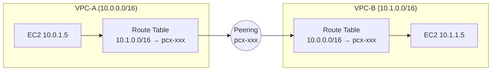
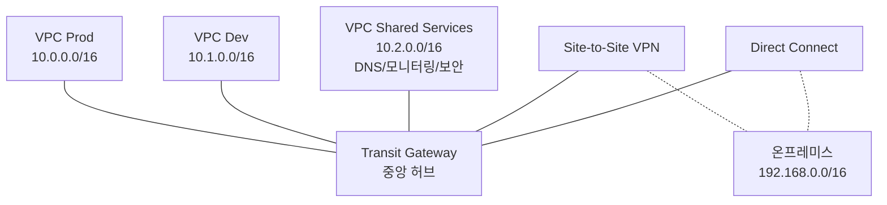
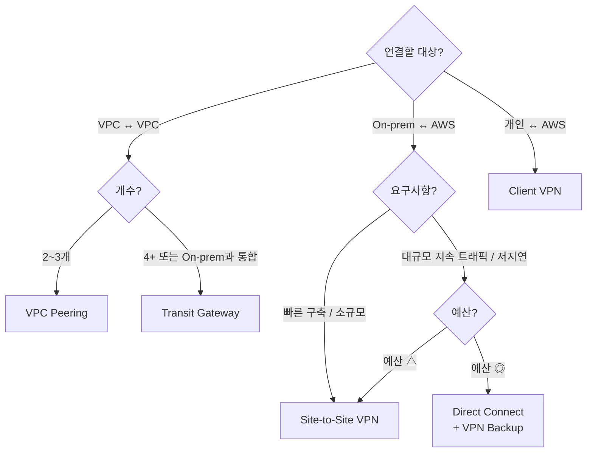

### CHAPTER 6 네트워크 연결 옵션

1~5장이 **단일 VPC 안**의 네트워크였다면, 6장은 **VPC와 VPC**, **VPC와 온프레미스**, **VPC와 다른 AWS 계정**을 연결하는 방법. 멀티 계정·멀티 리전·하이브리드 클라우드로 가는 길목.

#### 목차

- [1부. VPC Peering](#1부-vpc-peering)
- [2부. VPN 개념과 종류](#2부-vpn-개념과-종류)
- [3부. Transit Gateway](#3부-transit-gateway)
- [4부. 타 계정 간 VPC Peering](#4부-타-계정-간-vpc-peering)
- [5부. AWS Direct Connect](#5부-aws-direct-connect)
- [6부. 선택 기준과 조합 패턴](#6부-선택-기준과-조합-패턴)

---

## 1부. VPC Peering

### 개념

> **두 VPC를 1:1로 직접 연결**하는 가장 간단한 방식. AWS 백본을 통해 **사설 IP로 통신**이 가능하다.

**특징**:
- **1:1 연결** — 다자 간은 메시 형태로 N개의 Peering 필요
- **AWS 백본 사용** — 공용 인터넷 거치지 않음, 암호화 자동 (TLS 아님, AWS 네트워크 레이어)
- **같은 리전 또는 다른 리전** (Inter-Region Peering)
- **같은 계정 또는 다른 계정** (Cross-Account)
- **IPv4/IPv6** 모두 지원
- **대역폭 제한 없음** — 각 VPC의 네트워크 성능에 종속

### 필수 조건

1. **CIDR 블록이 겹치지 않을 것** — 10.0.0.0/16과 10.0.0.0/16은 Peering 불가
2. 두 VPC 모두에서 **라우팅 테이블에 Peering 라우트 추가**
3. 두 VPC 모두의 **SG/NACL에서 상대 CIDR 허용**
4. Peering **요청 측 요청 → 수락 측 승인** 2단계

### 설정 흐름

```
VPC-A (10.0.0.0/16)                      VPC-B (10.1.0.0/16)
   ↓                                        ↑
1. A가 B에게 Peering 요청 →
                            ← 2. B가 수락
3. A의 Route Table: 10.1.0.0/16 → pcx-xxx
4. B의 Route Table: 10.0.0.0/16 → pcx-xxx
5. SG에서 상대 CIDR Allow
```

### VPC Peering의 치명적 제약 — **Transitive Routing 불가**

> A ↔ B, B ↔ C 로 Peering되어 있어도 **A ↔ C는 통신 불가**. B를 경유할 수 없다.

```
VPC-A ──── Peering ──── VPC-B ──── Peering ──── VPC-C
   │                                             │
   └──────── A ↔ C 불가 (별도 Peering 필요) ─────┘
```

→ **3개 이상 VPC**를 모두 연결하려면 **각 쌍마다 Peering** 필요. N개 VPC는 **N(N-1)/2 Peering** 필요 → 10개 VPC면 45개 Peering → **관리 불가능**.

이 문제를 **Transit Gateway**가 해결한다.

### VPC Peering 비용

- Peering 연결 자체는 **무료**
- **같은 AZ 내 트래픽**은 무료
- **교차 AZ** 트래픽은 **$0.01/GB** (양방향)
- **교차 리전** 트래픽은 **$0.02~0.09/GB** (리전 쌍마다 다름)

### VPC Peering 사용 사례

- **공유 서비스 VPC** — 모니터링/로깅 VPC 하나를 여러 서비스 VPC가 참조
- **파트너사 통합** — 외부 조직과 1:1 연결
- **DB VPC + App VPC 분리**
- **스타트업 초기** — VPC 수가 적을 때는 Peering으로 충분

### VPC Peering 흐름 다이어그램



---

## 2부. VPN 개념과 종류

### VPN이란

> **Virtual Private Network**. 공용 인터넷 위에 **암호화된 가상 터널**을 만들어 사설 네트워크처럼 사용. **온프레미스 ↔ AWS**, **AWS ↔ 다른 클라우드**, **사용자 ↔ 회사 네트워크** 등을 연결.

**암호화 프로토콜**: IPsec, SSL/TLS, WireGuard 등. AWS Site-to-Site VPN은 **IPsec** 기반.

### AWS VPN 종류 (2가지)

| 종류 | 용도 | 연결 주체 |
|---|---|---|
| **Site-to-Site VPN** | 온프레미스 ↔ AWS VPC | 라우터/방화벽 ↔ AWS |
| **Client VPN** | 개별 사용자 ↔ AWS VPC | 개인 노트북/PC ↔ AWS |

### 1. Site-to-Site VPN (S2S VPN)

> **사내 데이터센터 네트워크 전체를 VPC에 연결**. 온프레미스 라우터(Customer Gateway)와 AWS의 Virtual Private Gateway/Transit Gateway 사이에 **IPsec 터널 2개** 생성.

**구성 요소**:

| 요소 | 설명 |
|---|---|
| **Customer Gateway (CGW)** | 온프레미스 측 **라우터/방화벽**을 AWS에 등록한 논리 객체. 공인 IP + BGP ASN |
| **Virtual Private Gateway (VGW)** | AWS 측 **VPN 종단점**. VPC에 attach |
| **Transit Gateway (대안)** | VGW 대신 TGW를 종단점으로 사용 (멀티 VPC 공유) |
| **Site-to-Site VPN Connection** | 위 둘을 연결하는 **터널 2개** (AZ 분산 HA) |

**아키텍처**:

```
On-prem Router (Customer Gateway, 공인 IP 1.2.3.4)
      ↕ IPsec Tunnel 1 (주)
      ↕ IPsec Tunnel 2 (예비)
Virtual Private Gateway (AWS 측)
      ↓
VPC
```

**라우팅 방식**:
- **Static Routing** — 수동으로 라우트 입력
- **Dynamic Routing (BGP)** — Customer Gateway와 AWS 간 BGP 세션으로 자동 교환

**특징**:
- **고가용성** — 터널 2개 (서로 다른 AWS 종단점)
- **최대 ~1.25 Gbps per tunnel** (ECMP로 다중 터널 묶으면 TGW 기준 50 Gbps까지)
- **AWS Side 비용** — 시간당 $0.05 + 데이터 전송료
- **공용 인터넷 경유** → 지연 가변적

### 2. Client VPN

> **개인 사용자**가 **자기 노트북**에서 **AWS VPC에 접속**. OpenVPN 기반.

**구성**:
- **Client VPN Endpoint** — AWS가 운영하는 VPN 서버
- **클라이언트 소프트웨어** — AWS VPN Client, OpenVPN 등
- **인증 방식**:
  - **상호 인증 (Mutual TLS)** — 클라이언트 인증서
  - **Active Directory 인증**
  - **SAML 2.0 (SSO)** — Okta, Azure AD 등
  - 조합 가능

**사용 사례**:
- 재택근무자가 **사내 VPC 리소스**에 접근
- **베스천 호스트 대체** — SG 수정 없이 안전하게 사내 네트워크 진입

### Site-to-Site VPN vs Client VPN

| 항목 | Site-to-Site | Client |
|---|---|---|
| **연결 주체** | 라우터 ↔ AWS | 개인 PC ↔ AWS |
| **프로토콜** | IPsec | OpenVPN (SSL/TLS) |
| **인증** | PSK, BGP ASN | 인증서/AD/SAML |
| **사용자 수** | 사내 전체 (라우터 뒤 모든 PC) | 사용자별 세션 |
| **비용** | 시간당 + 데이터 | **활성 사용자 시간당 $0.05~** + 엔드포인트 유지료 |

### VPN의 장단점

**장점**:
- **구축 즉시 가능** (몇 시간~며칠)
- **저비용** (전용선 대비)
- **공용 인터넷 어디서나** 접근 가능

**단점**:
- **인터넷 경로 종속** — 지연·패킷 손실 가변
- **대역폭 제한** — Direct Connect 대비 작음
- **보안** — 암호화는 되지만 공용 네트워크 통과

---

## 3부. Transit Gateway

### 개념

> **여러 VPC와 온프레미스를 중앙 허브로 연결**하는 완전관리형 네트워크 트랜싯 서비스. VPC Peering의 **Transitive 제약을 해결**한다.

**비유**: VPC Peering이 "직통 전화 1:1"이라면, TGW는 **"회사 교환기"** — 모든 VPC가 TGW 하나에 연결되고, TGW가 중앙에서 라우팅.

### 구조

```
                    ┌─────────────────┐
                    │  Transit Gateway │ (허브)
                    └────────┬────────┘
          ┌──────────┬───────┼───────┬──────────┐
          │          │       │       │          │
       VPC-A      VPC-B   VPC-C   VGW/VPN   Direct Connect
```

- 모든 VPC/VPN/DX가 **TGW에 attach**
- TGW의 **Route Table**이 중앙 라우팅 담당
- **최대 5,000 attachment**, 대역폭 **최대 50 Gbps/attachment**

### 핵심 구성 요소

| 요소 | 설명 |
|---|---|
| **Transit Gateway** | 리전 레벨 중앙 허브 |
| **Attachment** | VPC/VPN/DX/TGW Peering 각각을 TGW에 연결 |
| **TGW Route Table** | **TGW가 가진 라우팅 테이블**. 여러 개 가능 |
| **Association** | Attachment와 Route Table 연결 → "이 Attachment는 어떤 RT를 참조하는가" |
| **Propagation** | Attachment의 CIDR을 Route Table에 **자동 전파** |
| **TGW Peering** | 다른 리전의 TGW와 연결 (글로벌 메시) |

### 라우팅 격리 패턴

**다중 Route Table**로 **환경 격리** 구현:

```
TGW
├── Route Table: Production  (Prod VPC들만 참조, Dev는 보이지 않음)
└── Route Table: Development (Dev VPC들만 참조)
```

- 각 Attachment를 **Association + Propagation**으로 특정 RT에 묶음
- **Prod ↔ Dev 통신 완전 차단** 가능 (RT에 서로의 라우트 없음)

### TGW vs VPC Peering

| 항목 | VPC Peering | Transit Gateway |
|---|---|---|
| **연결 방식** | 1:1 메시 | **중앙 허브** |
| **Transitive 라우팅** | ❌ 불가 | ✅ 가능 |
| **N개 VPC 연결** | N(N-1)/2 Peering | **N개 Attachment** |
| **온프레미스 통합** | ❌ (VGW/DX 별도) | ✅ VGW/DX 함께 통합 |
| **멀티 리전** | Inter-Region Peering (1:1) | TGW Peering (허브 간) |
| **라우팅 제어** | 라우팅 테이블 분산 | **TGW RT 중앙 관리** |
| **비용** | 데이터 전송만 | **시간당 + Attachment당 + 데이터 처리료** |

### TGW 비용 (서울 리전 기준)

- **TGW 자체**: 시간당 요금
- **Attachment**: VPC/VPN/DX 각각 시간당 **$0.05**
- **데이터 처리**: **$0.02/GB** (양방향)
- → 10개 VPC 연결 시 Attachment만 월 **~$360** + 데이터

**비용 함정**:
- Peering은 데이터 전송료만, TGW는 **데이터 처리료($0.02/GB) 추가**
- 소규모(2~3 VPC)는 Peering이 저렴
- 중규모+ 또는 온프레미스 통합 시 TGW가 운영 비용 대비 저렴

### TGW 아키텍처 예시 (Hub-and-Spoke)



### TGW 베스트 프랙티스

1. **환경 격리**는 **Route Table 분리**로 (Prod/Dev/Shared 각각)
2. **공유 서비스 VPC** 하나를 두고 **모든 VPC가 참조**
3. **VPN + DX 조합** — DX 장애 시 VPN으로 자동 Failover (BGP)
4. **대규모 환경은 처음부터 TGW** — Peering 쌓이면 마이그레이션 지옥

---

## 4부. 타 계정 간 VPC Peering

### 왜 필요한가

- 대기업 **멀티 계정 구조**: 조직 단위/서비스 단위로 **AWS 계정 분리** (보안·과금·거버넌스)
- 파트너사와의 **B2B 통합** — 별개 계정끼리 사설 네트워크 연결
- M&A 후 **인수한 회사의 AWS 계정**과 통합

### 설정 흐름

```
[Account A: 1111...]                [Account B: 2222...]
   ↓                                    ↑
1. A의 VPC가 B의 VPC-ID + Account ID 지정해 Peering 요청
                                     ← 2. B 계정에서 수락 (요청 알림 수신)
3. A의 Route Table에 B CIDR → pcx-xxx 추가
4. B의 Route Table에 A CIDR → pcx-xxx 추가
5. A와 B의 SG/NACL에서 상대 CIDR Allow
```

### 중요 포인트

1. **CIDR 중복 금지** — 같은 조직이라도 서로 다른 CIDR 설계 필수
2. **SG 상호 참조 가능** — 같은 리전 Peering은 **상대 계정의 SG ID를 소스로** 지정 가능 (Inter-Region은 CIDR만)
3. **DNS 해석** — 기본은 사설 호스트명 조회 불가 → **DNS resolution for peering 옵션** 활성화해야 상대 VPC의 사설 DNS 조회 가능
4. **IAM 권한** — 수락 측 계정에 **`ec2:AcceptVpcPeeringConnection`** 권한 필요
5. **Peering 요청은 7일 후 만료** — 수락 안 하면 자동 삭제

### 다중 계정 전략 (대규모)

**AWS Organizations + RAM(Resource Access Manager) + TGW** 조합이 **표준 아키텍처**:

```
[Master Account - Network Account]
   └── Transit Gateway (중앙)
         │
         ├── RAM으로 다른 계정에 TGW 공유
         │
   ↓                      ↓                      ↓
[Account A VPC]      [Account B VPC]      [Account C VPC]
   TGW Attachment       TGW Attachment       TGW Attachment
```

- **네트워크 전용 계정**이 TGW 소유
- **RAM**으로 TGW를 다른 계정에 공유
- 각 계정 VPC는 Peering 없이 **TGW에 Attachment만**

→ **멀티 계정 Peering 메시의 복잡도를 TGW가 흡수**.

### Peering vs 멀티 계정 TGW

| 항목 | Cross-Account Peering | 다중 계정 TGW |
|---|---|---|
| **구성 복잡도** | 각 쌍마다 수동 | TGW 공유 + Attachment |
| **확장성** | 계정 수에 2차 증가 | 선형 |
| **중앙 관리** | ❌ | ✅ 네트워크 계정에서 중앙 통제 |
| **비용** | 저렴 | 비쌈 (TGW 시간당 + Attachment) |
| **소규모 (2~3 계정)** | ✅ 적합 | 과함 |
| **대규모 (10+ 계정)** | 관리 지옥 | ✅ 필수 |

---

## 5부. AWS Direct Connect

### 개념

> **AWS와 온프레미스 사이에 전용 광섬유 회선을 구축**하는 서비스. **공용 인터넷을 거치지 않는 사설 네트워크 연결**.

**비유**:
- VPN = 공용 도로에 전용 터널 뚫기 (암호화된 터널)
- Direct Connect = **전용 사설 도로** 깔기

### 아키텍처

```
[On-prem Data Center]
      ↓ 광섬유
[Direct Connect Location]
      ↓ AWS 전용 회선
[AWS Region]
      ↓
[VPC via VGW/TGW]
```

**Direct Connect Location**: AWS가 지정한 **코로케이션 데이터센터** (한국은 KINX, LG U+, SK브로드밴드 등). 고객의 라우터와 AWS의 라우터가 **같은 건물**에 있어 **크로스커넥트** (물리 광섬유) 연결.

### 핵심 특징

| 특징 | 설명 |
|---|---|
| **대역폭** | **1 Gbps, 10 Gbps, 100 Gbps** 전용 포트 (Hosted Connection은 50 Mbps~10 Gbps) |
| **지연** | **낮고 안정적** — 공용 인터넷 변동 없음 |
| **데이터 전송 요금** | **아웃바운드 요금 저렴** (VPN/인터넷 대비 ~1/3) |
| **보안** | 사설 회선이지만 **기본은 암호화 없음** — MACsec(물리 레벨 암호화) 지원, 또는 VPN over DX |
| **고가용성** | 포트 1개는 SPOF → **2개 포트 + 다른 Location** 권장 |
| **구축 기간** | **수주~수개월** (물리 회선 설치) |

### Direct Connect 가상 인터페이스 (VIF)

Direct Connect 포트 위에 **논리적 VIF 3종**을 올림:

| VIF 종류 | 용도 |
|---|---|
| **Private VIF** | 특정 **VPC에 직접 연결** (via VGW) |
| **Public VIF** | **AWS 공용 서비스**(S3, DynamoDB 등 공인 엔드포인트)에 접근 (인터넷 거치지 않고) |
| **Transit VIF** | **Transit Gateway 통해** 여러 VPC/리전 접근 |

### Direct Connect Gateway

> **다중 리전 + 다중 VPC** 접근을 위한 글로벌 라우팅 객체.

```
On-prem ↔ DX ↔ Direct Connect Gateway
                      │
         ┌────────────┼────────────┐
         ↓            ↓            ↓
      VGW-서울    VGW-도쿄    VGW-싱가포르
```

- 하나의 DX 포트로 **전 세계 리전의 VPC** 접근 가능
- TGW와 조합 시 **Transit VIF** 사용

### DX vs VPN

| 항목 | Direct Connect | Site-to-Site VPN |
|---|---|---|
| **네트워크** | **전용 사설 회선** | 공용 인터넷 + IPsec |
| **대역폭** | 1/10/100 Gbps 전용 | ~1.25 Gbps/tunnel |
| **지연** | **낮고 일정** | 가변적 |
| **구축 기간** | 수주~수개월 | **수 시간** |
| **비용 (고정)** | 포트 요금 ($0.30~22.5/hr) + 코로케이션 비용 | 시간당 $0.05 |
| **비용 (데이터 전송)** | **싼 아웃바운드 요금** | 일반 인터넷 요금 |
| **암호화** | 기본 없음 (MACsec 옵션) | IPsec 기본 |
| **대규모 지속 트래픽** | ✅ 저렴 + 안정 | 비쌈 + 불안정 |
| **백업/임시** | 과함 | ✅ 적합 |

### DX + VPN 조합 (실무 패턴)

**이상적인 하이브리드 구성**:

```
On-prem ──(Primary) Direct Connect ── AWS
       └─(Backup)   Site-to-Site VPN ── AWS
```

- **DX가 평시 트래픽** — 안정 + 저렴
- **DX 장애 시 VPN 자동 Failover** (BGP가 경로 전환)
- **VPN이 DX 터널을 암호화**하는 "VPN over DX" 패턴도 존재 (금융권 요구)

### DX 비용 구조 (서울 리전 기준)

- **포트 요금**:
  - 1 Gbps: 시간당 **$0.30** (월 ~$220)
  - 10 Gbps: 시간당 **$2.25** (월 ~$1,650)
  - 100 Gbps: 시간당 **$22.5** (월 ~$16,500)
- **데이터 아웃바운드**: **$0.02~0.08/GB** (대역폭·리전별)
- **코로케이션 비용**: 별도 (ISP/DC 사업자에게 지불)
- **크로스커넥트 비용**: 별도

→ **최소 월 수백~수천 달러**. 소규모엔 과함, 대규모엔 필수.

---

## 6부. 선택 기준과 조합 패턴

### 종합 비교표

| 방법 | 연결 범위 | Transitive | 대역폭 | 구축 기간 | 월 비용 (최소) | 사용처 |
|---|---|---|---|---|---|---|
| **VPC Peering** | 2 VPC | ❌ | VPC 성능 | 분 | $0 (데이터만) | 2~3 VPC |
| **TGW** | N VPC + VPN + DX | ✅ | 50 Gbps | 시간 | $36 (TGW) + Attachment | 중규모+ |
| **S2S VPN** | On-prem ↔ VPC | — | ~1.25 Gbps/tunnel | 시간 | $36 (연결) | On-prem 즉시 연결 |
| **Client VPN** | 개인 ↔ VPC | — | 사용자별 | 분 | 엔드포인트 + 활성 사용자 | 재택/베스천 대체 |
| **Direct Connect** | On-prem ↔ AWS 글로벌 | 가능 (DGW) | 1~100 Gbps | 주~월 | $220 (1G) + 설치비 | 대규모 안정 트래픽 |

### 선택 흐름도



### 전형적 아키텍처 조합

**패턴 1. 스타트업 (단일 계정, 2~3 VPC)**:
```
VPC-A ↔ Peering ↔ VPC-B
On-prem(개발팀 사무실) → S2S VPN → VPC-A
```

**패턴 2. 중견 기업 (10+ VPC, 하이브리드)**:
```
TGW 중앙 허브
├── 10+ VPC Attachment
├── Site-to-Site VPN (Backup)
└── Direct Connect (Primary, 1 Gbps)
```

**패턴 3. 대기업 멀티 계정 (수십~수백 계정)**:
```
Organizations
├── Network Account (TGW 소유)
│    ├── Direct Connect × 2 (멀티 Location HA)
│    └── TGW ─ RAM 공유 ─ → 모든 계정
│
├── Shared Services Account (DNS, 모니터링)
├── Prod Accounts (여러 개)
└── Dev Accounts (여러 개)
```

**패턴 4. 글로벌 서비스 (멀티 리전)**:
```
리전 A (서울)         리전 B (버지니아)        리전 C (도쿄)
TGW ──── TGW Peering ──── TGW ──── TGW Peering ──── TGW
 │                        │                         │
 VPC × N                  VPC × N                   VPC × N

Direct Connect Gateway → 모든 리전 VGW 통합
```

---

### 요약

- **VPC Peering**: 1:1 직접 연결, **Transitive 불가**, 소규모만 적합. 비용 저렴 (연결 자체 무료)
- **Site-to-Site VPN**: 온프레미스 라우터 ↔ AWS, IPsec, 터널 2개, 수 시간 구축, 공용 인터넷 경유
- **Client VPN**: 개인 PC ↔ VPC, OpenVPN 기반, 재택근무/베스천 대체
- **Transit Gateway**: **중앙 허브**로 N개 VPC + VPN + DX 통합, Transitive 가능, 중규모+ 필수
- **Cross-Account Peering**: SG 상호 참조 가능(같은 리전), DNS resolution 옵션 체크, 멀티 계정은 **TGW+RAM**이 표준
- **Direct Connect**: **전용 사설 광섬유**, 1~100 Gbps, 수주~수개월 구축, 대규모 지속 트래픽에 저렴, DGW로 글로벌 통합
- **선택 축**:
  - **규모**: 소 → Peering / 중+ → TGW
  - **On-prem 통합**: 즉시/소규모 → VPN / 안정/대규모 → DX
  - **멀티 계정**: Organizations + RAM + 중앙 TGW
  - **백업 전략**: DX + VPN Failover

> 다음 7장은 **네트워크 보안**. SG/NACL 심화 + WAF/Shield/Network Firewall 등 보안 서비스
