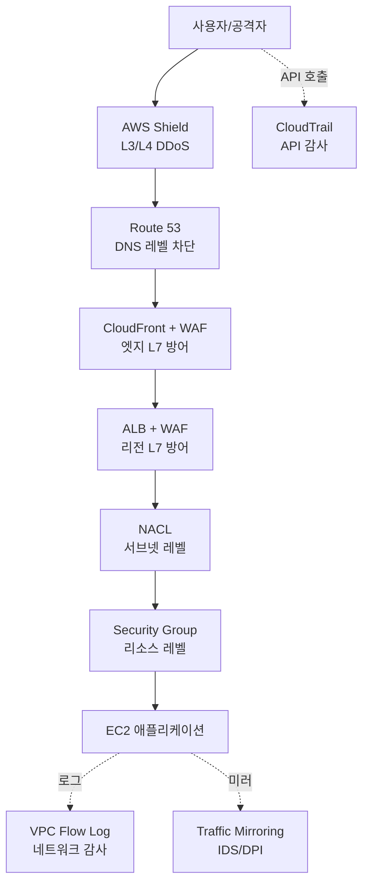

### CHAPTER 7 네트워크 보안

6장까지가 **네트워크를 어떻게 연결하는가**였다면, 7장은 **그 네트워크를 어떻게 지키는가**. **방화벽(SG/NACL)**, **가시성(Flow Log, Traffic Mirroring)**, **애플리케이션 레이어 방어(WAF)**, **감사(CloudTrail)** — 네 축으로 정리.

#### 목차

- [1부. Security Group과 Network ACL (심화)](#1부-security-group과-network-acl-심화)
- [2부. VPC Flow Log](#2부-vpc-flow-log)
- [3부. VPC Traffic Mirroring](#3부-vpc-traffic-mirroring)
- [4부. AWS WAF](#4부-aws-waf)
- [5부. CloudTrail](#5부-cloudtrail)
- [6부. 보안 레이어 종합 아키텍처](#6부-보안-레이어-종합-아키텍처)

---

## 1부. Security Group과 Network ACL (심화)

> 기본 개념은 [Chapter 2 - 6부](../chapter02/README.md#6부-보안그룹과-네트워크-acl)에서 다룸. 여기서는 **실무 패턴, 함정, 보안 설계 원칙**에 집중.

### 다시 짚는 핵심

| 축 | SG | NACL |
|---|---|---|
| **적용 지점** | ENI (리소스별) | 서브넷 |
| **상태** | Stateful | Stateless |
| **룰 종류** | Allow만 | Allow + Deny |
| **룰 평가** | 모든 룰 종합 | 번호 순, 첫 매칭 |
| **상호 참조** | SG ID 가능 | CIDR만 |

### SG 설계 원칙 — 체인 패턴

**Bad ❌** — CIDR 하드코딩:
```
App SG: Inbound TCP 8080 from 10.0.1.0/24  (ALB 서브넷 CIDR)
```
- ALB를 다른 서브넷으로 옮기면 **룰 수정 필요**
- 서브넷 CIDR이 바뀌면 매번 추적

**Good ✅** — SG 체인:
```
ALB SG (sg-alb): Inbound TCP 443 from 0.0.0.0/0
App SG (sg-app): Inbound TCP 8080 from sg-alb
DB SG  (sg-db):  Inbound TCP 3306 from sg-app
```
- CIDR 변경 영향 받지 않음
- **의도가 명시적** — "ALB에서만 App 접근, App에서만 DB 접근"
- SG는 **리소스 역할의 추상화**

### SG 함정 모음

1. **아웃바운드 기본값은 All Allow** — EC2가 외부로 뭐든 보낼 수 있음. 보안 민감 환경은 **아웃바운드도 제한**
2. **룰 수 한계** — SG당 Inbound/Outbound **60개씩**(기본), 쿼터 상향 가능
3. **ENI당 SG 최대 5개** (쿼터 상향 가능)
4. **SG는 리전 종속** — 다른 리전에서 그대로 재사용 불가
5. **SG 삭제 전 해제** — 다른 SG가 참조 중이면 삭제 불가 → 참조 끊고 삭제

### NACL 함정 모음

1. **Stateless** — 응답 트래픽도 **ephemeral port(1024-65535) Inbound Allow** 필요
2. **룰 번호 순서** — 100, 110, 120으로 **간격 두고** 작성 (중간 삽입 여유)
3. **Deny 룰 활용** — 특정 IP/CIDR 블랙리스트는 **NACL이 유일**한 수단 (SG는 Allow만)
4. **서브넷당 NACL 1개** — 복잡한 룰 많으면 NACL이 비대해짐 → 가능한 SG 중심

### 보안 설계 원칙 — 최소 권한 (Least Privilege)

1. **포트/CIDR 최대한 좁게**
2. **"0.0.0.0/0 + ALL"은 비상용** — Prod에서 발견 즉시 조사
3. **역할 분리** — ALB/App/DB 각각 다른 SG
4. **공용 SG 금지** — "default" SG는 사용 X, 모든 리소스에 전용 SG 할당
5. **IaC로 관리** — Terraform/CloudFormation으로 SG 변경 이력 추적

### SG vs NACL 중복 설계 금지

- **"SG에서도 막고 NACL에서도 막는다"** 식은 운영 피로 증가
- 원칙: **SG가 1차 방어선**, **NACL은 특수 요구만** (블랙리스트, 서브넷 단위 완전 차단)

---

## 2부. VPC Flow Log

### 개념

> VPC/서브넷/ENI를 **지나가는 IP 트래픽 메타데이터**를 캡처해 CloudWatch Logs/S3/Kinesis에 저장. **네트워크 디버깅과 보안 분석의 기본 도구**.

**중요**: Flow Log는 **패킷 내용(payload)은 저장하지 않음**. "누가 누구에게 몇 바이트 보냈고, Accept/Reject였는지"만 기록. 패킷 내용이 필요하면 **Traffic Mirroring**(3부).

### 활성화 수준

| 수준 | 적용 범위 | 사용처 |
|---|---|---|
| **VPC** | VPC 안의 **모든 ENI** | 전체 가시성 |
| **Subnet** | 특정 서브넷의 ENI만 | 서브넷 단위 분석 |
| **ENI** | 특정 리소스만 | 디버깅/보안 포커스 |

### Flow Log 레코드 포맷 (기본 v2)

```
<version> <account-id> <interface-id> <srcaddr> <dstaddr> <srcport>
<dstport> <protocol> <packets> <bytes> <start> <end> <action> <log-status>
```

**예시**:
```
2 123456789012 eni-abc123 10.0.11.5 198.51.100.5 50001 443
6 10 840 1696500000 1696500010 ACCEPT OK
```

| 필드 | 값 | 의미 |
|---|---|---|
| version | 2 | 레코드 버전 |
| account-id | 123456789012 | AWS 계정 |
| interface-id | eni-abc123 | ENI ID |
| srcaddr | 10.0.11.5 | 출발지 IP |
| dstaddr | 198.51.100.5 | 목적지 IP |
| srcport | 50001 | 출발지 포트 |
| dstport | 443 | 목적지 포트 |
| protocol | 6 | TCP (6), UDP(17), ICMP(1) |
| packets | 10 | 패킷 수 |
| bytes | 840 | 총 바이트 |
| start/end | timestamp | 시작/종료 (Unix) |
| action | ACCEPT | ACCEPT 또는 **REJECT** |
| log-status | OK | OK/NODATA/SKIPDATA |

### 커스텀 포맷 (v3+)

추가 필드 선택 가능:
- `vpc-id`, `subnet-id`, `instance-id`
- `pkt-srcaddr`, `pkt-dstaddr` — **NAT 처리 전 원본 IP** (NAT 흐름 추적에 중요)
- `tcp-flags`, `type`, `region`, `az-id`
- `flow-direction` (ingress/egress)
- `traffic-path` (how traffic reached destination)

### 저장 대상

| 대상 | 특징 |
|---|---|
| **CloudWatch Logs** | 즉시 분석, 비용 비쌈, 쿼리는 CloudWatch Insights |
| **S3** | 저렴, 장기 보관, **Athena로 쿼리** |
| **Kinesis Firehose** | 실시간 스트림 → 다른 SIEM/분석 도구로 |

### 디버깅 활용

**케이스 1. "EC2가 외부 API에 접근이 안 됨"**:
```
Flow Log 쿼리:
dstaddr = api.external.com의 IP
action = REJECT 있는지?
```
- REJECT 있음 → **SG/NACL 룰 미비**
- REJECT 없음 → **라우팅 테이블/NAT 문제**

**케이스 2. "밤새 수상한 외부 통신 발견"**:
- action=ACCEPT, dstport가 비정상 포트
- dstaddr가 알려진 악성 IP 범위
- → **침해사고 조사의 결정적 증거**

### CloudWatch Insights 쿼리 예시

```sql
-- 거부된 트래픽 Top IP
filter action = "REJECT"
| stats count(*) as reject_count by srcaddr
| sort reject_count desc
| limit 20

-- 특정 EC2의 아웃바운드 트래픽
filter interface-id = "eni-abc123" and flow-direction = "egress"
| stats sum(bytes) as total_bytes by dstaddr
| sort total_bytes desc
```

### Athena 쿼리 (S3 저장 시)

```sql
SELECT srcaddr, dstaddr, SUM(bytes) AS total_bytes
FROM vpc_flow_logs
WHERE action = 'REJECT'
  AND start >= timestamp '2026-10-10 00:00:00'
GROUP BY srcaddr, dstaddr
ORDER BY total_bytes DESC
LIMIT 100;
```

### Flow Log의 한계

- **패킷 내용(payload) 없음** — URL/헤더/HTTP body 알 수 없음
- **집계 간격** — 기본 10분 집계(S3), 1분(CloudWatch) — 실시간 아님
- **일부 트래픽 미캡처** — Amazon DNS 서버(VPC+2) 트래픽, DHCP, 메타데이터 서비스
- **비용** — 데이터 수집 요금 ($0.50/GB CW, 저장비 별도)

### 활성화 베스트 프랙티스

1. **Prod VPC는 전부 활성화** — 침해사고 조사의 유일한 증거
2. **S3 저장 + Athena** — 비용 효율적, 장기 보관
3. **커스텀 포맷**으로 `pkt-srcaddr`, `instance-id`, `flow-direction` 포함
4. **집계 간격 1분**(CloudWatch) — 민감한 환경
5. **SIEM 연동** — Splunk, Datadog, Elastic 등으로 Kinesis Firehose 통해

---

## 3부. VPC Traffic Mirroring

### 개념

> **ENI의 네트워크 트래픽을 복제(mirror)** 해서 **분석 도구/보안 어플라이언스**에 전달. Flow Log가 **메타데이터**라면, Mirroring은 **패킷 자체 전부**(payload 포함) 복사.

**온프레미스 네트워크의 SPAN(Switched Port Analyzer) 포트** 또는 TAP과 동일 개념의 클라우드 버전.

### 아키텍처

```
[Source ENI (대상 EC2)]
   ↓ 패킷 발생
   ↓ 복제
[Mirror Session]
   ↓ VXLAN 캡슐화
[Mirror Target (NLB, ENI, GWLB)]
   ↓
분석 도구 (IDS/IPS, DPI, 포렌식)
```

### 핵심 구성 요소

| 요소 | 설명 |
|---|---|
| **Mirror Source** | 복제 대상 ENI (EC2, 특정 네트워크 인터페이스) |
| **Mirror Target** | 복제본 수신 (ENI, NLB, GWLB) |
| **Mirror Filter** | 복제할 트래픽 필터 (프로토콜/포트/CIDR) |
| **Mirror Session** | 위 셋을 묶어 활성화 |

### 캡슐화

- **VXLAN(UDP 4789)**으로 캡슐화해 Target에 전달
- 분석 도구는 VXLAN을 **디캡슐**해서 원본 패킷 읽음 (Suricata, Zeek, Wireshark 등 지원)

### 사용 사례

1. **IDS/IPS 운영** — Suricata, Snort 등으로 실시간 침입 탐지
2. **DPI (Deep Packet Inspection)** — 애플리케이션 레이어 분석
3. **포렌식 조사** — 침해사고 시 전체 패킷 캡처 보관
4. **애플리케이션 성능 분석** — HTTP/TCP 레이어 성능 지표
5. **컴플라이언스** — 트래픽 전체 저장 요구 (금융/공공)

### Flow Log vs Traffic Mirroring

| 항목 | Flow Log | Traffic Mirroring |
|---|---|---|
| **캡처 대상** | 메타데이터만 | **패킷 전체 (payload 포함)** |
| **용도** | 디버깅, 감사, 통계 | **IDS/IPS, 포렌식, DPI** |
| **저장량** | 작음 | **매우 큼** (실제 트래픽 복제) |
| **지연 영향** | 없음 | 거의 없음 (별도 복제 경로) |
| **비용** | 저렴 | **비쌈** (ENI 처리 + 저장) |
| **분석 도구** | CloudWatch, Athena | Suricata, Zeek, Wireshark |

### 제약 사항

- Nitro 기반 EC2(C5, M5 이후)만 Source 가능
- Source에서 발생한 트래픽만 복제 (ENI를 통과하는 모든 패킷)
- **AWS 서비스 간 트래픽은 미러링 불가** (예: EC2 → S3는 Hyperplane 경유라 ENI 밖)
- Target과 Source는 **같은 리전** (Peering으로 연결하면 다른 VPC도 가능)

### 비용 요약

- Mirror Session 활성 시간당 요금
- 미러링 트래픽에 따른 데이터 처리 요금
- Target 저장소(NLB/EC2) 비용 별도

→ **상시 켜두기엔 비싸다**. 보통 **IDS 운영 또는 사고 조사 시** 선택적으로 활성화.

---

## 4부. AWS WAF

### 개념

> **Web Application Firewall**. L7(HTTP/HTTPS) 레벨에서 **악성 요청을 차단**하는 매니지드 방화벽. **SQL Injection, XSS, Bot, DDoS(L7)** 등 애플리케이션 레이어 공격 방어.

**적용 지점**:
- **CloudFront** (글로벌 엣지)
- **ALB** (리전)
- **API Gateway**
- **AppSync**
- **Cognito User Pool**

→ 적용 지점이 WAF의 "앞단"으로 가므로 **엣지 적용(CloudFront)이 가장 빠름**.

### WAF 구성 요소

| 요소 | 설명 |
|---|---|
| **Web ACL** | 룰 집합. 하나의 WAF 적용 단위 |
| **Rule** | 조건 + 액션 (Allow/Block/Count/CAPTCHA/Challenge) |
| **Rule Group** | 룰 묶음. 재사용/관리형 룰 그룹 |
| **IP Set** | IP CIDR 목록 (whitelist/blacklist) |
| **Regex Pattern Set** | 정규식 패턴 집합 |

### 룰 유형

1. **Managed Rules (관리형)** — AWS 또는 Marketplace가 제공
   - **AWS Managed Rules Common Rule Set** — OWASP Top 10 커버
   - **Known Bad Inputs** — 알려진 공격 패턴
   - **SQL Database** — SQLi 방어
   - **Linux/Windows/PHP OS** — OS 공격 패턴
   - **Admin Protection** — 관리자 경로 보호
   - **Bot Control** — 봇 트래픽 식별/차단 (추가 요금)
   - **Account Takeover Prevention (ATP)** — 로그인 공격 방어

2. **Rate-based Rule** — 특정 IP가 **5분당 N회 초과** 요청 시 차단 (DDoS 완화)
3. **Custom Rule** — 사용자 정의 조건
   - URI 경로 매칭
   - HTTP 헤더/쿠키 값
   - Body 크기/내용
   - 지리 (국가 코드)
   - IP Set 매칭

### 룰 액션

| 액션 | 설명 |
|---|---|
| **Allow** | 통과 |
| **Block** | 차단 (403 반환, 또는 커스텀 응답) |
| **Count** | 로그만, 차단하지 않음 — **테스트 모드** |
| **CAPTCHA** | 사람 확인 필요 |
| **Challenge** | JavaScript 챌린지 (봇 필터) |

### 룰 평가 순서

1. **우선순위 숫자 낮은 룰부터** 평가
2. **첫 매칭된 Terminating 액션**(Allow/Block/CAPTCHA/Challenge)에서 종료
3. Count는 매칭돼도 **다음 룰 계속 평가**

### WAF 사용 패턴

**패턴 1. 기본 보안 (최소 설정)**:
- AWS Managed Rules **Common Rule Set**
- **Known Bad Inputs**
- **IP Reputation List** (알려진 악성 IP)

**패턴 2. API 보호**:
- 위 + **SQL Database** (SQLi)
- + Rate-based Rule (**IP당 분당 1000 요청 초과 차단**)
- + 지리 차단 (서비스 미지원 국가 Block)

**패턴 3. 로그인 보호**:
- 위 + **Account Takeover Prevention (ATP)**
- + Rate-based Rule (로그인 엔드포인트에 **IP당 분당 10회**)
- + CAPTCHA 액션 (의심 요청)

**패턴 4. 봇 방어**:
- Bot Control 관리형 그룹 (유료)
- Challenge 액션으로 봇 필터
- 알려진 Good Bot (Googlebot)은 Allow

### 로깅

- **Kinesis Data Firehose → S3 / Elasticsearch**
- 모든 매칭 룰과 액션 기록
- 분석 도구와 통합 (SIEM, Splunk)

### WAF vs Shield

| 서비스 | 역할 | 레이어 |
|---|---|---|
| **AWS Shield Standard** | **DDoS 기본 방어** (L3/L4), **무료**, 자동 적용 | L3/L4 |
| **AWS Shield Advanced** | 고급 DDoS 방어, 24/7 DRT 지원, L7 방어, **월 $3,000** | L3/L4/L7 |
| **AWS WAF** | L7 애플리케이션 공격 방어 | L7 |

→ **DDoS는 Shield(L3/L4)가 1차**, **애플리케이션 공격은 WAF(L7)가 1차**. **둘 다 조합**이 표준.

### WAF 비용 구조

- **Web ACL**: 월 $5
- **Rule**: Web ACL당 **룰당 월 $1**
- **요청 처리**: **$0.60 / 100만 요청**
- **Managed Rule Group**: 월 $10~ (서비스별)
- Bot Control: 월 $10 + **100만 요청당 $1**

---

## 5부. CloudTrail

### 개념

> **AWS 계정의 모든 API 호출을 기록**하는 감사(Audit) 서비스. "누가 언제 어떤 리소스를 어떻게 조작했는가"를 추적.

**중요**: Flow Log/WAF가 **네트워크 트래픽** 감사라면, CloudTrail은 **AWS API(Control Plane) 감사**. 둘은 완전 다른 레이어.

### 기록하는 것

- **AWS Management Console** 사용 (로그인, 리소스 생성/삭제 등)
- **AWS CLI / SDK API** 호출
- **다른 AWS 서비스**가 자동으로 호출한 API
- **IAM 자격증명** 사용 내역

### 이벤트 유형

| 유형 | 설명 | 예 |
|---|---|---|
| **Management Events** | 리소스 조작 API | `RunInstances`, `CreateBucket`, `AssumeRole` |
| **Data Events** | **데이터 레벨** 조작 (대량) | `s3:GetObject`, `lambda:Invoke` |
| **Insights Events** | 비정상 API 호출 패턴 탐지 | 평소보다 10배 많은 `IamUserCreate` 등 |

**Data Events는 기본 비활성** — 양이 많고 비용 발생.

### Trail (추적)

- **Trail** = CloudTrail 로그를 **S3에 영구 저장**하도록 설정
- **Organizations 전체 Trail**로 전 계정 로그를 하나의 S3로 모을 수 있음
- 기본 **90일 Event History**는 콘솔에서 조회 가능 (Trail 없이도)
- 90일 이후 또는 통합 분석/감사를 위해 **Trail 생성 필수**

### 로그 레코드 예시

```json
{
  "eventTime": "2026-10-10T15:23:45Z",
  "eventName": "RunInstances",
  "eventSource": "ec2.amazonaws.com",
  "userIdentity": {
    "type": "IAMUser",
    "userName": "shyoon",
    "accountId": "123456789012"
  },
  "sourceIPAddress": "203.0.113.5",
  "userAgent": "aws-cli/2.17.0",
  "requestParameters": {
    "instanceType": "t3.medium",
    "imageId": "ami-0xxx"
  },
  "responseElements": {
    "instancesSet": {
      "items": [{ "instanceId": "i-0abc..." }]
    }
  }
}
```

→ **누가(userIdentity), 언제(eventTime), 어디서(sourceIPAddress), 무엇을(eventName), 어떻게(requestParameters)** 모두 기록.

### CloudTrail 활용

1. **보안 사고 조사** — 침해 후 "공격자가 어떤 리소스를 건드렸는가"
2. **컴플라이언스** — SOC2, ISO 27001, PCI-DSS 등 감사 로그 요구사항
3. **운영 디버깅** — "왜 Prod EC2가 사라졌지?" → 삭제한 사용자/역할 추적
4. **IAM 최적화** — Access Analyzer로 **쓰지 않는 권한 식별**
5. **알림** — EventBridge + CloudWatch로 **민감 이벤트 즉시 알림** (Root 로그인, SG 변경 등)

### CloudTrail Insights

- **비정상 API 호출 패턴 자동 탐지** (ML 기반)
- 예: `AssumeRole` 호출이 평소 대비 급증 → 자격증명 탈취 가능성
- 추가 비용

### 보안 민감 이벤트 알림 예시 (EventBridge)

```json
{
  "source": ["aws.signin"],
  "detail-type": ["AWS Console Sign In via CloudTrail"],
  "detail": {
    "userIdentity": { "type": ["Root"] }
  }
}
```
→ Root 계정 콘솔 로그인 시 **즉시 Slack/SNS 알림**.

### CloudTrail vs CloudWatch vs Flow Log

| 서비스 | 기록 대상 | 레이어 |
|---|---|---|
| **CloudTrail** | AWS **API 호출** (Control Plane) | 관리 |
| **CloudWatch Logs** | 애플리케이션/서비스 **로그** | 애플리케이션 |
| **CloudWatch Metrics** | 리소스 **지표** (CPU, 네트워크 등) | 메트릭 |
| **VPC Flow Log** | **네트워크 트래픽** 메타데이터 | 네트워크 |

→ **다른 레이어의 다른 질문에 답하는 도구들**. 모두 조합이 필요.

### CloudTrail 비용

- **Management Events** — 모든 계정 **기본 무료** (90일 Event History)
- **Trail 1개** — 모든 Management Events 추적 **무료** (추가 Trail은 유료)
- **Data Events** — **100,000 이벤트당 $0.10**
- **Insights** — **100,000 이벤트당 $0.35**
- **S3 저장비** 별도

---

## 6부. 보안 레이어 종합 아키텍처

### 통합 보안 스택



### 레이어별 역할

| 레이어 | 서비스 | 방어 대상 |
|---|---|---|
| **L3/L4 DDoS** | Shield Standard (무료) / Advanced | SYN Flood, UDP Flood |
| **L7 애플리케이션 공격** | WAF | SQLi, XSS, 봇, L7 DDoS |
| **네트워크 (리소스)** | Security Group | 포트/소스 기반 |
| **네트워크 (서브넷)** | NACL | 블랙리스트, 서브넷 격리 |
| **네트워크 가시성** | VPC Flow Log | 트래픽 메타데이터 감사 |
| **침입 탐지** | Traffic Mirroring + IDS | 실시간 공격 탐지 |
| **API 감사** | CloudTrail | 누가 뭘 조작했나 |

### 실무 체크리스트

**최소 (Must)**:
- [ ] 모든 리소스에 **역할별 SG** 할당 (default SG 사용 금지)
- [ ] **ALB/CloudFront에 WAF Managed Rules** (Common + Known Bad + IP Rep)
- [ ] **CloudTrail Trail → S3**, Organizations 통합
- [ ] **VPC Flow Log → S3** 활성화
- [ ] **Root 계정 로그인 알림** (EventBridge)
- [ ] **Shield Standard**는 기본 활성 (별도 설정 불필요)

**권장 (Should)**:
- [ ] WAF **Rate-based Rule** (DDoS 완화)
- [ ] **Guard​Duty** 활성화 (ML 기반 침입 탐지)
- [ ] **Security Hub** 활성화 (보안 상태 통합 대시보드)
- [ ] **Config** 활성화 (리소스 설정 변경 추적)
- [ ] CloudTrail Insights
- [ ] 민감 리소스 **Traffic Mirroring**

**고급 (Enterprise)**:
- [ ] **Network Firewall** (서브넷 레벨 L7 방화벽)
- [ ] **Shield Advanced** (금융/대형 서비스)
- [ ] **WAF Bot Control / ATP**
- [ ] SIEM 통합 (Splunk, Datadog, Elastic)
- [ ] IDS/IPS 운영 (Mirroring + Suricata)

### 사고 조사 플레이북

**침해 의심 상황**:

1. **CloudTrail** — 공격자가 사용한 자격증명, 조작한 리소스 확인
2. **VPC Flow Log** — 공격자 IP의 네트워크 트래픽 추적
3. **Traffic Mirroring (있다면)** — 패킷 레벨 분석
4. **WAF Logs** — L7 공격 패턴 확인
5. **GuardDuty Findings** — 자동 탐지된 이상행위
6. **S3 액세스 로그, ALB 액세스 로그** — 애플리케이션 레벨 흔적

→ **단일 도구로는 불충분**. 여러 레이어 로그를 **상관분석**해야 전체 그림이 보임.

---

### 요약

- **SG(Stateful, Allow만, 리소스별) + NACL(Stateless, Allow/Deny, 서브넷별)** — SG 체인이 실무 핵심
- **VPC Flow Log**: 트래픽 **메타데이터** 캡처. S3+Athena 조합이 비용 효율적. **패킷 내용은 없음**
- **Traffic Mirroring**: **패킷 전체 복제** → IDS/IPS/포렌식. 비싸므로 선택적 사용
- **AWS WAF**: L7 애플리케이션 방어. **Managed Rules** 기본 + Rate-based + Custom. CloudFront/ALB/API GW에 적용
- **CloudTrail**: AWS **API 호출 감사**. 모든 계정 기본 90일 Event History, Trail로 S3 영구 보관
- **보안은 레이어 조합**: Shield(L3/L4) + WAF(L7) + SG/NACL(네트워크) + Flow Log(가시성) + CloudTrail(API 감사) + GuardDuty(탐지)

> **이전 책 참고**: [업무에 바로 쓰는 AWS 입문 — Chapter 2 IAM](../../aws-practical-intro/chapter02/README.md) / [Chapter 6 CloudWatch](../../aws-practical-intro/chapter06/README.md) / [Chapter 8 CloudFront](../../aws-practical-intro/chapter08/README.md)
