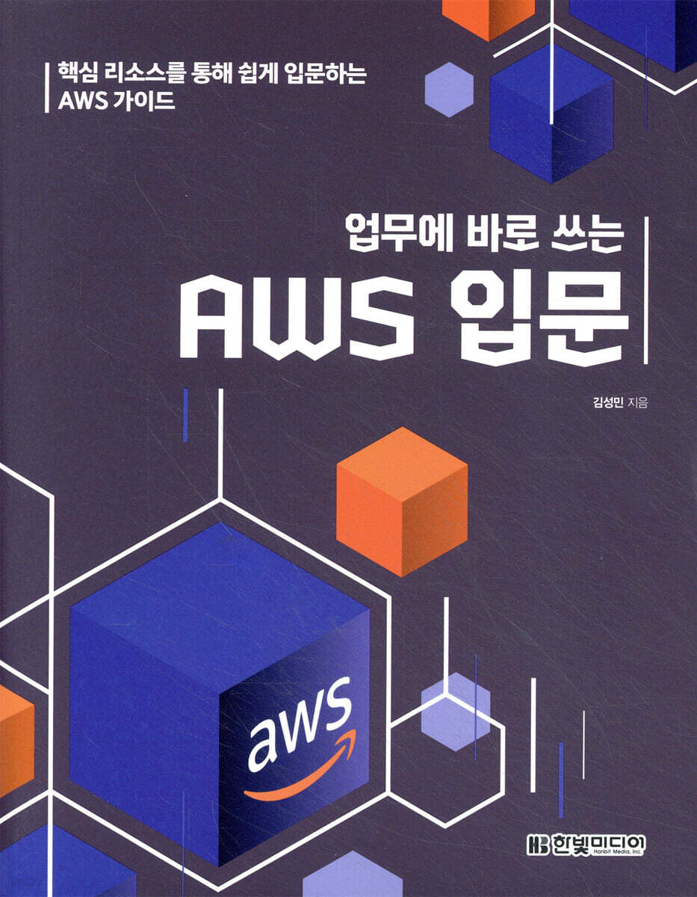

### 업무에 바로 쓰는 AWS 입문

※ 이미지 출처: 교보문고

#### 정보

- 제목: 업무에 바로 쓰는 AWS 입문
- 저자: 김성민
- 교보문고: `https://product.kyobobook.co.kr/detail/S000200581072`
- 시작: 2026-10-09
- 완독: 2026-10-09

#### 목차

- ✅ 1장. AWS 개요
- ✅ [2장. IAM](chapter02/README.md)
- ✅ [3장. EC2](chapter03/README.md)
- ✅ [4장. RDS](chapter04/README.md)
- ✅ [5장. S3](chapter05/README.md)
- ✅ [6장. CloudWatch](chapter06/README.md)
- ✅ [7장. Lambda](chapter07/README.md)
- ✅ [8장. CloudFront](chapter08/README.md)
- ✅ [9장. DynamoDB](chapter09/README.md)
- ✅ [10장. API Gateway](chapter10/README.md)
- ✅ [11장. CI/CD 파이프라인](chapter11/README.md)
- ✅ 12장. 마치며
