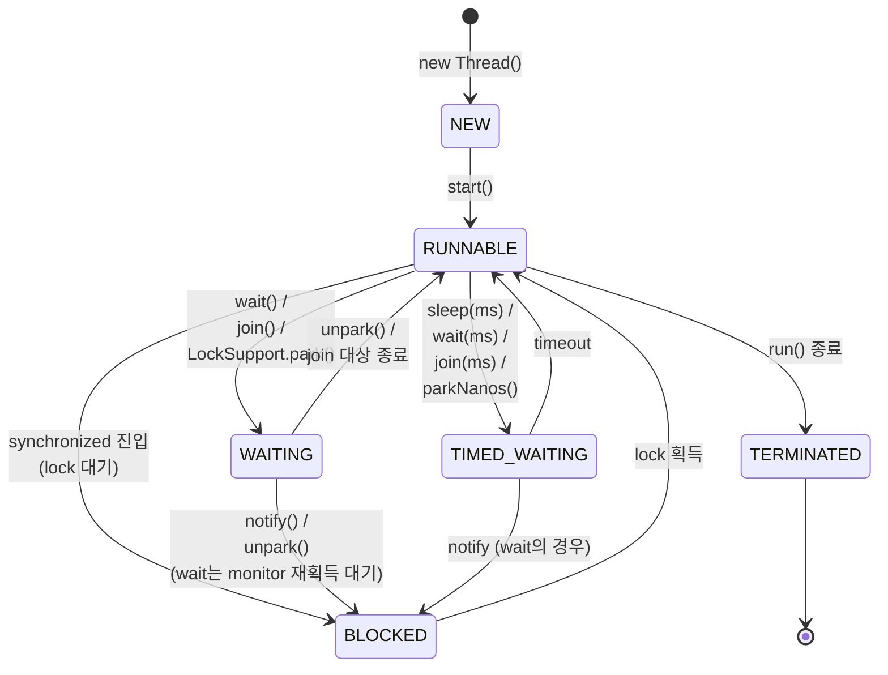

### Story 08. synchronized는 제대로 알고 써야 한다.

## 1부. Thread 상태 전이 — 다이어그램과 메커니즘

#### `Thread.State` enum — 6가지 상태

| 상태 | 의미 |
|------|------|
| `NEW` | 생성 직후, `start()` 전 |
| `RUNNABLE` | `start()` 호출됨. 실행 중이거나 OS 스케줄러 대기 중 (둘 구분 X) |
| `BLOCKED` | **monitor 락 대기** (`synchronized` 블록 진입 전) |
| `WAITING` | **무한 대기** — `wait()`, `join()`, `LockSupport.park()` |
| `TIMED_WAITING` | **시간 제한 대기** — `sleep(ms)`, `wait(ms)`, `join(ms)`, `parkNanos()` |
| `TERMINATED` | `run()` 종료 또는 uncaught exception |

주의: Java의 `RUNNABLE`은 OS 레벨의 "Running"과 "Ready"를 **구분하지 않음**. 실제 CPU 점유 중인지 여부를 Java API로는 알 수 없음.

#### 상태 전이 다이어그램



**verified** (JDK 21 로컬 실행):
```
Before start:         NEW
While sleeping:       TIMED_WAITING
After join:           TERMINATED
```

#### 주요 전이 메서드 요약

| 메서드 | 전이 | 모니터 락 | 특이사항 |
|--------|------|---------|---------|
| `start()` | NEW → RUNNABLE | — | **새 OS 스레드 생성** (platform thread) |
| `run()` 직접 호출 | 전이 없음 | — | 그냥 메서드 호출. 스레드 안 뜸 (⚠️ 안티패턴) |
| `sleep(ms)` | RUNNABLE → TIMED_WAITING | **유지** | CPU 양보, **락은 그대로 보유** |
| `yield()` | 전이 없음 (hint) | 유지 | 스케줄러에게 "양보해도 됨" 힌트. 보장 X |
| `wait()` | RUNNABLE → WAITING | **해제** | monitor 안에서만 호출 가능. **락 release** |
| `wait(ms)` | RUNNABLE → TIMED_WAITING | 해제 | |
| `notify()` | 전이 없음 (대기 중인 **1개** 깨움) | 유지 | monitor 안에서만 |
| `notifyAll()` | 대기 중 전부 BLOCKED로 | 유지 | |
| `join()` | RUNNABLE → WAITING | 유지 | 대상 스레드 종료까지 |
| `interrupt()` | **전이 없음, flag만 set** | — | ⭐ 아래 2부 상세 |

---

## 2부. join, wait, notify, interrupt 상세

#### `join()` — "너 끝날 때까지 기다릴게"

```java
Thread worker = new Thread(() -> doHeavyWork());
worker.start();
worker.join();   // 호출한 스레드가 WAITING 상태로 대기, worker 끝나면 깨어남
```

- 내부 구현: `isAlive()` 체크 + `wait()`. worker가 종료되면 JVM이 worker 객체에 대해 `notifyAll()` 호출.
- `join(ms)` — timeout 지정 가능.
- InterruptedException throw 가능.

#### `wait()` / `notify()` / `notifyAll()` — 조건 변수 패턴

**규칙**:
- 반드시 **`synchronized` 블록 안**에서 호출 (안 그러면 `IllegalMonitorStateException`).
- `wait()`는 모니터 락을 **release하고** 대기 → 다른 스레드가 그 모니터에 들어와서 `notify()` 가능.
- 깨어난 뒤엔 **다시 모니터 락 획득 대기** (`BLOCKED`) → 획득 후 `RUNNABLE`.

**표준 패턴**:
```java
synchronized (lock) {
    while (!condition) {    // ← while로 체크. if 쓰면 spurious wakeup에 버그
        lock.wait();
    }
    // condition 성립. 작업 수행
}

// 반대편
synchronized (lock) {
    condition = true;
    lock.notifyAll();      // 또는 notify()
}
```

**왜 while, if 아님?**: spurious wakeup — `notify()` 안 불렀는데 깨어날 수 있음 (JVM/OS 레벨 noise). 조건 재확인 필수.

#### `sleep()` vs `wait()` 핵심 차이

| 항목 | `Thread.sleep(ms)` | `obj.wait()` |
|------|-------------------|--------------|
| 호출 위치 | 아무 데서나 | **synchronized 안에서만** |
| 모니터 락 | **유지** | **해제** |
| 깨어나는 방법 | timeout 또는 interrupt | notify / timeout / interrupt |
| 전이 | TIMED_WAITING | WAITING (timeout 있으면 TIMED_WAITING) |

실무 함정: `sleep()`은 락을 **놓지 않음**. synchronized 안에서 `sleep()` 걸면 **다른 스레드 전부 BLOCKED**로 몰림. 디버깅 시 꽤 흔한 삽질.

#### `LockSupport.park()` / `unpark()` — 저수준 primitive

- `wait/notify`보다 간단한 blocking primitive. `synchronized` 불필요.
- `ReentrantLock`, `CountDownLatch` 등 `java.util.concurrent` 전체가 내부적으로 이걸 씀.
- `unpark()`는 **먼저 호출돼도 상관없음** — "permit" 개념이라 다음 park()가 즉시 통과.
- `wait/notify`의 "notify가 wait 전에 가면 영원히 대기" 문제 해결.

#### ⭐ `interrupt()` — 가장 많이 오해받는 메서드

**핵심 사실**: `interrupt()`는 **단지 interrupt flag를 true로 설정**할 뿐. 스레드를 멈추지 **않음**.

**효과가 즉시 나타나는 경우** — 스레드가 **blocking state**일 때:
- `sleep()`, `wait()`, `join()`, `LockSupport.park()` 중이면 → `InterruptedException` 던지고 깨어남
- `InterruptibleChannel.read/write()` 중이면 → `ClosedByInterruptException`
- `Selector.select()` 중이면 → 즉시 리턴

**효과 없음** — 다음 상황:
- **CPU-busy loop** (`while (true) { calc(); }`)
- **일반 blocking I/O** (`InputStream.read()`, `Socket.read()`) — 구식 I/O는 interrupt 못 받음!
- **synchronized 블록 진입 대기 (BLOCKED)** — ⚠️ interrupt로 못 깨움

**verified** (JDK 21):
```java
Thread t = Thread.ofPlatform().start(() -> {
    long count = 0;
    while (!Thread.currentThread().isInterrupted()) {
        count++;
    }
});
Thread.sleep(100);
t.interrupt();
// 결과: count=151,547,505 돌고 나서야 종료
// (100ms 동안 1.5억 번 iteration 후, 다음 체크에서 종료)
```

→ CPU 돌리는 중엔 **스스로 `isInterrupted()` 체크 안 하면 영원히 안 멈춤**.

**올바른 interrupt 처리 패턴**:

```java
// ❌ Bad — flag만 보고 안 종료
Thread t = new Thread(() -> {
    while (true) { doWork(); }
});
t.interrupt();   // 아무 효과 없음

// ✅ Good — flag 체크
Thread t = new Thread(() -> {
    while (!Thread.currentThread().isInterrupted()) {
        doWork();
    }
});

// ✅ Good — InterruptedException 복원
try {
    Thread.sleep(1000);
} catch (InterruptedException e) {
    // sleep은 catch 시 flag를 clear해버림. 복원 필수.
    Thread.currentThread().interrupt();
    // 그래서 상위 코드도 interrupt를 인식 가능
}

// ✅ Good — IO interrupt
try (SocketChannel ch = SocketChannel.open(...)) {
    ch.read(buf);   // InterruptibleChannel → interrupt에 반응
}
```

**정적 메서드 2가지 혼동 주의**:
```java
Thread.currentThread().isInterrupted()  // 상태만 조회
Thread.interrupted()                    // 조회 + flag clear (static!)
```

`Thread.interrupted()`는 호출 후 flag가 **false로 돌아감**. 쓸 때 주의.

---

## 3부. `synchronized` 내부 동작 — 모니터와 상호 배제

#### 모든 Java 객체는 모니터를 가진다

**책의 "자바 객체는 각자의 monitor를 가지고 있다, synchronized는 monitor를 활성화한다"의 실체**:

- Java에서 **모든 객체(`Object` 포함)는 암묵적으로 monitor를 하나씩 가짐** — 이건 **개념적**인 보유. 모든 객체 메모리에 monitor 구조가 미리 할당된 건 아님.
- HotSpot JVM은 효율을 위해 **필요할 때만 실제 monitor 구조(`ObjectMonitor`)를 할당** (lazy inflation).
- `synchronized`는 그 객체의 monitor를 **"활성화(inflate)" + 획득** → "**상호 배제(mutual exclusion)**" 영역 진입.

**객체마다 다른 monitor**를 가진다는 것의 코드 레벨 의미:

```java
Object lockA = new Object();
Object lockB = new Object();

Thread t1 = new Thread(() -> {
    synchronized (lockA) { heavyWork(); }   // lockA의 monitor
});
Thread t2 = new Thread(() -> {
    synchronized (lockB) { heavyWork(); }   // lockB의 monitor — 다른 lock!
});
```
→ `t1`과 `t2`는 **서로 다른 monitor**를 획득 → **동시 실행 가능**. "synchronized만 썼으니 안전하겠지"는 틀림. **어느 객체의 monitor인지**가 결정적.

**같은 monitor로 보호해야 하는 경우**:
```java
Object sharedLock = new Object();

Thread t1 = new Thread(() -> { synchronized (sharedLock) { updateX(); } });
Thread t2 = new Thread(() -> { synchronized (sharedLock) { updateX(); } });
// ✅ 같은 객체(sharedLock)의 monitor → 상호 배제
```

#### Monitor 내부 구조 — HotSpot `ObjectMonitor`

```
┌─────────── Java Object ──────────┐
│ Mark Word (8 bytes) ← lock 상태 │
│ Klass pointer                     │
│ ... instance fields ...           │
└───────────────────────────────────┘
             ↓ (inflated 상태일 때)
    ┌──── ObjectMonitor ────┐
    │ _owner: Thread*       │ ← 현재 lock 보유 스레드
    │ _recursions: int      │ ← 재귀 획득 횟수
    │ _EntryList: Queue     │ ← lock 대기 (BLOCKED)
    │ _WaitSet: Queue       │ ← wait() 중 (WAITING)
    │ _cxq: Queue           │ ← 새로 들어오는 contention
    └───────────────────────┘
```

**각 필드의 역할**:
- `_owner`: 현재 critical section에 들어와 있는 스레드. **단 하나만 존재** → 이게 상호 배제의 핵심.
- `_recursions`: 같은 스레드가 중첩 `synchronized`로 재귀 획득한 횟수. Java는 **reentrant lock** (같은 스레드는 자기 lock을 다시 획득 가능).
- `_EntryList` / `_cxq`: lock 획득 대기 큐. 큐에 들어간 스레드 → `BLOCKED` 상태.
- `_WaitSet`: `wait()` 호출로 lock 놓고 대기 중인 스레드 → `WAITING` 상태. `notify()`로 `_cxq`나 `_EntryList`로 이동.

#### Lock 획득 플로우 (단계별)

```java
synchronized (obj) {
    // critical section
}
```

이 코드 실행 시 JVM 내부 흐름:

```
1. monitorenter 바이트코드 실행
2. obj.markWord 확인
   ├─ Unlocked (biased locking 없는 환경, JDK 15+)
   │    ↓
   │    CAS로 lightweight lock 시도 (Mark Word를 stack-locked로 변경)
   │    ├─ 성공 → 진입. 끝.
   │    └─ 실패 → 다른 스레드가 보유 중 → inflate
   │
   ├─ Already lightweight locked by SAME thread
   │    ↓
   │    recursion count 증가. 진입.
   │
   └─ Heavy locked (ObjectMonitor 존재)
        ↓
        ObjectMonitor._owner 확인
        ├─ 자기 자신 → _recursions++, 진입
        ├─ 다른 스레드 → _cxq 큐에 추가 → BLOCKED 상태로 park
        └─ null (방금 해제됨) → CAS로 owner 획득 시도
```

**해제 플로우** (`monitorexit`):
```
1. _recursions > 0 이면 _recursions--, 리턴 (재귀 해제)
2. _recursions == 0 이면 _owner = null
3. _EntryList 또는 _cxq에서 다음 스레드 하나 깨움 (unpark)
   → 깨어난 스레드가 CAS로 owner 쟁취 시도 (경쟁)
```

#### 상호 배제 프로토콜 (Mutual Exclusion Protocol)

책에서 언급된 "상호 배제 프로토콜"의 이론적 배경:

**Critical Section** (임계 영역): 공유 자원에 접근하는 코드 영역. 한 번에 **한 스레드만** 진입 가능해야 함.

**상호 배제 보장 3대 조건** (Dijkstra, 1965):
1. **Mutual Exclusion**: 임계 영역에 **한 번에 한 스레드만** 진입 (가장 기본)
2. **Progress**: 아무도 임계 영역에 없을 때, 진입하려는 스레드는 **유한 시간 내** 진입 가능 (deadlock-free)
3. **Bounded Waiting**: 임계 영역 진입 요청 후 **유한 번만 대기** 후 진입 가능 (starvation-free)

**Java `synchronized`의 보장**:
- ✅ Mutual Exclusion — `_owner`가 한 번에 하나만 설정됨
- ✅ Progress — 소유자가 `monitorexit`하면 `_EntryList`에서 즉시 다음 선정
- ⚠️ Bounded Waiting — JVM의 기본 모니터는 **non-fair**. 운이 나쁘면 starvation 가능. Fair가 필요하면 `ReentrantLock(true)` 사용.

#### Mark Word와 Lock 상태 전이

Object header의 **Mark Word (64-bit)**는 lock 상태에 따라 포맷이 바뀜:

| 상태 | Mark Word 내용 | 설명 |
|-----|---------------|------|
| Unlocked | `hash:31 \| age:4 \| 01` | 일반 객체 |
| Lightweight locked | `ptr to lock record (stack)` | CAS로 획득, OS mutex 안 씀 |
| Heavy locked (inflated) | `ptr to ObjectMonitor` | OS mutex 사용. 경합 시 전환 |
| GC marked | `GC bit set` | GC 중 임시 상태 |

**인플레이션(Inflation) 조건** — 경합 발생 (다른 스레드가 이미 lock 보유) 시 lightweight → heavy로 전환. OS mutex 통해 `park()`/`unpark()` 사용.

#### JVM 락 최적화 역사

| 최적화 | 등장 | 설명 | 현재 상태 |
|-------|------|------|---------|
| **Biased Locking** | JDK 6 | 처음 획득 스레드가 재획득 시 체크 skip | **JDK 15 deprecated, JDK 18 완전 제거** |
| **Lightweight Locking** | JDK 6 | 경합 없을 때 CAS만, OS mutex X | 현재도 유효 |
| **Lock Coarsening** | JDK 7+ | 연속된 짧은 synchronized를 하나로 합침 | 현재도 유효 |
| **Lock Elision** | JDK 7+ | escape analysis로 "외부에 안 노출됨" 판정되면 락 제거 | 현재도 유효 |

JDK 15+에선 **Biased Locking 비활성**, Lightweight + Inflation 조합만 사용.

#### static synchronized vs instance synchronized — 주의점

```java
class Counter {
    private int instanceCount = 0;
    private static int staticCount = 0;

    public synchronized void inc1() {        // ← this의 monitor
        instanceCount++;
    }
    public static synchronized void inc3() { // ← Counter.class의 monitor
        staticCount++;
    }
}
```

**둘은 완전히 다른 lock**:
- `inc1`은 **인스턴스 객체의 monitor**를 획득 (`this`)
- `inc3`은 **Class 객체의 monitor**를 획득 (`Counter.class`)
- 두 인스턴스 `c1`, `c2`가 있다면:
  - `c1.inc1()`과 `c2.inc1()`은 **서로 간섭 안 함** (각자의 monitor)
  - 모든 인스턴스의 `inc3()`는 **서로 간섭** (하나의 Class monitor)

**함정 1 — Lock 혼용 race**:
```java
class Shared {
    private int count = 0;

    public synchronized void inc()  { count++; }         // this lock
    public static synchronized void reset(Shared s) {    // Class lock
        s.count = 0;                                     // ⚠️ 보호 안 됨!
    }
}
```
→ `inc()`와 `reset()`은 **서로 다른 lock**을 쓰므로 `count`에 대해 **상호 배제 보장 X**. race condition.

**함정 2 — 전역 병목**:
```java
public class Logger {
    public static synchronized void log(String msg) {
        System.out.println(msg);
    }
}
```
→ 모든 스레드가 하나의 Logger.class monitor에 경쟁 → scalability 안 좋음. 로깅처럼 자주 쓰는 코드에선 치명적.

**함정 3 — Class loading과 Deadlock**:
- JVM의 class initialization도 내부적으로 class monitor 사용 (`<clinit>` 호출 시)
- `static synchronized` + `Class.forName()` 조합에서 lock 순서 꼬이면 deadlock 가능

**함정 4 — 상속의 혼동**:
```java
class Parent {
    public static synchronized void foo() {}  // Parent.class lock
}
class Child extends Parent {
    public static synchronized void bar() {}  // Child.class lock (not Parent.class!)
}
```
→ `foo()`와 `bar()`는 **다른 lock**. 상속받아도 class monitor는 별개.

**실무 권장**:
- static synchronized는 **진짜 class-level 상태**를 보호할 때만 (예: static counter, static cache 초기화)
- 로깅/일반 utility엔 쓰지 말 것 → 대안: `ConcurrentHashMap`, `AtomicLong`, 또는 `ReentrantLock`
- 가능하면 **좁은 범위**의 synchronized 블록 사용 (`synchronized (specificLock) { ... }`)

---

## 4부. 동기화 유틸 정리 — `java.util.concurrent`

JDK 5에서 도입된 **`java.util.concurrent`** 패키지 (JSR 166, Doug Lea 주도). `synchronized`보다 유연하고 성능 좋은 동시성 도구 모음.

#### 4.1 Lock (`java.util.concurrent.locks`)

`synchronized`의 유연한 대안.

| 클래스 | 특징 | 쓸 때 |
|-------|------|------|
| `ReentrantLock` | synchronized와 동등 + 추가 기능 | `tryLock()`, `lockInterruptibly()`, fair 옵션 필요할 때 |
| `ReentrantReadWriteLock` | 읽기/쓰기 분리. 읽기는 다중 허용 | 읽기 >> 쓰기인 공유 상태 |
| `StampedLock` (JDK 8+) | optimistic read 지원. 가장 빠름 | 극단적 read-heavy. 단 reentrant 아님 |

```java
ReentrantLock lock = new ReentrantLock(true);  // fair = true
try {
    lock.lockInterruptibly();      // interrupt 받을 수 있음
    // critical section
} catch (InterruptedException e) {
    Thread.currentThread().interrupt();
} finally {
    lock.unlock();                 // ⚠️ finally에서 반드시 unlock
}

// tryLock — 못 얻으면 바로 리턴 (deadlock 회피에 유용)
if (lock.tryLock(1, TimeUnit.SECONDS)) {
    try { ... } finally { lock.unlock(); }
} else {
    // fallback
}
```

**`synchronized` 대비 장점**:
- `tryLock()` — non-blocking 획득 시도
- `tryLock(timeout)` — 타임아웃 지원
- `lockInterruptibly()` — synchronized의 BLOCKED는 interrupt 안 됨, 이건 됨
- Fair ordering — FIFO 보장 가능

#### 4.2 Atomic (`java.util.concurrent.atomic`) — Lock-Free

**CAS (Compare-And-Swap)** 기반 lock-free 원자 연산. OS mutex 없음.

| 클래스 | 용도 |
|-------|------|
| `AtomicInteger`, `AtomicLong`, `AtomicBoolean` | 원시 타입 atomic 연산 |
| `AtomicReference<T>` | 참조형 atomic. 전체 객체 교체 |
| `AtomicIntegerArray`, `AtomicLongArray` | 배열의 원소별 atomic |
| `LongAdder` (JDK 8+) | 고경합 환경에서 `AtomicLong`보다 **훨씬 빠름** (스레드별 셀 분산) |
| `AtomicStampedReference<T>` | stamp 추가 → **ABA 문제** 해결 |

```java
AtomicInteger count = new AtomicInteger(0);
count.incrementAndGet();                 // ++count 등가, atomic
count.getAndAdd(5);                      // += 5
count.compareAndSet(10, 20);            // 10이면 20으로 (CAS)

// 고경합엔 LongAdder
LongAdder adder = new LongAdder();
adder.increment();
long sum = adder.sum();  // 모든 셀 합산
```

**ABA 문제**: 값 A → B → A로 바뀌었을 때 CAS가 "안 바뀌었다"로 오인. `AtomicStampedReference`가 stamp(버전)로 해결.

#### 4.3 Concurrent Collections

| 클래스 | 동시성 전략 | 쓸 때 |
|-------|-----------|------|
| `ConcurrentHashMap` | 세그먼트 lock (JDK 7) / bin-level CAS (JDK 8+) | thread-safe Map |
| `CopyOnWriteArrayList` / `CopyOnWriteArraySet` | 쓰기 시 전체 복사 | read >> write, 수백 개 미만 원소 |
| `ConcurrentSkipListMap` / `ConcurrentSkipListSet` | lock-free skip list | thread-safe NavigableMap/Set |
| `ConcurrentLinkedQueue` / `ConcurrentLinkedDeque` | lock-free | high-throughput queue |
| `BlockingQueue` 계열 | lock + Condition | producer-consumer 패턴 |

**BlockingQueue 변종**:
- `ArrayBlockingQueue(N)` — 고정 크기 배열 기반
- `LinkedBlockingQueue(N?)` — 연결 리스트, 크기 선택적
- `SynchronousQueue` — 저장 없음. 핸드오프만
- `PriorityBlockingQueue` — 우선순위 heap
- `DelayQueue` — 지연 시간 기반

```java
BlockingQueue<Task> queue = new LinkedBlockingQueue<>(100);

// Producer
queue.put(task);           // 가득 차면 block

// Consumer
Task t = queue.take();     // 비어있으면 block
```

#### 4.4 Synchronizers — 스레드 조율 primitive

| 클래스 | 용도 | 재사용 |
|-------|------|------|
| `CountDownLatch(N)` | N개 완료까지 대기 | **1회성** |
| `CyclicBarrier(N)` | N 스레드 집결 후 함께 진행 | 재사용 가능 |
| `Semaphore(N)` | N개 permit 관리 (동시 접근 제한) | 재사용 가능 |
| `Phaser` | 유연한 멀티-페이즈 배리어 | 재사용 가능 |
| `Exchanger<V>` | 2 스레드 간 객체 교환 | 재사용 가능 |

```java
// 예: 모든 워커가 끝날 때까지 대기
CountDownLatch latch = new CountDownLatch(workers);
for (int i = 0; i < workers; i++) {
    new Thread(() -> {
        doWork();
        latch.countDown();  // 하나 완료
    }).start();
}
latch.await();  // 전부 완료까지 WAITING

// 예: rate limiting (동시 3개까지만 허용)
Semaphore sem = new Semaphore(3);
sem.acquire();
try { callAPI(); } finally { sem.release(); }
```

#### 4.5 Executor — 스레드 풀

**직접 Thread 생성** 대신 **스레드 풀 재사용**이 표준.

| Factory | 특징 | 쓸 때 |
|---------|------|------|
| `Executors.newFixedThreadPool(N)` | 고정 N개 | 안정적 부하 |
| `Executors.newCachedThreadPool()` | 필요 시 생성, 60s idle 시 제거 | 짧고 많은 작업 |
| `Executors.newSingleThreadExecutor()` | 1개 | 순차 처리 보장 |
| `Executors.newScheduledThreadPool(N)` | 지연/주기 실행 | 스케줄링 |
| `Executors.newWorkStealingPool()` (JDK 8+) | ForkJoinPool. CPU-bound 작업 분할 | CPU 집약 |
| `Executors.newVirtualThreadPerTaskExecutor()` (JDK 21+) | 매 task마다 Virtual Thread | IO-bound |

**⚠️ `Executors` 팩토리의 함정**:
- `newFixedThreadPool`/`newSingleThreadExecutor`는 내부적으로 **unbounded queue** (`LinkedBlockingQueue`) 사용 → 작업이 쌓이면 **OOM**
- 실무에선 `ThreadPoolExecutor`를 **직접 생성**해서 queue 크기, rejection policy 명시 권장:
  ```java
  new ThreadPoolExecutor(
      coreSize, maxSize,
      60L, TimeUnit.SECONDS,
      new ArrayBlockingQueue<>(1000),      // bounded!
      new ThreadPoolExecutor.CallerRunsPolicy()  // 거부 시 호출자가 실행
  );
  ```

#### 4.6 Future / CompletableFuture

```java
// JDK 5+ Future — blocking 결과 조회
ExecutorService exec = Executors.newFixedThreadPool(4);
Future<Integer> f = exec.submit(() -> computeHeavy());
Integer result = f.get();  // block까지 대기

// JDK 8+ CompletableFuture — 조합/체이닝
CompletableFuture.supplyAsync(() -> fetchUser(1))
    .thenApply(user -> user.getName())
    .thenCombine(fetchOrder(1), (name, order) -> name + ": " + order)
    .exceptionally(ex -> "error")
    .thenAccept(System.out::println);
```

#### 선택 가이드 — 상황별

| 상황 | 추천 |
|------|------|
| 단일 변수 counter | `AtomicInteger` / `LongAdder` (고경합) |
| Map 공유 | `ConcurrentHashMap` |
| 짧은 critical section | `synchronized` (JVM 최적화 혜택) |
| 긴 critical section, tryLock 필요 | `ReentrantLock` |
| 읽기 >> 쓰기 | `ReadWriteLock` or `StampedLock` |
| N 스레드 완료 대기 | `CountDownLatch` |
| N 스레드 집결 후 진행 | `CyclicBarrier` |
| 동시 접근 N개 제한 | `Semaphore` |
| producer-consumer | `BlockingQueue` |
| 비동기 조합 | `CompletableFuture` |
| CPU-bound 분할 작업 | `ForkJoinPool` / `WorkStealingPool` |
| IO-bound 대량 작업 | `VirtualThreadPerTaskExecutor` (JDK 21+) |

---

## 5부. Virtual Thread (JDK 21) vs Kotlin Coroutine

#### Virtual Thread — JEP 444 (JDK 21 정식)

**개념**:
- **JVM runtime이 관리하는 lightweight thread**
- 실제 OS thread (**Carrier Thread**)에 **mount/unmount**되며 실행
- Blocking I/O 시 Carrier에서 unmount → 다른 Virtual Thread가 Carrier 사용 → 재개 시 다시 mount

```
[Carrier Thread 1]  ←  [Virtual Thread A: 실행 중]
                        [Virtual Thread B: parking]
                        [Virtual Thread C: parking]
[Carrier Thread 2]  ←  [Virtual Thread D: 실행 중]
```

- 수백만 개 Virtual Thread를 소수의 Carrier로 돌림
- 코드는 **일반 Thread API 그대로** — `Thread.sleep()`, `BlockingQueue.take()` 등이 자동으로 async화

**사용법 (verified JDK 21)**:
```java
// 생성 방식 1: Factory
Thread t = Thread.ofVirtual().name("vt-1").start(() -> doWork());

// 생성 방식 2: ExecutorService
try (ExecutorService exec = Executors.newVirtualThreadPerTaskExecutor()) {
    exec.submit(() -> doWork());
}

// 확인
System.out.println(t.isVirtual());   // true
```

**장점**:
- 수백만 개 가능 (한 Virtual Thread ≈ 수 KB stack)
- 기존 Java 코드 거의 그대로 async 혜택
- `synchronized`, `wait/notify`도 그대로 동작

**함정 — Thread Pinning** (JDK 21 당시):
- `synchronized` 블록 안에서 blocking IO 하면 **Carrier가 pin됨** (unmount 못 함)
- JDK 24에서 synchronized 안에서도 unmount 가능하도록 개선 (JEP 491)
- JDK 21/22/23은 `-Djdk.tracePinnedThreads=full`로 모니터링 권장

#### Kotlin Coroutine

**개념**:
- **언어 레벨** 추상화 (Kotlin 컴파일러가 state machine으로 변환)
- `suspend` 키워드로 중단 가능 지점 표시
- 중단 시 **continuation** 객체로 상태 저장 → 재개 시 복원
- JVM thread는 **Dispatcher 통해 공유 pool로 사용** (Dispatchers.IO, Dispatchers.Default 등)

```kotlin
suspend fun fetchUser(id: Long): User {
    val data = httpClient.get("/users/$id").await()  // suspend 지점
    return parse(data)
}

coroutineScope.launch {
    val user = fetchUser(1)  // 중단 가능
    println(user)
}
```

- 컴파일러가 `fetchUser`를 **state machine**으로 변환:
  ```kotlin
  // 개념적 번역
  fun fetchUser(id: Long, cont: Continuation) {
      when (cont.state) {
          0 -> httpClient.get("/users/$id").await { user -> fetchUser(id, cont.next) }
          1 -> cont.resume(parse(user))
      }
  }
  ```

**장점**:
- 매우 가벼움 (continuation 객체만 heap에)
- 구조화된 동시성 (`CoroutineScope`로 lifecycle 관리)
- Flow (reactive stream 유사) 지원

**함정**:
- `suspend` 함수 안에서 **blocking 코드** (`Thread.sleep`, `URL.openStream`) 호출 시 **그 Dispatcher thread 자체가 블록** → 다른 코루틴에 영향
- `runBlocking { }`은 호출 스레드 블록
- 디버깅 어려움 — 스택 트레이스가 continuation chain으로 변형됨

#### 비교표

| 항목 | Virtual Thread (JDK 21) | Kotlin Coroutine |
|------|------------------------|------------------|
| 레벨 | **JVM runtime** | **언어/컴파일러** |
| 코드 작성 | 일반 Java (`Thread.sleep`, `BlockingQueue`...) | `suspend` 키워드 명시 |
| 변환 방식 | JVM이 런타임에 mount/unmount | 컴파일러가 state machine 생성 |
| 생성 비용 | 수 KB (가벼움) | 더 가벼움 (continuation만) |
| 스위칭 비용 | ns 단위 | ns 단위 |
| 기존 코드 호환 | 매우 좋음 (API 동일) | 변환 필요 (suspend 전파) |
| Blocking IO 자동 | JDK 21+ ✅ 자동 async화 | Dispatcher 지정만, blocking 코드는 그 쓰레드 block |
| synchronized | 지원 (JDK 24+ pinning 개선) | 코루틴에서 synchronized 쓰면 pin 효과 → Mutex 권장 |
| 디버깅 | 보통 (Thread.currentThread로 확인 가능) | 어려움 (스택 변형) |
| 구조화된 동시성 | JDK 21 preview (JEP 453) | 네이티브 (CoroutineScope) |
| 취소 | `interrupt()` | `CancellationException` |
| 플랫폼 | JVM 전용 | JVM/Native/JS (멀티플랫폼) |

#### 선택 기준

**Virtual Thread가 유리**:
- 기존 Java 코드베이스에 블로킹 I/O 많음 (서블릿 기반 서버, JDBC 등)
- Spring Boot 3.2+ (Tomcat Virtual Thread 자동 활용)
- Kotlin 아닌 순수 Java/Scala

**Kotlin Coroutine이 유리**:
- Kotlin 프로젝트
- Flow 기반 reactive 코드가 많음
- 안드로이드 (Virtual Thread는 Android 미지원)
- 멀티플랫폼 (JS/Native)

**둘 다 가능**:
- Kotlin 프로젝트에서도 Virtual Thread 쓸 수 있음 — `Dispatchers.IO`를 Virtual Thread Executor로 wrap 가능
```kotlin
val vtDispatcher = Executors.newVirtualThreadPerTaskExecutor().asCoroutineDispatcher()
```

---

## 참고 자료

- [JEP 444: Virtual Threads](https://openjdk.org/jeps/444) (JDK 21)
- [JEP 453: Structured Concurrency (Preview)](https://openjdk.org/jeps/453) (JDK 21)
- [JEP 491: Synchronize Virtual Threads without Pinning](https://openjdk.org/jeps/491) (JDK 24)
- [JEP 374: Deprecate and Disable Biased Locking](https://openjdk.org/jeps/374) (JDK 15)
- `java.util.concurrent.locks.LockSupport` javadoc
- Kotlin Coroutine documentation
