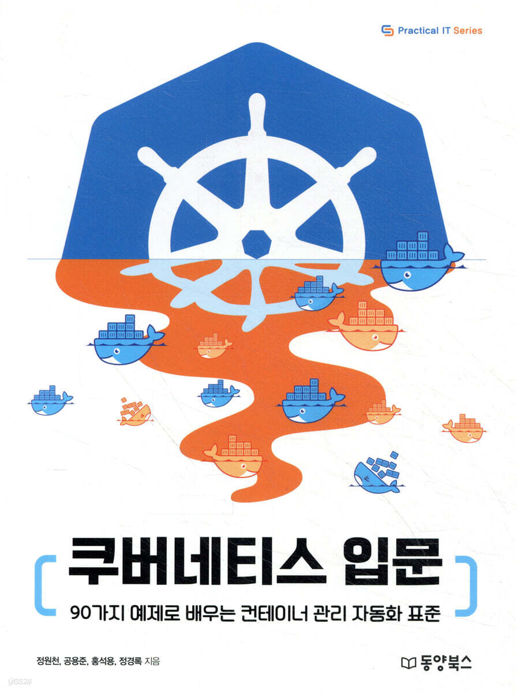

### 쿠버네티스 입문

※ 이미지 출처: Yes24

#### 정보

- 제목: 쿠버네티스 입문 (90가지 예제로 배우는 컨테이너 관리 자동화 표준)
- 저자: 정원천, 홍석용, 정경록, 공용준
- 출판사: 동양북스
- Yes24: `https://www.yes24.com/product/goods/85578606`
- 시작: 2026-10-25
- 완독: 2026-10-26

#### 목차

**Part I. 쿠버네티스 시작하기**

- ✅ 1장. 쿠버네티스 소개
- ✅ 2장. 쿠버네티스 설치하기
- ✅ [3장. 쿠버네티스로 컨테이너 실행하기](chapter03/README.md)

**Part II. 쿠버네티스 기본 개념**

- ✅ [4장. 쿠버네티스 아키텍처](chapter04/README.md)
- ✅ [5장. 파드](chapter05/README.md)
- ✅ [6장. 컨트롤러](chapter06/README.md)
- ✅ [7장. 서비스](chapter07/README.md)
- ✅ [8장. 인그레스](chapter08/README.md)
- ✅ [9장. 레이블과 애너테이션](chapter09/README.md)
- ✅ [10장. 컨피그맵](chapter10/README.md)
- ✅ [11장. 시크릿](chapter11/README.md)

**Part III. 쿠버네티스 한 걸음 더 들어가기**

- ✅ [12장. 파드 스케줄링](chapter12/README.md)
- ✅ [13장. 인증과 권한 관리](chapter13/README.md)
- ✅ [14장. 데이터 저장](chapter14/README.md)
- ✅ [15장. 클러스터 네트워킹 구성](chapter15/README.md)
- ✅ [16장. 쿠버네티스 DNS](chapter16/README.md)
- ✅ [17장. 로깅과 모니터링](chapter17/README.md)
- ✅ [18장. 오토스케일링](chapter18/README.md)
- ✅ [19장. 사용자 정의 자원](chapter19/README.md)
- ✅ 20장. 쿠버네티스 기반으로 워드프레스 앱 실행하기
- ✅ [21장. 헬름](chapter21/README.md)
