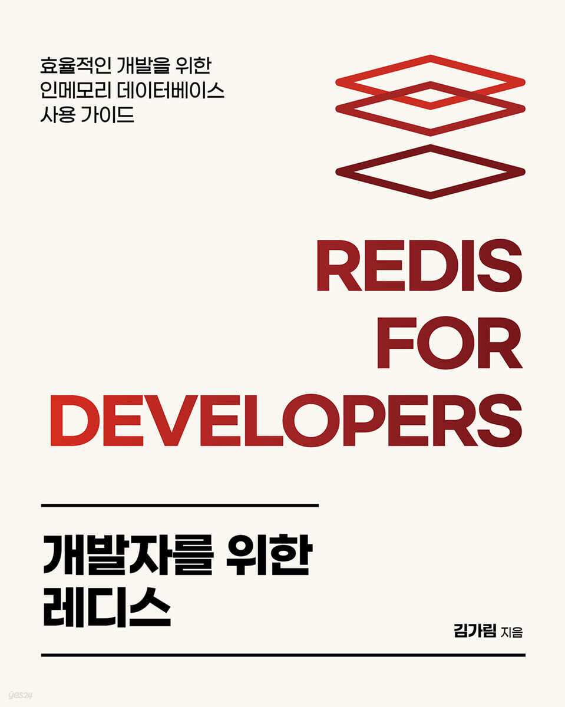

### 개발자를 위한 레디스

※ 이미지 출처: Yes24

#### 정보

- 제목: 개발자를 위한 레디스
- 저자: 김가림
- 출판사: 에이콘출판사
- 교보문고: `https://product.kyobobook.co.kr/detail/S000210785682`
- Yes24: `https://www.yes24.com/product/goods/123182350`
- 시작: 2026-10-11
- 완독: 2026-10-18

#### 목차

- ✅ [1장. 마이크로서비스 아키텍처와 레디스](chapter01/README.md)
- ✅ [2장. 레디스 시작하기](chapter02/README.md)
- ✅ [3장. 레디스 기본 개념](chapter03/README.md)
- ✅ [4장. 레디스 자료 구조 활용 사례](chapter04/README.md)
- ✅ [5장. 레디스를 캐시로 사용하기](chapter05/README.md)
- ✅ [6장. 레디스를 메시지 브로커로 사용하기](chapter06/README.md)
- ✅ [7장. 레디스 데이터 백업 방법](chapter07/README.md)
- ✅ [8장. 복제](chapter08/README.md)
- ✅ [9장. 센티널](chapter09/README.md)
- ✅ [10장. 클러스터](chapter10/README.md)
- ✅ [11장. 보안](chapter11/README.md)
- ✅ [12장. 클라이언트 관리](chapter12/README.md)
- ✅ [13장. 레디스 운영하기](chapter13/README.md)
- [부록. 책을 읽으며 추가로 궁금했던 내용 정리](appendix/README.md)
