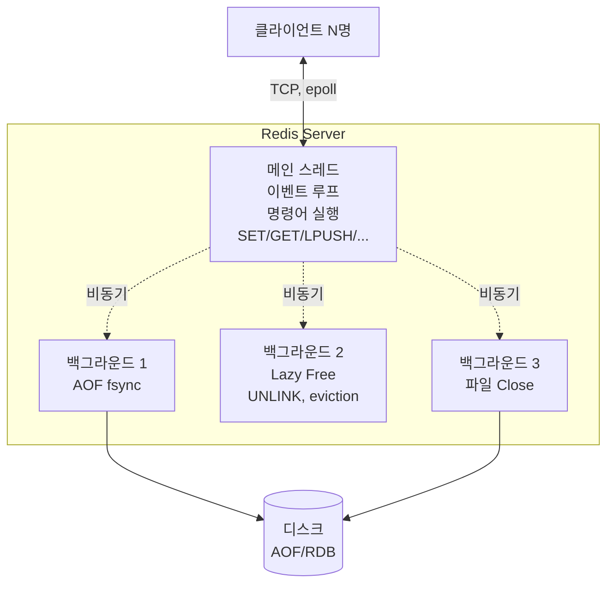

### CHAPTER 1 마이크로서비스 아키텍처와 레디스

NoSQL이 왜 등장했고, 그 흐름 속에서 **레디스가 어떤 위치**를 차지하는가. 그리고 레디스의 **설계 철학**(단일 스레드 이벤트 루프, 인메모리)과 **두 가지 핵심 사용처**(데이터 저장소 / 메시지 브로커)를 짚어낸다.

#### 목차

- [1부. 레디스란 무엇인가 — 특징](#1부-레디스란-무엇인가--특징)
- [2부. 이벤트 루프와 스레드 모델](#2부-이벤트-루프와-스레드-모델)
- [3부. 데이터 저장소로서의 레디스](#3부-데이터-저장소로서의-레디스)
- [4부. 메시지 브로커로서의 레디스](#4부-메시지-브로커로서의-레디스)

---

## 1부. 레디스란 무엇인가 — 특징

### 정의

> **Redis**(**RE**mote **DI**ctionary **S**erver). 인메모리 **Key-Value 저장소**. 2009년 Salvatore Sanfilippo가 개발. 다양한 **데이터 구조**를 지원하는 **Data Structure Server**.

### 핵심 특징

| 특징 | 설명 |
|---|---|
| **인메모리** | 모든 데이터를 **메모리(RAM)에 저장** → 디스크 I/O 없이 μs 단위 응답 |
| **단일 스레드** | 명령어 처리는 **한 번에 하나씩** 순차 처리 (경쟁 조건 없음, 원자성 자동 보장) |
| **다양한 자료 구조** | String, List, Hash, Set, Sorted Set, Stream, HyperLogLog, Bitmap, Geo 등 |
| **영속성(선택)** | RDB(스냅샷) / AOF(쓰기 로그) 지원 — 재시작 시 복구 |
| **복제 (Replication)** | Master-Replica 구조로 읽기 분산·HA |
| **클러스터링** | 샤딩으로 수평 확장 |
| **Pub/Sub, Stream** | 메시지 브로커 역할 |
| **Lua 스크립트** | 서버 사이드 스크립트 (원자적 실행) |
| **트랜잭션** | `MULTI/EXEC` — 명령어 묶음 원자 실행 |
| **TTL 기반 만료** | 키마다 자동 삭제 시점 설정 |

### 왜 빠른가 — 세 가지 축

1. **메모리 접근** — 디스크(ms) → 메모리(μs). 1000배 빠름
2. **단일 스레드 + 이벤트 루프** — 컨텍스트 스위칭 비용 없음, 락 없음
3. **I/O 멀티플렉싱** — `epoll(Linux)/kqueue(BSD)`로 **수만 커넥션을 한 스레드가 다중 처리**

### Redis vs 다른 저장소

| 축 | Redis | RDBMS | DynamoDB | Memcached |
|---|---|---|---|---|
| **저장 매체** | 메모리 (디스크 영속화 옵션) | 디스크 | SSD | 메모리 |
| **자료 구조** | **다양함** | 테이블(튜플) | 테이블(JSON 가능) | **문자열만** |
| **지속성** | 선택 (RDB/AOF) | 기본 | 기본 | 없음 |
| **트랜잭션** | MULTI/EXEC | 완전 ACID | 제한적 | 없음 |
| **Pub/Sub** | ✅ | X | X | X |
| **용도** | 캐시, 세션, 리더보드, 큐, 분산 락 | OLTP | KV at scale | 단순 캐시 |

### 레디스가 적합한 사용 사례

- **캐시** — DB 부하 완화, API 응답 가속
- **세션 저장소** — 로그인 토큰, 사용자 세션
- **리더보드/랭킹** — Sorted Set
- **실시간 카운터** — INCR, HyperLogLog(유니크 카운팅)
- **분산 락** — SET NX EX 또는 Redlock
- **메시지 큐 / Pub/Sub / Stream**
- **지리 기반 검색** — Geo
- **Rate Limiting** — INCR + EXPIRE

### 레디스가 **부적합한** 사용 사례

- **대용량 영속 저장소** — 메모리 비용이 디스크 대비 ~100배 비쌈
- **복잡한 조인·집계** — SQL이 필요한 OLAP
- **100% 데이터 손실 금지** — 영속화는 best-effort (AOF everysec도 1초 유실 가능)
- **대형 BLOB 저장** — 수 MB~GB 단일 값은 성능 저하

---

## 2부. 이벤트 루프와 스레드 모델

### 단일 스레드 — 핵심 설계

> 레디스는 **"명령어 실행 스레드가 하나뿐"**. 수천 개 클라이언트가 접속해도 **메인 스레드 1개가 순차적으로** 명령어를 처리한다.

### 왜 단일 스레드인가

**장점**:
- **락 없음** — 자료 구조 접근 시 동기화 오버헤드 제거
- **원자성 자동** — 모든 단일 명령은 **인터럽트 없이** 완료
- **디버깅 단순** — 멀티스레드 레이스 컨디션 없음
- **메모리 접근은 CPU bound가 아님** — 메모리 I/O가 병목이지 CPU가 병목이 아님

**단점**:
- **느린 명령어 하나가 전체를 블록** — `KEYS *`, `FLUSHALL` 등
- CPU 1코어만 사용 → **멀티 코어 활용은 Redis 인스턴스 여러 개로** (샤딩)

### 이벤트 루프 (Event Loop) 동작 원리

레디스의 메인 스레드는 **이벤트 루프**(ae.c의 `aeMain`)로 돌아간다. **Node.js의 이벤트 루프와 유사한 구조**.

```
┌──────────────────────────────────────────┐
│ while (!stop) {                          │
│    // 1. 짧은 타임아웃으로 I/O 이벤트 대기    │
│    events = aeApiPoll(epoll_wait, ...)   │
│                                          │
│    // 2. 각 이벤트 처리                      │
│    for e in events:                      │
│        if e == readable:                 │
│            readQueryFromClient(e.fd)     │
│            processCommand(cmd)   ← 명령어 실행 │
│            addReplyToOutputBuffer()      │
│        if e == writable:                 │
│            writeToClient(e.fd)           │
│                                          │
│    // 3. 타이머 이벤트 처리                   │
│    processTimeEvents()                   │
│      - 만료된 키 정리                        │
│      - 통계 갱신, Replication 등            │
│ }                                        │
└──────────────────────────────────────────┘
```

**핵심 포인트**:
- **I/O 멀티플렉싱**: `epoll`(Linux) / `kqueue`(BSD) / `select` → **커널이 "준비된 FD만"** 알려줌
- 수만 커넥션을 **한 스레드가 돌아가며** 처리
- 명령어 처리 자체는 **메모리 연산**이라 보통 μs 단위에 끝남 → 다음 FD로 즉시 이동

### 메인 스레드 1개 + 별도 스레드 3개 (중요)

레디스를 **"단일 스레드"**라고 하지만, 엄밀히는 **메인 스레드 + 보조 백그라운드 스레드 3개**로 구성된다. 핵심은 **명령어 실행이 단일 스레드**라는 점.

#### 메인 스레드 (Main Thread)

- **이벤트 루프 실행**
- **클라이언트 명령어 수신 → 실행 → 응답**
- 모든 자료 구조 조작 (SET, GET, LPUSH, ZADD 등)
- **단일 스레드이므로 명령어 간 경쟁 없음**

#### 백그라운드 스레드 1 — **AOF Rewrite / fsync**

- **AOF(Append Only File) 디스크 쓰기**를 비동기로 처리
- 메인 스레드가 매 명령마다 `fsync()`로 블록되면 성능 저하 → **별도 스레드에서 백그라운드로** fsync 수행
- `appendfsync everysec` 설정 시 1초마다 백그라운드 fsync

**왜 분리했나**: `fsync()`는 **디스크 I/O**로 ms 단위 지연 가능. 메인 스레드가 이걸 기다리면 **전체 명령 처리 지연** → 백그라운드로 분리.

#### 백그라운드 스레드 2 — **큰 객체 lazy 삭제 (Lazy Free)**

- `DEL`, `FLUSHDB` 같은 삭제 명령은 **큰 자료 구조**(수백만 원소 Hash/Set 등) 삭제 시 시간이 오래 걸림
- 메인 스레드에서 삭제하면 다른 명령이 블록됨
- **`UNLINK`** 명령 또는 `lazyfree-*` 설정 활성화 시 **백그라운드 스레드가 삭제** 수행
- Redis 4.0부터 도입

**설정 예**:
```
lazyfree-lazy-eviction yes       # 메모리 꽉 찼을 때 eviction 비동기
lazyfree-lazy-expire yes         # TTL 만료 삭제 비동기
lazyfree-lazy-server-del yes     # SET으로 덮어쓸 때 기존 값 비동기 삭제
lazyfree-lazy-user-del yes       # DEL 명령 자체도 비동기 (UNLINK처럼)
```

#### 백그라운드 스레드 3 — **파일 닫기 (Close)**

- 복제(Replication) 시 **대량 데이터 파일 닫기**(RDB 파일 전송 후), **AOF 파일 roll** 등
- `close()` 시스템 콜도 **버퍼 flush**로 블록 가능 → 백그라운드로

### 스레드 구조 요약



### I/O Threads (Redis 6.0+, 선택적)

Redis 6.0부터 **I/O 멀티스레딩** 옵션 추가. **명령어 실행은 여전히 메인 스레드**지만, **네트워크 I/O 읽기/쓰기**를 여러 스레드로 병렬화.

**설정 예** (`redis.conf`):
```
io-threads 4                 # I/O 스레드 수 (코어 수의 절반 권장)
io-threads-do-reads yes      # 읽기도 멀티스레드
```

**효과**:
- 수만 커넥션 환경에서 **네트워크 I/O 병목 완화**
- 명령어 실행 자체의 단일 스레드 특성은 **그대로 유지** (원자성 보장)

### 레디스가 느려지는 전형 상황

1. **O(N) 명령어** — `KEYS *`, `SMEMBERS` (큰 Set), `HGETALL` (큰 Hash)
   - 대신 `SCAN`, `HSCAN`, `SSCAN` 사용
2. **큰 값 저장** — 수 MB 단일 값
3. **fork() 지연** — RDB BGSAVE, AOF Rewrite 시 메모리 많은 인스턴스는 fork가 ms 이상
4. **네트워크 패킷 폭주** — I/O 스레드로 완화 가능
5. **AOF appendfsync always** — 매 명령마다 fsync → 극히 느림

### 느린 명령 디버깅

```
# 50ms 이상 걸린 명령을 50개 기록
CONFIG SET slowlog-log-slower-than 50000
CONFIG SET slowlog-max-len 50

# 조회
SLOWLOG GET 10
```

---

## 3부. 데이터 저장소로서의 레디스

### 레디스의 두 얼굴

레디스는 **데이터 저장소**이자 **메시지 브로커**다. 1장은 전체적인 포지션을 소개하고, 이후 장에서 각각을 깊이 다룬다.

### 저장소로서의 사용 패턴

#### 1. 캐시 (Cache)

가장 보편적인 사용. **RDBMS 앞에 두고** 자주 조회되는 데이터를 메모리에 보관.

```
Client → App → Redis (hit) → 즉시 응답
                   ↓ miss
                 RDBMS → Redis에 저장 → 응답
```

**캐시 전략**:
- **Cache-Aside (Lazy Loading)** — App이 캐시 miss 시 DB 조회 후 캐시 저장
- **Write-Through** — DB 쓰기 시 캐시도 함께 업데이트
- **Write-Behind** — 캐시만 먼저 쓰고 DB는 비동기 반영 (레디스로 자주 구현)

**TTL 설정 필수** — 메모리 유한하므로 자동 만료 필요.

#### 2. 세션 저장소 (Session Store)

- 로그인한 사용자의 세션 정보
- **애플리케이션이 수평 확장(스케일 아웃)** 될 때 **공유 세션 저장소**로 필수
- 로그인 토큰, 장바구니 상태, OAuth 토큰 등
- **TTL = 세션 유효기간** (예: 30분)

#### 3. 실시간 카운터 / 통계

```
# 조회수 증가
INCR article:12345:views

# 유니크 방문자 (HyperLogLog, 메모리 효율 ↑)
PFADD unique:visitors:2026-10-11 user:123
PFCOUNT unique:visitors:2026-10-11
```

- `INCR`은 원자적 — 동시 요청에도 정확
- `HyperLogLog`은 **12 KB로 수억 개 유니크 추정** 가능

#### 4. 리더보드 / 랭킹 (Sorted Set)

```
# 점수 추가
ZADD leaderboard 2500 "player1"
ZADD leaderboard 1800 "player2"

# 상위 10명
ZREVRANGE leaderboard 0 9 WITHSCORES
```

- 삽입/조회/순위 모두 **O(log N)**
- 게임, 쇼핑몰 베스트셀러, 실시간 트렌드

#### 5. 분산 락

```
# NX = Not eXists, EX = EXpire
SET lock:order:12345 "server-1" NX EX 10
```

- 여러 서버가 **공유 리소스** 접근 시 동시성 제어
- 더 안전하게는 **Redlock 알고리즘**
- Redisson 같은 라이브러리가 Java에서 널리 사용

#### 6. Rate Limiting

```
# 사용자 ID당 분당 100 요청 제한
INCR rate:user:123:2026-10-11-14:30
EXPIRE rate:user:123:2026-10-11-14:30 60
# 결과가 100 초과면 거부
```

- 토큰 버킷, 리키 버킷 알고리즘도 Lua 스크립트로 구현

### 저장소로서의 레디스 — 영속성 옵션

| 모드 | 설명 | 유실 가능성 | 성능 |
|---|---|---|---|
| **No persistence** | 메모리만 (재시작 시 손실) | 전체 | 최고 |
| **RDB** | 주기적 스냅샷 (예: 5분마다) | 마지막 스냅샷 이후 | 좋음 |
| **AOF everysec** | 1초마다 fsync | 최대 1초 | 좋음 (기본 추천) |
| **AOF always** | 매 명령마다 fsync | 거의 0 | 느림 |
| **RDB + AOF** | 둘 다 | 최대 1초 | 좋음 |

### 저장소 사용 시 고려사항

1. **메모리 용량 계획** — 데이터 크기 × 1.5~2배 (오버헤드, fork, replication buffer)
2. **키 네이밍 규칙** — `user:123:profile`, `cache:article:456`
3. **TTL 적극 사용** — 메모리 자동 회수
4. **큰 자료 구조 분할** — 수백만 원소 Hash는 분할 저장
5. **Eviction Policy** — 메모리 꽉 찼을 때 어떤 키를 지울지 (`allkeys-lru`, `volatile-ttl` 등)

---

## 4부. 메시지 브로커로서의 레디스

### 왜 레디스가 메시지 브로커로도 쓰이나

- **빠른 처리** — 메모리 기반, μs 단위 전달
- **단순함** — Kafka/RabbitMQ 대비 운영 복잡도 낮음
- **다재다능** — 캐시로 쓰던 Redis에 **추가 설치 없이** 메시징 기능 활용
- **다양한 메시징 모델** 지원 (Pub/Sub, Stream, List)

### 세 가지 메시징 패턴

#### 1. Pub/Sub (Publish-Subscribe)

```
Publisher ──PUBLISH topic1 "hello"──→ Redis
                                      ↓ topic1 구독자에게 fanout
                                 Subscriber 1, 2, 3
```

**특징**:
- **Fire-and-Forget** — 메시지 보관 X. 구독자가 없거나 접속 중이 아니면 **메시지 유실**
- **1:N 브로드캐스트**
- 지연 매우 짧음 (수십 μs)

**사용 사례**:
- 실시간 알림 (채팅, 주식 시세)
- 캐시 무효화 신호 (한 서버가 캐시 삭제 명령 → 다른 서버가 로컬 캐시 비우기)
- **메시지 유실 허용 가능한 실시간 이벤트**

**명령어**:
```
# Publisher
PUBLISH news "breaking: ..."

# Subscriber
SUBSCRIBE news
PSUBSCRIBE news.*   # 패턴 구독
```

#### 2. Stream (Redis 5.0+)

```
Producer ──XADD stream1 * field1 value1──→ Redis Stream
                                            ↓ (영속 로그, Consumer Group)
                                      Consumer 1, 2, 3
```

**특징**:
- **메시지 영속화** — 로그처럼 쌓임 (Kafka와 유사)
- **Consumer Group** — 여러 Consumer가 메시지 분산 처리 (Load Balancing)
- **ACK 지원** — 처리 완료 확인
- **Range 조회** — ID 기반 재조회 가능
- (참고) Redis 7.0부터 **Sharded Pub/Sub** 추가 — 클러스터 환경 Pub/Sub 개선 ([6장](../chapter06/README.md) 참고)

**사용 사례**:
- **메시지 유실 안 되는 작업 큐**
- **Event Sourcing** 유사 패턴
- 로그 집계 파이프라인

**명령어**:
```
# Producer
XADD mystream * event "user_signup" user_id 123

# Consumer Group
XGROUP CREATE mystream mygroup $ MKSTREAM
XREADGROUP GROUP mygroup consumer1 COUNT 10 STREAMS mystream >
XACK mystream mygroup <id>
```

#### 3. List 기반 메시지 큐

```
Producer ──LPUSH queue "task1"──→ Redis List
                                     ↓
Consumer ──BRPOP queue 0──→ "task1"
```

**특징**:
- **FIFO 큐** (LPUSH + RPOP)
- `BRPOP`/`BLPOP`는 **블로킹** — 큐가 비어있으면 대기
- 단순한 **작업 큐** 구현에 적합

**사용 사례**:
- 이메일 발송 큐
- 백그라운드 작업 큐
- 간단한 FIFO 처리

### 메시징 패턴 비교

| 패턴 | 영속성 | ACK | Consumer Group | 유실 가능성 | 사용 사례 |
|---|---|---|---|---|---|
| **Pub/Sub** | ❌ | ❌ | ❌ | **있음** | 실시간 알림, 캐시 무효화 |
| **Stream** | ✅ | ✅ | ✅ | 없음 | 작업 큐, 이벤트 로그 |
| **List** | ✅ | ❌ (수동) | ❌ (한 Consumer) | 처리 중 다운 시 유실 | 단순 FIFO 큐 |

### Redis vs Kafka / RabbitMQ

| 축 | Redis Stream | Kafka | RabbitMQ |
|---|---|---|---|
| **처리량** | 수만~수십만 msg/s | 수백만 msg/s | 수십만 msg/s |
| **메시지 영속성** | ✅ | ✅ (디스크 primary) | ✅ |
| **메시지 보관** | 메모리 (설정 가능) | 디스크 (long term) | 메모리 + 디스크 |
| **운영 복잡도** | 낮음 | 높음 | 중간 |
| **지연** | 수십 μs | 수 ms | 수 ms |
| **용도** | 소~중규모 메시지 큐, 캐시 겸용 | 대규모 이벤트 스트림 (OLAP, 데이터 레이크) | 복잡한 라우팅/큐잉 |

→ **대규모 영구 이벤트 스트림은 Kafka**, **빠른 중소규모 메시징은 Redis**가 적합.

---

### 요약

- **레디스**: 인메모리 Key-Value 저장소 + Data Structure Server. 메모리 접근 + 단일 스레드 + I/O 멀티플렉싱으로 μs 단위 응답
- **단일 스레드 ≠ 스레드 1개**:
  - **메인 스레드 1개** (명령어 실행, 이벤트 루프)
  - **백그라운드 스레드 3개**:
    - **AOF fsync** 비동기 수행
    - **Lazy Free** — 큰 자료 구조 비동기 삭제
    - **파일 Close** 비동기 처리
  - 추가로 Redis 6.0+ **I/O Threads** 옵션 (네트워크 I/O 병렬화)
- **데이터 저장소**: 캐시, 세션, 카운터, 리더보드(Sorted Set), 분산 락, Rate Limiting
- **메시지 브로커**: Pub/Sub(유실 OK), Stream(영속·Consumer Group), List(단순 FIFO 큐)
- **적합/부적합** 기준: 메모리 비용 감당 + 데이터 손실 1초 허용 + 단순 접근 패턴 → 적합. 대용량 영속 + 복잡 조인 → 부적합
