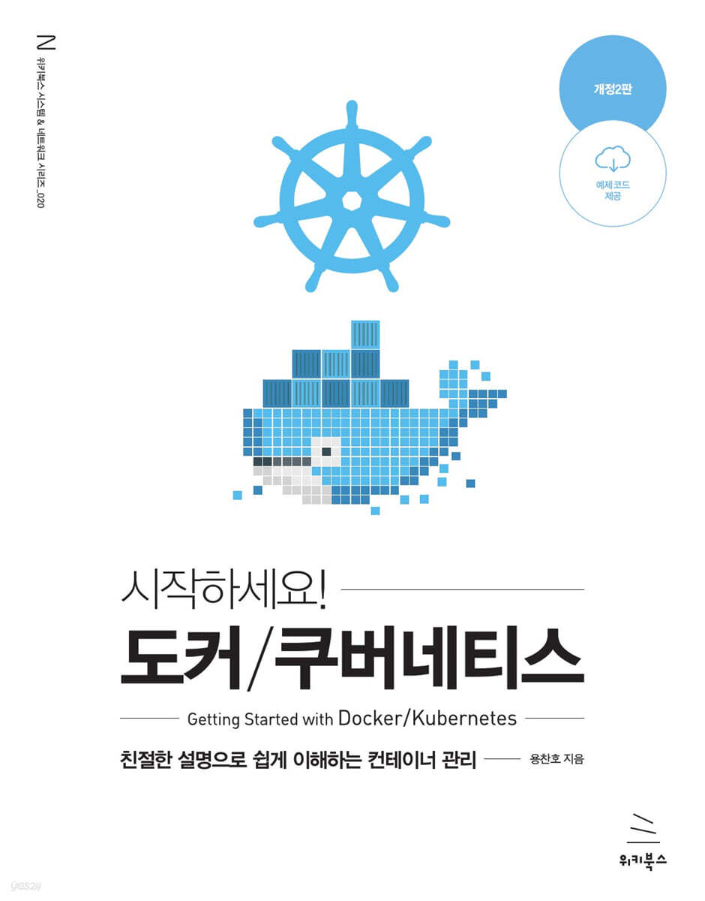

### 시작하세요! 도커/쿠버네티스

※ 이미지 출처: Yes24

#### 정보

- 제목: 시작하세요! 도커/쿠버네티스 (친절한 설명으로 쉽게 이해하는 컨테이너 관리, 개정2판)
- 저자: 용찬호
- 출판사: 위키북스
- 교보문고: `https://product.kyobobook.co.kr/detail/S000216911094`
- Yes24: `https://www.yes24.com/product/goods/148124010`
- 시작: 2026-10-18
- 완독: 2026-10-25

#### 목차

- ✅ [1장. 도커란?](chapter01/README.md)
- ✅ [2장. 도커 엔진](chapter02/README.md)
- ✅ [3장. 도커 스웜](chapter03/README.md)
- ✅ [4장. 도커 컴포즈](chapter04/README.md)
- ✅ 5장. 쿠버네티스 설치
- ✅ [6장. 쿠버네티스 시작하기](chapter06/README.md)
- ✅ [7장. 쿠버네티스 리소스의 관리와 설정](chapter07/README.md)
- ✅ [8장. 인그레스(Ingress)](chapter08/README.md)
- ✅ [9장. 퍼시스턴트 볼륨(PV)과 퍼시스턴트 볼륨 클레임(PVC)](chapter09/README.md)
- ✅ [10장. 보안을 위한 인증과 인가 - ServiceAccount와 RBAC](chapter10/README.md)
- ✅ [11장. 애플리케이션 배포를 위한 고급 설정](chapter11/README.md)
- ✅ [12장. 커스텀 리소스와 컨트롤러](chapter12/README.md)
- ✅ [13장. 파드를 사용하는 다른 오브젝트들](chapter13/README.md)
- ✅ [14장. 쿠버네티스 모니터링](chapter14/README.md)
- ✅ 부록 A. 도커 데몬 시작 옵션 변경하기
- ✅ 부록 B. gcloud 명령어 설치하기
- ✅ 부록 C. AWS CLI 설치하기
